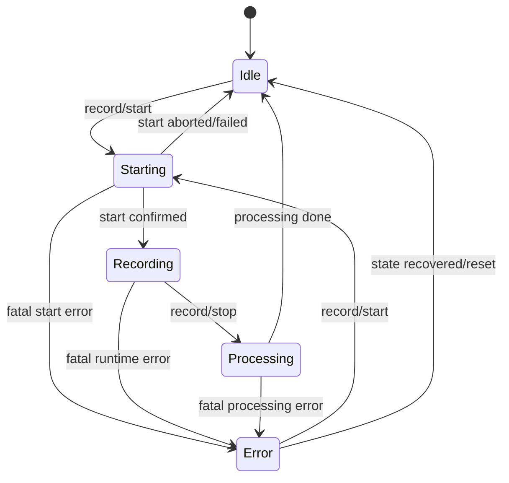
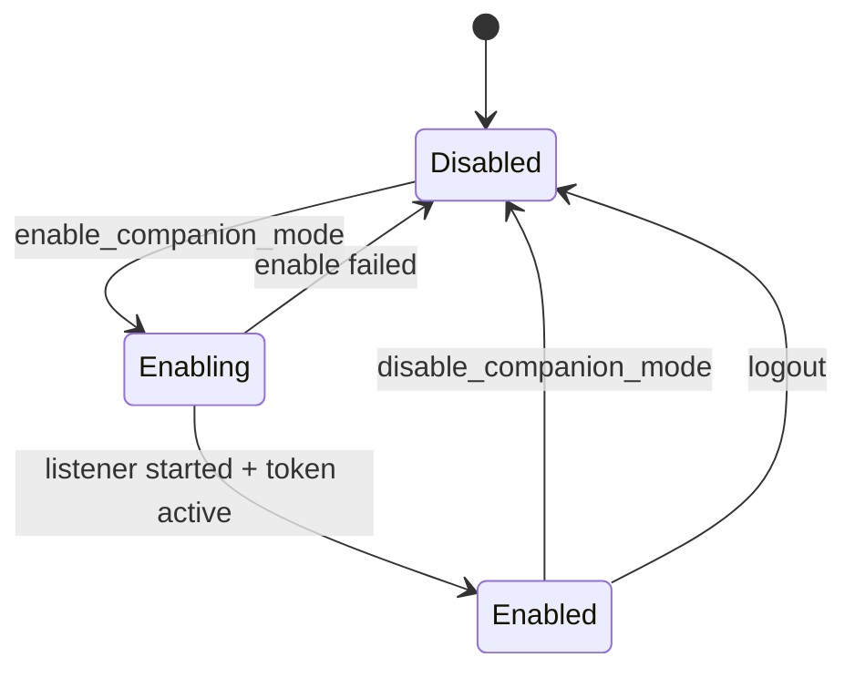
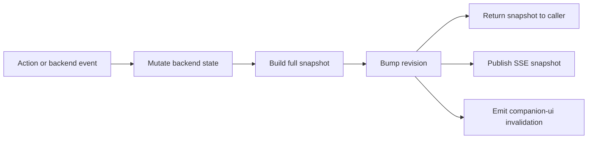

# Companion Plan - Safe SSE + HTTP Rollout

## Статус документа

Это не "идея", а технический план с жёсткими ограничениями, которые нужны, чтобы не создать тихих расхождений между:

- hidden desktop window
- phone companion
- текущим `Tauri + Vue` UI
- реальным Rust backend

Главная цель этого плана - **не сделать быстро, а сделать так, чтобы потом не ловить плавающие баги состояния**.

---

## Короткий вывод

`SSE + HTTP` для companion - правильное направление.  
Но старый план был слишком оптимистичным в трёх местах:

1. он недооценивал, сколько текущей логики живёт только во frontend
2. он переоценивал надёжность fire-and-forget sync в скрытом `WebView`
3. он оставлял слишком много семантически важных действий в локальном TS state

Если делать аккуратно, безопасный путь такой:

1. сделать backend snapshot + безопасный HTTP/SSE сервер
2. завести **общий Rust SoT** для companion timeline и companion controls
3. подключить **revision-based reconcile** для desktop окна
4. только после этого добавлять shared actions вроде `clear context`, `clear history`
5. `AI request` с телефона включать **не сразу**, а только после выноса общего reducer/context builder

## Финальные решения, в которых теперь есть чёткая уверенность

Это не просто рекомендации, а решения, которые закрывают самые тонкие места в текущем коде.

- production companion server делается **новым runtime поверх `hyper`**, а не как "доработка" текущего `presentation/companion.rs`
- все mutating actions проходят через **один serialized backend write path**, а не напрямую через текущие Tauri commands
- mutating `POST` должны возвращать **свежий snapshot из того же critical section**, а не надеяться только на будущий `SSE`
- `phone AI request` нельзя включать, пока prompt/context semantics не станут backend-owned
- desktop окно при show/hide больше не должно решать судьбу shared timeline - только `refresh()` и apply snapshot

---

## Что я перепроверил перед обновлением плана

### 1. Текущий стек уже имеет рабочий state-sync паттерн

В проекте уже есть нормальная модель:

- Rust snapshot command
- monotonic `revision`
- invalidation event `state-sync:invalidation`
- frontend `refresh()` при show/focus-like lifecycle

Это уже используется для:

- `app-config`
- `stt-config`
- `auth-state`
- `auth-session`
- `ui-preferences`

Вывод:

⚠️ Для companion нельзя делать "кастомные разовые desktop events и надеяться, что hidden window их не пропустит".  
Нужно использовать **тот же revision/snapshot pattern**, который уже есть в проекте.

### 2. Текущий desktop чат - не Rust SoT

Сейчас логика чата живёт в `src/stores/chat.ts` и `src/stores/transcription.ts`, и там есть важная семантика:

- merge финальных utterances по gap
- dedup system vs mic
- live partial buffers
- local `haiku` lifecycle
- local `clear context`
- local `clear history`
- local `edit/delete/select`

Вывод:

⚠️ Нельзя просто "отдать Rust raw events на телефон" и считать, что это тот же самый контент, что сейчас видит desktop UI.

### 3. Текущая отмена `haiku` - локальная, не backend cancel

Сейчас cancel в основном фронтовый:

- UI просто перестаёт принимать события по `request_id`
- backend stream реально не останавливается

Вывод:

⚠️ В `v1` нельзя обещать честный shared `AI cancel`.  
Либо делаем настоящий backend cancellation token, либо **вообще не включаем cancel в phone companion**.

### 4. Latest `axum` не подходит под текущий MSRV проекта

В проекте `src-tauri/Cargo.toml` сейчас:

```toml
rust-version = "1.77.2"
```

Актуальные официальные источники показывают:

- current `axum` `0.8.9` требует MSRV `1.80`
- `EventSource` в браузере не умеет custom headers, только `withCredentials`
- официальный путь для `hyper` сервера - `hyper 1 + hyper-util 0.1 + http-body-util 0.1`

Вывод:

⚠️ Нельзя бездумно взять latest `axum` и воткнуть его в проект.  
Это либо поднимет toolchain requirement, либо даст скрытый инфраструктурный долг.

### 5. В текущем desktop UI уже есть destructive clear paths

Сейчас в `RecordingPopover.vue` есть два места, которые чистят локальный UI:

- на `EVENT_RECORDING_WINDOW_SHOWN`, если backend idle, вызываются:
  - `store.clearText()`
  - `chatStore.clearChatOutgoing()`
- на `recording:start-requested` перед стартом тоже вызываются:
  - `store.clearText()`
  - `chatStore.clearChatOutgoing()`

Вывод:

⚠️ Пока эти paths живут как local-first логика, desktop окно может само стереть shared companion state или разойтись с backend snapshot.  
Это не "мелкая деталь", а полноценный migration blocker.

### 6. Текущий `start_recording` нельзя считать companion-safe write path

В `commands.rs` сейчас есть важная деталь:

- `start_recording` сначала делает `transcription_session_seq.fetch_add(...)`
- сразу после этого пишет `active_transcription_session_id`
- и только потом вызывает `transcription_service.start_recording(...)`

А сам `TranscriptionService::start_recording(...)` уже внутри может вернуть:

- `Already recording or starting`
- ошибку инициализации провайдера
- ошибку старта стрима/захвата

Вывод:

⚠️ Повторный или конкурентный вызов `start_recording` может **сжечь новый `session_id` даже без реального старта записи**.  
Значит текущий Tauri command нельзя просто переиспользовать как HTTP route handler для телефона.

Что из этого следует:

- companion write path должен сначала сериализовать действие
- затем проверить текущее состояние
- и только при реальном переходе `Idle -> Starting` выделять новый `session_id`

### 7. Текущий test companion server нельзя развивать в production "по месту"

В текущем коде `presentation/companion.rs`:

- listener поднимается сразу при старте приложения
- bind идёт на `0.0.0.0`
- `start_test_server()` уходит в бесконечный `accept` loop
- порт хранится в `OnceLock<u16>`
- сервер читает один раз в буфер `8192` и не парсит request body / streaming корректно

А в `lib.rs` это ещё и запускается fire-and-forget через `tauri::async_runtime::spawn(...)`.

Вывод:

⚠️ Этот сервер хорош как reachability probe для телефона, но он **структурно не подходит** как база для:

- `enable/disable companion mode`
- token rotation
- graceful shutdown
- predictable tests lifecycle
- настоящий `SSE` и mutating `POST`

---

## Решения, в которых была наименьшая уверенность

Ниже - места, которые были самыми тонкими, и как они теперь решены.

### 1. Чем поднимать HTTP/SSE сервер

#### Вариант 1 - продолжать на handwritten TCP/HTTP parser
🎯 5   🛡️ 4   🧠 3  
Примерно `250-450` строк.

Плюсы:

- быстро
- без новых зависимостей

Минусы:

- высокий риск багов на `Content-Length`, partial reads, keep-alive, SSE flushing
- тяжело тестировать корректно
- слишком хрупко для real server, нормален только как тестовая заглушка

#### Вариант 2 - `hyper 1 + hyper-util 0.1 + http-body-util 0.1`
🎯 9   🛡️ 9   🧠 6  
Примерно `450-800` строк.

Плюсы:

- официальный low-level stack
- не упирается в MSRV `1.77.2` как latest `axum`
- убирает риск самописного HTTP parser
- достаточно гибок для `GET`, `POST`, `SSE`

Минусы:

- чуть больше кода, чем в `axum`
- чуть ниже ergonomics

#### Вариант 3 - `axum`
🎯 6   🛡️ 8   🧠 4  
Примерно `350-650` строк, если бы toolchain уже подходил.

Плюсы:

- удобнее router
- проще handlers

Минусы:

- current latest `axum` branch требует более высокий MSRV, чем текущий проект
- значит это уже не "маленькое безопасное изменение", а решение уровня toolchain

### Решение

Для этого проекта safest path:

- тестовый сервер можно оставить как есть до миграции
- production companion server делать на `hyper` stack, а не на handwritten parser
- `axum` не использовать, пока сознательно не поднимем `rust-version`

---

### 2. Как синхронизировать desktop окно

#### Вариант 1 - слать кастомные Tauri events
🎯 5   🛡️ 4   🧠 2  
Примерно `80-140` строк.

Плюсы:

- быстро

Минусы:

- hidden `NSPanel/WebView` уже сейчас может пропускать события при hide/show
- нет deterministic rehydrate
- late-join окно не догоняет реальное состояние

#### Вариант 2 - revision + snapshot + invalidation
🎯 10   🛡️ 10   🧠 5  
Примерно `180-320` строк.

Плюсы:

- уже соответствует архитектуре репозитория
- late-join и missed invalidation закрываются через `refresh()`
- можно звать `refresh()` на `EVENT_RECORDING_WINDOW_SHOWN`

Минусы:

- нужно сделать snapshot contract и store adapter

#### Вариант 3 - вообще не синкать desktop, считать phone отдельным UI
🎯 3   🛡️ 3   🧠 1  
Примерно `0-50` строк.

Плюсы:

- быстро

Минусы:

- окно на Mac потом открывается в невалидном состоянии
- пользователь видит другой timeline

### Решение

Для companion нужен **тот же state-sync контракт**, что уже используется в проекте.

---

### 3. Давать ли сразу AI кнопку на телефон

#### Вариант 1 - включить сразу на raw backend timeline
🎯 4   🛡️ 4   🧠 3  
Примерно `120-220` строк.

Плюсы:

- быстро получаем кнопку

Минусы:

- prompt получится не тем же, что на desktop
- сейчас dedup, merge и часть chat semantics живут в TS
- при clear/history/cancel легко получить stale deltas

#### Вариант 2 - отложить AI до shared reducer
🎯 10   🛡️ 9   🧠 6  
Примерно `250-500` строк на отдельный этап.

Плюсы:

- поведение становится предсказуемым
- можно тестами сравнить desktop semantics и backend semantics

Минусы:

- AI кнопка появится не в самый первый шаг

#### Вариант 3 - сразу выносить весь chat.ts в backend SoT
🎯 7   🛡️ 10   🧠 9  
Примерно `1200-2500+` строк.

Плюсы:

- самый чистый long-term путь

Минусы:

- слишком большой рефактор для первого companion rollout

### Решение

⚠️ Safe rollout: **не включать phone AI в самом первом этапе**.  
Сначала - live view + record/mic + snapshot/rehydrate.  
AI - только после shared reducer/context builder.

---

### 4. Можно ли прямо вызывать существующие Tauri commands из companion server

#### Вариант 1 - вызывать commands напрямую, где сигнатура подходит
🎯 8   🛡️ 8   🧠 2  
Примерно `40-120` строк.

Плюсы:

- быстро
- меньше дублирования

Минусы:

- годится только для команд без `Window`
- легко случайно затащить UI-specific побочные эффекты

#### Вариант 2 - сделать explicit internal companion-safe helpers
🎯 10   🛡️ 10   🧠 5  
Примерно `120-260` строк.

Плюсы:

- чётко отделяет UI commands от backend-safe write path
- легче тестировать без Tauri window assumptions
- меньше шансов потом случайно вызвать не тот path

Минусы:

- чуть больше кода

### Решение

Для надёжного rollout нужно явно разделить:

- **companion-safe backend actions**
- **UI-only Tauri commands**

#### Safe to call from companion route

- `get_recording_status(state)`
- `ensure_recording_started(state, app_handle)`
- `ensure_recording_stopped(state, app_handle)`
- `ensure_microphone_muted(state, app_handle, muted)` или другой explicit internal helper
- `get_microphone_mute_state()`
- позже `ensure_ai_request_started(...)`, но только после backend context builder

#### Not safe / not appropriate for companion route

- `toggle_recording_with_window(...)`
- `toggle_window(...)`
- `show_recording_window(...)`
- любые команды, которым нужен `Window`
- любые локальные TS actions без Rust SoT

Практический вывод:

⚠️ Companion не должен управлять visibility/focus окна.  
Он должен управлять только backend state.

### Recommended extraction pattern

Чтобы не зависеть от `State<'_, AppState>` внутри route handlers, лучше вынести внутренние helpers:

```rust
pub struct CompanionActionResult {
    pub action_result: &'static str, // started | stopped | muted | unmuted | noop
    pub snapshot: CompanionSnapshotEnvelope,
}

pub async fn ensure_recording_started(
    state: &AppState,
    app_handle: &AppHandle,
) -> Result<CompanionActionResult, String> { ... }

pub async fn ensure_recording_stopped(
    state: &AppState,
    app_handle: &AppHandle,
) -> Result<CompanionActionResult, String> { ... }

pub async fn ensure_microphone_muted(
    state: &AppState,
    app_handle: &AppHandle,
    muted: bool,
) -> Result<CompanionActionResult, String> { ... }
```

Тогда:

- Tauri command wrapper остаётся тонким
- companion HTTP route вызывает тот же internal helper
- меньше риска divergence между write paths
- семантика `noop`/`started`/`stopped` становится явной и тестируемой

---

## Главные инварианты

Если хоть один из них нарушается, companion будет хрупким.

### Invariant 1 - источник правды только Rust

Никакое действие, влияющее на общий companion state, не должно жить только во frontend.

Это относится к:

- record state
- mic mute state
- context clear
- history clear
- AI request lifecycle

### Invariant 2 - toggle не должен быть серверным контрактом

`toggle` слишком хрупок при двух клиентах и stale state.

Нужны только idempotent действия:

- `record/start`
- `record/stop`
- `microphone/mute`
- `microphone/unmute`
- `context/clear`
- `history/clear`

UI-кнопка может быть одна, но API должен быть явным.

### Invariant 3 - hidden window должно уметь догонять состояние

Если desktop окно было скрыто и что-то пропустило, оно обязано восстановиться через snapshot pull.

### Invariant 4 - общие действия идут через один write path

Если `broom` и `trash` меняют shared semantics, desktop и phone должны вызывать **один backend command path**, а не каждый свою локальную логику.

### Invariant 5 - companion snapshot не содержит секретов

В snapshot нельзя отдавать:

- access token
- refresh token
- provider API keys
- backend URLs/секреты

### Invariant 6 - локальный LAN companion не должен быть полностью открыт всем в сети

Нужен random session token + ограниченный API surface.

### Invariant 7 - старые session/request события не должны оживлять новый UI

Это относится к:

- поздним `transcription:*` от старой recording session
- поздним `haiku:*` после clear/cancel/new generation

### Invariant 8 - companion не должен зависеть от window lifecycle hacks

Если shared semantics уже вынесена в Rust, то:

- `window_shown` не должен быть местом, где "решается судьба" timeline
- `window_shown` может только делать `refresh()`, но не придумывать новое состояние

### Invariant 9 - server lifecycle должен быть явным и обратимым

Companion server не должен жить как неуправляемая background-задача "навсегда".

Нужно уметь:

- запустить listener
- остановить listener
- ротировать token
- освободить порт

Это нужно и для безопасности, и для предсказуемых тестов.

### Invariant 10 - mutating actions должны быть сериализованы

Для shared companion состояния запрещено допускать несколько параллельных write decisions.

Под write decisions попадают:

- `record/start`
- `record/stop`
- `microphone/mute`
- `microphone/unmute`
- `context/clear`
- `history/clear`
- `enable/disable companion mode`

Если два клиента одновременно делают write без serialization, то баги будут не только UI-level, но и state-level.

---

## Что именно сейчас мешает "просто подключить телефон"

Это ключевой раздел. Здесь список конкретных локальных TS-only семантик, которые старый план недоучёл.

### 1. `transcription.ts` делает свой session gating

Сейчас frontend защищается от поздних событий через:

- `sessionId`
- `closedSessionIdFloor`
- `lastSeenSessionId`
- `awaitingSessionStart`

Вывод:

⚠️ Companion backend reducer должен иметь свой session gate.  
Иначе поздние события от старой recording session будут загрязнять phone snapshot.

### 2. `transcription.ts` сам объединяет final utterances

Сейчас desktop UI использует merge gap:

```ts
const UTTERANCE_MERGE_GAP_MS = 2500;
```

Вывод:

⚠️ Если backend timeline будет просто append raw finals, phone timeline и desktop timeline будут chunked по-разному.

### 3. `chat.ts` делает dedup system vs mic

Сейчас есть:

- `isSystemTextDuplicateOfMic`
- `isMicTextDuplicateOfSystem`
- `isNearDuplicateText`
- mic dominance gating

Вывод:

⚠️ Phone AI нельзя строить на raw timeline без переноса этих правил или явного отказа от parity.

### 4. `clear context` и `clear history` сейчас frontend-local

Сейчас:

- `clearLlmContext()` живёт только в `chat.ts`
- `clearAllHistory()` живёт только в `chat.ts` + `transcription.ts`

Вывод:

⚠️ Пока эти действия не вынесены в backend SoT, phone companion не должен претендовать на shared semantic context.

### Additional blocker - `systemPrompt` сейчас localStorage-only

Сейчас `chat.ts` читает и пишет `systemPrompt` через `localStorage`.

Вывод:

⚠️ Даже если backend научится собирать timeline, `phone AI` всё равно не будет честно совпадать с desktop AI, пока prompt живёт только в frontend storage.

Безопасные варианты тут только два:

#### Вариант 1 - до `Phase 6` не давать phone запускать AI
🎯 10   🛡️ 10   🧠 2  
Примерно `0-40` строк.

#### Вариант 2 - переносить prompt в backend-owned snapshot/config
🎯 9   🛡️ 10   🧠 6  
Примерно `120-260` строк.

### Additional blocker - текущий Rust `history` не равен desktop chat timeline

Сейчас `AppState.history` пополняется из `start_recording()` только системными финальными транскриптами.

Туда не попадают:

- микрофонные сообщения
- prompt messages
- `haiku` ответы
- selection
- context/history floors

Вывод:

⚠️ Нельзя брать текущий `AppState.history` и считать, что это уже готовая база для phone timeline или AI context.

### Additional blocker - текущий `clear context` использует смешанные cutoff semantics

Сейчас `chat.ts` режет контекст не единым способом:

- `stt` сообщения фильтруются через `contextFloorSttIndex`
- `mic` / `prompt` / `haiku` фильтруются через `contextClearedAtMs`

Вывод:

⚠️ Это значит, что текущая semantics clear зависит и от индекса, и от времени одновременно.  
Если переносить её в backend "на глаз", почти гарантированно получится drift.

Что из этого следует:

- backend должен использовать **одну unified model** для cutoffs
- safest path - unified `seq`
- migration должна явно описать, как старая mixed semantics схлопывается в новую

### Additional blocker - AI anchoring сейчас зависит от local UI mechanics

Сейчас в `chat.ts` есть специфическая логика:

- `haiku` может временно якориться на `LIVE_STT_MESSAGE_ID`
- после появления финального STT ответ переякоривается на последний final STT
- `insertAfterId` зависит от selection / live state / prompt origin

Вывод:

⚠️ Даже если backend уже умеет стримить `haiku` текст, этого недостаточно для parity.  
Нужна явная backend model для:

- anchor resolution
- live-to-final re-anchor
- prompt-attached vs selection-attached AI response placement

### 5. edit/delete/select/reply/prompt composer сейчас local-only

Это значит:

- desktop может изменить смысл timeline локально
- backend companion об этом не узнает
- phone AI увидит другой контекст

Вывод:

⚠️ Эти функции не должны входить в companion `v1`.  
Если хотим избежать тихих багов, их надо либо:

- явно не поддерживать в companion mode
- либо позже переносить в backend write path

### 6. Новая запись сейчас семантически чистит старый локальный timeline

Это уже видно в desktop коде:

- `startRecordingOnce()` очищает transcription state
- hotkey `recording:start-requested` очищает и transcription, и chat outgoing state

Вывод:

⚠️ Companion rollout должен **явно выбрать продуктовую семантику**:

1. либо timeline по-прежнему session-local и новая запись сбрасывает shared timeline
2. либо вы меняете продуктовую модель и делаете persistent history между сессиями

Без этого решения backend reducer получится внутренне противоречивым.

### Recommended decision

Для безопасного первого rollout:

- сохранить текущую продуктовую семантику
- считать timeline **session-local**
- новая запись поднимает новую session/generation и сбрасывает session timeline в backend SoT

Это сильно уменьшает риск скрытых расхождений с тем, как приложение уже работает сегодня.

### 7. Current hotkey/window lifecycle assume local-first reset

Сейчас часть UX строится на идее:

- hotkey стартует новую запись
- локальный UI заранее чистится
- затем идут новые события

Вывод:

⚠️ При переходе на backend SoT нельзя просто удалить эти clears без замены.  
Нужен явный migration path:

1. сначала backend умеет возвращать новый session snapshot
2. потом `window_shown`/`start_requested` переключаются с local clear на `refresh()`
3. только после этого старые destructive clear paths удаляются

### 8. Companion write path должен быть отдельным от текущих Tauri command wrappers

Наиболее тонкий момент здесь такой:

- некоторые существующие команды уже нормальны как read-only reuse
- но некоторые write-команды несут UI-ориентированные или race-sensitive побочные эффекты

Особенно важно это для `start_recording`.

Поэтому companion routes не должны делать "тонкий proxy" вида:

```rust
// ПЛОХО: прямой reuse Tauri command
start_recording(state_wrapper, app_handle).await?;
```

Вместо этого нужен слой internal actions:

```rust
pub async fn ensure_recording_started(
    state: &AppState,
    app_handle: &AppHandle,
) -> Result<CompanionActionResult, String> { ... }

pub async fn ensure_recording_stopped(
    state: &AppState,
    app_handle: &AppHandle,
) -> Result<CompanionActionResult, String> { ... }
```

И уже:

- Tauri UI
- global hotkey path
- HTTP companion routes

должны идти через один и тот же internal слой.

---

## Правильная целевая архитектура

### Слой 1 - Companion Core в Rust

Нужен один backend runtime, который живёт независимо от окон.

Рекомендуемая структура:

```rust
pub struct CompanionRuntime {
    pub snapshot: Arc<RwLock<CompanionSnapshot>>,
    pub sse_tx: tokio::sync::watch::Sender<CompanionSnapshotEnvelope>,
    pub security_token: Arc<RwLock<String>>,
}
```

`CompanionRuntime` лучше хранить в `AppState`, а не в глобальном static, чтобы:

- его было проще тестировать
- не плодить неявный global mutable state
- использовать уже существующие revision counters рядом

### Почему здесь `watch`, а не `broadcast`

Для companion лучше подходит именно `tokio::sync::watch`:

- snapshot у нас full-state, а не event log
- клиенту нужен **последний консистентный state**, а не каждая промежуточная мутация
- lagging subscriber должен догоняться latest snapshot, а не получать overflow/error как в event-stream queue

Практический вывод:

- `watch` подходит для `latest-wins`
- replay buffer для `SSE` в `v1/v2` не нужен
- correctness обеспечивается через `revision + full snapshot + GET /api/state`

### Recommended `AppState` additions

```rust
pub struct AppState {
    // ...
    pub companion_revision: Arc<RwLock<u64>>,
    pub companion_runtime: Arc<RwLock<CompanionRuntime>>,
    pub companion_server_task: Arc<RwLock<Option<tauri::async_runtime::JoinHandle<()>>>>,
    pub companion_action_lock: Arc<tokio::sync::Mutex<()>>,
}
```

Это даст тот же lifecycle control, который уже используется в проекте для других фоновых задач.

### Single-writer policy

Это один из самых важных новых выводов.

Hotkey, desktop clicks и phone `POST` не должны менять shared state параллельно.  
Иначе можно получить:

- double start
- start/stop crossing
- clear во время `Starting`
- token rotation одновременно с активным `POST`

Поэтому нужен один backend lock:

```rust
pub companion_action_lock: Arc<tokio::sync::Mutex<()>>;
```

Правило простое:

- каждый mutating companion action берёт этот lock
- внутри lock принимает решение по текущему состоянию
- делает mutation
- собирает новый snapshot
- bump revision / publish invalidation / SSE уже после согласованной мутации

Это важнее "красоты API".  
Без этого часть гонок будет плавающей и плохо воспроизводимой.

### Lock ordering и bounded busy policy

Здесь легко сделать скрытый deadlock или повисший `POST`, поэтому порядок должен быть жёстким.

#### Порядок lock'ов

1. сначала `companion_action_lock`
2. потом короткоживущие `snapshot/config/runtime` lock'и
3. release внутренних lock'ов до network write / `emit` / `SSE publish`

#### Запрещено

- держать `snapshot.write()` во время внешнего I/O
- держать `companion_runtime` lock во время `serve_connection`
- строить HTTP response body, пока удерживается write lock на snapshot

#### Busy policy

`start_recording` может реально висеть на handshake/инициализации секунды.  
Поэтому mutating `POST` не должны бесконечно ждать action lock.

Безопасный контракт:

- route пытается взять `companion_action_lock`
- если lock занят дольше короткого бюджета, вернуть `409 busy_transition` + текущий snapshot

Пример:

```json
{
  "ok": false,
  "actionResult": "busy_transition",
  "snapshot": { "revision": "18", "data": { "...": "..." } }
}
```

Это лучше, чем:

- вешать HTTP request на долгий handshake
- скрыто ставить команды в очередь без явной семантики
- допускать двойной старт/стоп ради "быстрого ответа"

### Слой 2 - Companion Snapshot

Не просто "какой-то JSON", а формальный контракт.

```rust
#[derive(Debug, Clone, serde::Serialize)]
#[serde(rename_all = "camelCase")]
pub struct CompanionSnapshotEnvelope {
    pub revision: String,
    pub data: CompanionSnapshot,
}

#[derive(Debug, Clone, serde::Serialize)]
#[serde(rename_all = "camelCase")]
pub struct CompanionSnapshot {
    pub auth_required: bool,
    pub recording: CompanionRecordingState,
    pub microphone: CompanionMicrophoneState,
    pub controls: CompanionControlState,
    pub live: CompanionLiveState,
    pub timeline: Vec<CompanionMessage>,
}
```

Ключевой момент:

- `revision` обязателен
- phone HTTP и desktop Tauri command должны отдавать **один и тот же contract**

### Слой 3 - Companion Timeline reducer

Нужен reducer, который обновляет snapshot строго через backend payloads.

Пример сообщения:

```rust
#[derive(Debug, Clone, serde::Serialize)]
#[serde(rename_all = "camelCase")]
pub struct CompanionMessage {
    pub id: String,
    pub seq: u64,
    pub kind: String,      // stt | mic | haiku
    pub role: String,      // incoming | outgoing
    pub status: String,    // final | streaming | error
    pub text: String,
    pub created_at_ms: i64,
    pub session_id: Option<u64>,
    pub request_id: Option<String>,
    pub generation: Option<u64>,
}
```

### Слой 4 - HTTP/SSE surface

Phone UI работает только с этим слоем.

### Слой 5 - Desktop rehydrate bridge

Desktop окно не должно пытаться "догадываться", что произошло, если оно спало.  
Оно должно уметь `refresh()` snapshot from Rust.

---

## Почему snapshot должен быть один и для phone, и для desktop

Это критично.

Если сделать отдельно:

- HTTP snapshot для телефона
- другой IPC snapshot для desktop

то появится два разных контракта и drift.

Нужно:

- один `CompanionSnapshotEnvelope`
- один backend reducer
- два транспорта:
  - Tauri `invoke('get_companion_snapshot')`
  - HTTP `GET /api/state`

---

## Companion state model

Здесь - самое важное изменение по сравнению со старым планом.

### Нельзя использовать timestamps как главный semantic floor

Старый план опирался на:

- `context_cleared_at_ms`
- `history_cleared_at_ms`

Это лучше, чем local index, но всё ещё не идеально.

Надёжнее:

- держать монотонный backend `seq`
- все semantic cutoffs выражать через `seq`

Пример:

```rust
pub struct CompanionControlState {
    pub history_floor_seq: u64,
    pub context_floor_seq: u64,
    pub conversation_generation: u64,
}
```

### Почему `seq` лучше, чем время

- не зависит от clock skew
- не ломается при одинаковых timestamps
- deterministic для desktop/phone/backend

### Как работают floor values

- `history_floor_seq`
  - сообщения `<= history_floor_seq` не входят в visible history и AI context
- `context_floor_seq`
  - сообщения `<= context_floor_seq` видны в UI, но не входят в AI context

Это важное различие:

- `history clear` режет и UI, и AI context
- `context clear` режет только AI context

---

## Session gating для transcription events

Companion reducer должен повторить принцип frontend gate, но уже в Rust.

Минимально нужны:

```rust
pub struct CompanionRecordingState {
    pub status: String,
    pub active_session_id: u64,
    pub closed_session_floor: u64,
    pub last_seen_session_id: u64,
    pub connection_quality: String,
}
```

### Правила

#### На `RecordingStatus::Starting(session = s)`

- если `s > closed_session_floor`
- сделать `active_session_id = s`
- очистить live partial buffers
- status = `Starting`

#### На partial/final payload с `session_id < active_session_id`

- игнорировать

#### На `Idle/Error(session = s)`

- если `s == active_session_id`
- `closed_session_floor = max(closed_session_floor, s)`
- очистить live partials

### Почему это обязательно

Без этого старые callback closures из прошлой recording session смогут загрязнить новый snapshot.

---

## AI request lifecycle model

Старый план недооценивал stale `haiku` events.

Нужен generation-based guard.

```rust
pub struct CompanionAiState {
    pub current_generation: u64,
    pub active_requests: std::collections::HashMap<String, CompanionAiRequestMeta>,
}

pub struct CompanionAiRequestMeta {
    pub generation: u64,
    pub message_id: String,
}
```

### Правила

#### При старте нового AI request

- request получает `generation = current_generation`
- создаётся streaming message

#### При `clear context` или `clear history`

- `current_generation += 1`
- все старые `active_requests` логически инвалидируются

#### На `haiku:delta/done/error`

- если request привязан к generation < current_generation
- событие игнорируется

### Что это решает

- старые AI deltas не оживляют очищенный timeline
- clear не приводит к "призракам" старого ответа

---

## Security model для local companion

Это было пропущено в старом плане. Для LAN control это must-have.

### Угроза

Companion server слушает `0.0.0.0`, значит любой девайс в той же сети потенциально видит порт.

### Требование

У companion должен быть random session token.

### Почему нельзя просто ставить header на SSE

Потому что нативный `EventSource` не умеет custom headers.  
У него в constructor есть только `withCredentials`.

### Безопасная схема

#### Для страницы и SSE

Использовать token в URL:

```text
http://<mac-ip>:<port>/c/<token>
http://<mac-ip>:<port>/events?token=<token>
```

#### Для POST

Использовать header:

```text
X-Companion-Token: <token>
```

### Дополнительные правила

- production companion server не должен слушать `0.0.0.0` всегда по умолчанию
- bind на LAN включается только когда companion mode явно активирован
- не отдавать `Access-Control-Allow-Origin`
- reject `OPTIONS`
- reject POST без `Content-Type: application/json`
- token ротировать при каждом старте приложения
- token ротировать при logout/disable companion mode
- не логировать полный URL запроса, чтобы не утекал token
- позже можно добавить кнопку `Regenerate link`
- phone page должна быть self-contained, без внешних шрифтов/скриптов/картинок
- для HTML ответа лучше выставлять `Referrer-Policy: no-referrer`

### Практический вывод

⚠️ QR/link на телефон должен содержать token, а не просто `http://ip:port`.

### Listener lifecycle

Рекомендуемое поведение:

1. при старте приложения `CompanionRuntime` создаётся, но LAN listener не поднимается
2. при `enable_companion_mode`:
   - генерируется новый token
   - поднимается listener task
   - сохраняется `JoinHandle`
3. при `disable_companion_mode` или logout:
   - listener task abort
   - token invalidated
   - порт освобождён

Это лучше, чем всегда слушать порт в фоне.

---

## Почему `toggle` нельзя использовать как API

Старый план включал `POST /api/record/toggle`. Это плохой контракт.

### Проблема

Если:

- телефон видит stale snapshot
- desktop одновременно меняет состояние

то `toggle` может сделать противоположное ожидаемому действие.

### Правильный API

```text
POST /api/record/start
POST /api/record/stop
POST /api/microphone/mute
POST /api/microphone/unmute
POST /api/context/clear
POST /api/history/clear
```

### Поведение должно быть идемпотентным

#### `record/start`

- если уже `Recording` или `Starting` - вернуть `200/202` и не падать

#### `record/stop`

- если уже `Idle` или `Processing` - вернуть `200/202`

То же для `mute/unmute`.

---

## Shared actions и desktop кнопки

### Важная коррекция

Desktop `broom` и `trash` нельзя оставлять как local-only actions, если phone companion тоже будет ими управлять.

### Правильная схема

Desktop кнопки должны вызвать backend command, например:

```ts
await invoke('companion_clear_context');
await invoke('companion_clear_history');
```

А локальное очищение desktop store должно происходить не напрямую из click handler, а из companion snapshot apply path.

### Почему это важно

Если desktop оставит локальную write path, а phone будет писать в backend SoT, получится два разных semantic state.

### Migration blocker

До перевода `broom` и `trash` на backend write path:

- нельзя считать их shared controls
- нельзя обещать parity между phone и desktop

---

## Companion не должен сразу поддерживать весь текущий desktop feature set

Это самая важная scope correction.

### В `v1` safe to share

- live transcript view
- record start/stop
- mic mute/unmute
- live AI output display, если AI был запущен с desktop и backend уже стримит результат

### В `v1` не надо шарить

- selection
- lasso
- inline edit
- delete message
- reply-to-message
- prompt composer
- image attachments
- real AI cancel

### Почему

Почти всё из этого сейчас local-only в TS.

### Что делать с desktop функциями, которые меняют timeline локально

Есть 2 безопасных пути.

#### Вариант 1 - временно disable these features in companion mode
🎯 9   🛡️ 9   🧠 3  
Примерно `60-140` строк.

#### Вариант 2 - переносить их на backend write path
🎯 8   🛡️ 10   🧠 8  
Примерно `500-1200+` строк.

### Решение

Для первого production companion safest path - **disable local-only timeline mutations while companion mode is active**.

---

## Desktop rehydrate path

Это место, где старый план был недостаточно строгим.

### Цель

Если запись шла, пока desktop окно было скрыто, то при показе окна оно должно уметь догнать:

- live partial text
- timeline
- mic state
- control floors

### Как делать правильно

Нужно добавить:

- новый Tauri topic `companion-ui`
- команду `get_companion_snapshot`
- frontend sync handle, как в других store

Пример topic:

```ts
export const TOPIC_COMPANION_UI = 'companion-ui';
export const CMD_GET_COMPANION_SNAPSHOT = 'get_companion_snapshot';
```

### На Rust стороне

При любом meaningful companion state update:

```rust
let revision = AppState::bump_revision(&state.companion_revision).await;
AppState::emit_invalidation(
    &app_handle,
    "companion-ui",
    revision,
    source_id,
).await;
```

### На frontend стороне

Либо отдельный `companionStore`, либо manual sync handle.

На `EVENT_RECORDING_WINDOW_SHOWN`:

```ts
await companionSyncHandle?.refresh();
```

### Почему это must-have

Потому что hidden `NSPanel` уже сейчас может пропускать invalidation events.

### Что считать `meaningful companion state update`

⚠️ Не надо эмитить Tauri invalidation на каждый partial token и каждый live delta.

В `Phase 4` invalidation должна идти только на coarse transitions:

- recording start
- recording stop
- microphone mute state changed
- auth required changed
- context/history clear
- companion mode enabled/disabled

А latest live state desktop догоняет через:

- свой обычный event layer, если окно активно
- `refresh()` при `window_shown`, если окно спало

Это защищает от event storm и лишней нагрузки на скрытый WebView.

### Важная коррекция к rollout

⚠️ Desktop нельзя сразу переводить на full timeline rehydrate из companion snapshot, пока backend reducer ещё не повторяет chat semantics.

Поэтому нужен двухшаговый путь:

#### Step A - coarse rehydrate

Через `companion-ui` синхронизируем только:

- recording status
- microphone state
- control floors
- auth_required

Но не делаем snapshot авторитетным для полного timeline desktop UI.

#### Step B - full timeline rehydrate

Только после того как backend reducer покрывает:

- session gating
- utterance merge
- нужный dedup
- clear semantics

можно убирать старый local-first timeline path и восстанавливать десктопный чат из companion snapshot.

### Практический вывод

⚠️ Если попытаться сделать full desktop rehydrate слишком рано, то мы не уберём баги, а просто перенесём их в другое место.

## Ownership matrix по фазам

Это нужен не для красоты, а чтобы не допустить split-brain, когда одно и то же поле
одновременно обновляется из двух разных источников.

### До `Phase 4`

- desktop recording status - текущие Rust events + existing TS stores
- desktop timeline - existing TS stores
- phone timeline - backend companion snapshot
- phone controls - нет shared writes

### `Phase 4`

- desktop coarse state (`recording`, `microphone`, `auth_required`, control floors) - companion snapshot
- desktop timeline text/messages - всё ещё existing TS stores
- phone timeline - backend companion snapshot

### `Phase 5`

- desktop `clear context/history` semantics - backend write path + snapshot apply
- desktop timeline rendering - ещё не полностью backend-owned
- phone timeline - backend companion snapshot

### `Phase 6`

- AI context builder - backend-owned
- shared AI lifecycle - backend-owned
- full timeline parity можно постепенно переводить на backend snapshot

### Жёсткое правило

⚠️ В рамках одной фазы один и тот же semantic field должен иметь ровно один authoritative source.

Нельзя, например:

- писать desktop `recording status` и из raw events, и из companion snapshot
- применять `clear context` локально в TS и одновременно из backend snapshot
- строить AI context частично из backend, частично из local-only edited timeline

---

## HTTP/SSE surface

### Recommended routes

```text
GET  /c/<token>                 -> phone page
GET  /api/state?token=<token>   -> current snapshot envelope
GET  /events?token=<token>      -> SSE snapshots
POST /api/record/start
POST /api/record/stop
POST /api/microphone/mute
POST /api/microphone/unmute
POST /api/context/clear
POST /api/history/clear
```

### Что важно

- `GET /api/state` должен возвращать тот же envelope, что Tauri command
- `GET /events` должен посылать **полный snapshot envelope**, а не patch
- heartbeat comment каждые `15s` полезен для mobile browsers
- mutating `POST` должны возвращать результат **из того же serialized write path**
- в `v1/v2` не нужен полноценный replay protocol по `Last-Event-ID`

### Response contract для mutating `POST`

Безопаснее всего не отвечать пустым `204`, а вернуть подтверждение + актуальный snapshot:

```json
{
  "ok": true,
  "actionResult": "started",
  "snapshot": {
    "revision": "17",
    "data": { "...": "..." }
  }
}
```

Почему это важно:

- phone UI не зависит только от того, придёт ли `SSE` мгновенно
- после reconnect UI быстрее приходит в согласованное состояние
- проще дебажить idempotent `noop` и `rejected` cases
- можно честно обработать `busy_transition`, не теряя текущее состояние

Пример SSE frame:

```text
id: 17
event: snapshot
retry: 1500
data: {"revision":"17","data":{...}}

```

### Почему full snapshot, а не patch

Потому что в первом стабильном rollout correctness важнее, чем экономия байтов.

### Почему пока без replay buffer

Хотя `EventSource` поддерживает `id`, для этого rollout safer path такой:

- `id` можно равнять `revision`
- но сервер **не обязан** хранить историю снапшотов и досылать пропущенные диффы
- reconnect correctness достигается через `GET /api/state` + latest snapshot stream

Это существенно проще и надёжнее, чем пытаться сразу реализовать event replay.

### Publish policy

Полный snapshot по `SSE` не должен публиковаться "на каждый чих" без коалесинга.

Рекомендуемый policy:

- state mutate - сразу
- `SSE publish` - coalesced, latest-wins
- soft throttle примерно `50-100ms`
- durable transitions публикуются сразу

Пример durable transitions:

- recording start/stop
- mic mute/unmute
- clear context/history
- auth required changed

Пример coalesced transitions:

- live partial text updates
- haiku token deltas

Это снижает риск перегруза phone UI и бессмысленного full-snapshot spam.

### Command execution policy

Mutating `POST` не должны делать optimistic local patching на телефоне.  
Порядок должен быть таким:

1. route получает token и проходит auth
2. route берёт `companion_action_lock`
3. route выполняет internal action
4. route собирает итоговый snapshot
5. route отвечает `snapshot` в HTTP
6. потом публикует/коалесит `SSE`

Так phone UI получает deterministic result даже если `SSE` в этот момент переподключается.

### Explicit action result vocabulary

Чтобы не плодить двусмысленность, mutating actions должны возвращать ограниченный набор результатов:

- `started`
- `stopped`
- `muted`
- `unmuted`
- `cleared_context`
- `cleared_history`
- `noop`
- `busy_transition`
- `rejected_auth`

Так проще писать phone UI и тесты, чем разбирать произвольные строки ошибок.

### Reconnect policy

Phone page должна делать:

- initial `GET /api/state`
- потом `EventSource('/events?...')`
- на `error` не паниковать, а ждать native reconnect
- на `visibilitychange -> visible` делать дополнительный `GET /api/state`
- если `POST` вернул более новый snapshot, применить его сразу, не дожидаясь `SSE`

Это нужно, потому что mobile browser backgrounding часто рвёт long-lived connections неочевидно.

---

## Hyper-based server skeleton

Если делать production surface, safer path выглядит так:

```rust
use hyper::server::conn::http1;
use hyper::service::service_fn;
use hyper_util::rt::TokioIo;
use tokio::net::TcpListener;

loop {
    let (stream, _) = listener.accept().await?;
    let io = TokioIo::new(stream);
    let app = app_handle.clone();

    tokio::spawn(async move {
        let service = service_fn(move |req| route_request(app.clone(), req));
        let _ = http1::Builder::new().serve_connection(io, service).await;
    });
}
```

### Почему это лучше handwritten parser

- нормальный HTTP parsing
- predictable request lifecycle
- легче писать тесты на handlers

---

## Что должно жить в snapshot, а что нет

### Safe to expose

- `auth_required`
- recording status
- connection quality
- microphone mute state
- live partial texts
- timeline messages
- control floor seq values
- revision

### Must not expose

- access token
- refresh token
- provider API keys
- backend auth token
- private config internals

### Auth gating

Если пользователь не авторизован:

- snapshot должен вернуть `auth_required: true`
- phone page должна показать locked/read-only состояние
- mutating POST endpoints должны отвечать `401`

Это важно, потому что текущий desktop hotkey path уже проверяет auth state, а companion тоже должен соблюдать тот же продуктовый инвариант.

---

## Этапы rollout

Здесь уже не "хотелки", а правильный порядок, если цель - без скрытых регрессий.

### Phase 0 - prep fixes

Сделать до companion rollout:

1. зафиксировать local `haiku` lifecycle bug around clear/cancel
2. решить, что делать с local-only edit/delete/reply while companion mode active
3. добавить feature flag или явный режим `companion_mode_enabled`
4. убрать или жёстко загейтить destructive clear в `window_shown`/`start_requested`
5. вынести companion-safe internal helpers из UI-oriented Tauri commands
6. завести `companion_action_lock` и зафиксировать single-writer policy для shared writes

Почему это Phase 0:

пока локальная timeline mutation semantics не ограничена, shared companion semantics будет хрупкой.

### Phase 1 - backend snapshot + secure server

Сделать:

- `CompanionRuntime` в Rust
- snapshot envelope
- explicit `companion_mode_enabled`
- `GET /api/state`
- `GET /events`
- secure tokened page
- `hyper` server вместо production handwritten parser
- explicit server task lifecycle (`start/stop/rotate token`)

Пока без shared action buttons.

### Phase 2 - read-only phone UI

Сделать:

- phone page с render snapshot
- reconnect logic
- `visibilitychange -> refresh()`

Проверить:

- hidden desktop
- reconnect после suspend/resume
- no stale data after reconnect

Это ещё **preview-only**, не ship-ready shared UX.

### Phase 3 - idempotent record/mic actions

Сделать:

- `record/start`
- `record/stop`
- `microphone/mute`
- `microphone/unmute`
- `POST -> snapshot` response contract
- explicit `busy_transition` handling
- action result vocabulary без произвольных строк

Проверить:

- rapid repeated taps
- desktop hotkey одновременно с phone action
- no double flip
- duplicate start не двигает `session_id`, если реального старта не было

### Важная продуктовая фиксация для mic control

Shared phone control должен означать именно **OS microphone mute/unmute**, а не абстрактное
`microphone_transcription_enabled`.

Почему:

- текущая desktop кнопка уже фактически работает через `set_microphone_muted`
- `microphoneEnabled` в TS - это производное UI-состояние
- backend сам синхронизирует mute state и `set_microphone_transcription_enabled`

Если перепутать эти два уровня, phone и desktop начнут по-разному понимать одну и ту же кнопку.

### Phase 4 - companion-ui revision sync for desktop

Сделать:

- `companion-ui` topic
- `get_companion_snapshot`
- desktop `refresh()` on window shown
- coarse rehydrate only, без авторитетного timeline restore

Проверить:

- окно было скрыто
- companion работал
- окно показали
- coarse state корректно догнал snapshot
- нет invalidation storm на partial updates

### Phase 5 - backend-owned clear context/history

Сделать:

- `history_floor_seq`
- `context_floor_seq`
- backend commands
- desktop broom/trash переводим на backend path

Проверить:

- clear с телефона
- clear с desktop
- hidden window catch-up
- no stale AI deltas after clear

### Phase 6 - shared reducer for AI context parity

Сделать:

- backend context builder
- backend merge/dedup semantics enough to match desktop
- generation gating for AI requests

Только после этого можно включать:

- phone AI request button

---

## Release gates

Это новый обязательный раздел. Без него слишком легко перепутать "технически работает" и "можно отдавать пользователю".

### Dev Preview Gate

Можно включать только себе, если готовы:

- `Phase 1`
- `Phase 2`

Что разрешено:

- открыть phone page
- смотреть live state

Что нельзя обещать:

- shared timeline parity с desktop
- shared clear semantics
- shared AI semantics

### Beta Gate

Можно давать ограниченно, если готовы:

- `Phase 3`
- `Phase 4`

Что разрешено:

- shared record/mic controls
- coarse desktop catch-up

Что нельзя обещать:

- полный parity desktop chat после sleep/hide
- shared AI request
- shared local edits/deletes

### Stable Gate

Можно считать полноценным feature только если готовы:

- `Phase 5`

И только тогда допустимо обещать:

- shared semantic controls
- desktop/phone convergence
- отсутствие destructive clear drift

Что всё ещё нельзя обещать:

- safe AI requests from phone

### Stable AI Gate

Можно включать phone AI только если готовы:

- `Phase 6`

И только тогда допустимо обещать:

- safe AI requests from phone

---

## Что должно быть протестировано unit tests, а не только руками

### 1. Session race tests

Сценарии:

- session 1 partial -> session 2 starts -> late session 1 final ignored
- session 2 idle -> late session 2 partial ignored
- duplicate `record/start` during `Starting` не должен сжечь ещё один live session

### 2. AI generation tests

Сценарии:

- request A started
- `history clear`
- `haiku:delta` for request A arrives later
- delta ignored
- live-anchored AI response после финального STT переякоривается детерминированно

### 3. Security tests

Сценарии:

- missing token -> `401/403`
- wrong token -> `401/403`
- POST without required header -> reject
- `OPTIONS` -> reject
- HTML page не тянет внешние ресурсы и не утекает token через referer

### 4. Snapshot tests

Сценарии:

- snapshot revision monotonic
- same mutation order gives deterministic timeline order
- mutating `POST` возвращает snapshot не старее текущего `revision`

### 5. Desktop rehydrate tests

Сценарии:

- window misses invalidation
- later `refresh()` pulls newer revision
- old revision does not overwrite new state

### 6. Publish coalescing tests

Сценарии:

- 20 partial updates подряд
- наружу ушло не 20 независимых publish bursts, а coalesced latest-wins поток

### 7. Listener lifecycle tests

Сценарии:

- enable companion -> listener started
- disable companion -> listener aborted
- re-enable companion -> token changed, old token rejected

### 8. Single-writer tests

Сценарии:

- phone `record/start` и hotkey `record/start` одновременно
- phone `history/clear` и desktop `trash` одновременно
- `disable companion mode` во время открытого `SSE`
- второй mutating `POST` во время долгого `start_recording` получает `busy_transition`, а не висит бесконечно

Ожидаемо:

- итоговый snapshot согласован
- `revision` монотонен
- нет двойного `session_id` burn

---

## Что обязательно проверить руками

### Scenario A - hidden desktop full loop

Prerequisite:

- `Stable Gate` минимум

1. Скрыть desktop окно
2. Открыть phone page
3. Начать запись с телефона
4. Поговорить
5. Остановить запись
6. Показать desktop окно

Ожидаемо:

- desktop видит актуальный timeline
- нет пустого/старого состояния

### Scenario B - concurrent controls

1. Начать запись hotkey на Mac
2. Пока идёт `Starting`, нажать stop/start на телефоне

Ожидаемо:

- никаких flip-flop
- состояние консистентное

### Scenario C - clear during active AI

Prerequisite:

- `Stable AI Gate`

1. Запустить AI
2. Пока stream идёт, нажать `clear history`

Ожидаемо:

- старые AI deltas больше не оживляют timeline

### Scenario D - mobile suspend/resume

1. Открыть phone page
2. Свернуть браузер на телефоне
3. Подождать
4. Вернуть страницу

Ожидаемо:

- state refresh проходит
- UI не остаётся со stale snapshot

### Scenario E - window shown does not destroy shared state

Prerequisite:

- `Beta Gate` минимум

1. Держать companion активным на телефоне
2. На Mac скрыть окно
3. Дать timeline накопиться
4. Показать desktop окно

Ожидаемо:

- окно не вызывает destructive local clear
- оно делает `refresh()` и догоняет backend

### Scenario F - companion disable/enable rotation

1. Включить companion mode
2. Открыть phone page
3. Выключить companion mode
4. Попробовать использовать старый URL
5. Включить снова

Ожидаемо:

- старый token больше не работает
- новый token отличается
- порт/сервер lifecycle предсказуем

---

## Что я считаю безопасным scope для первого реального companion релиза

### Recommended v1
🎯 10   🛡️ 9   🧠 5  
Примерно `700-1300` строк.

Соответствует `Beta Gate`, но ещё не `Stable Gate`.

Включает:

- secure tokened local page
- live transcript/AI display
- record start/stop
- mic mute/unmute
- coarse desktop rehydrate

Не включает:

- phone AI request
- clear context/history
- edit/delete/select/reply

### Recommended v2
🎯 9   🛡️ 9   🧠 7  
Примерно ещё `400-900` строк.

Соответствует `Stable Gate`, но ещё не `Stable AI Gate`.

Добавляет:

- backend-owned clear context/history
- desktop broom/trash через backend
- companion-ui revision sync for control floors

### Recommended v3
🎯 8   🛡️ 9   🧠 8  
Примерно ещё `500-1200` строк.

Соответствует `Stable AI Gate`.

Добавляет:

- shared AI context reducer
- phone AI button
- generation-safe AI lifecycle

---

## Что точно не надо делать

### 1. Не надо строить production companion поверх текущего handwritten HTTP parser

Для тестовой страницы ок. Для настоящего режима - нет.

И особенно не надо тащить в production:

- `OnceLock` для активного порта
- бесконечный task без shutdown handle
- unconditionally-started LAN listener

### 2. Не надо использовать custom desktop events как основной sync

Они хороши как дополнительный сигнал, но не как SoT sync.

### 3. Не надо делать `toggle` API

Слишком хрупко при двух клиентах.

### 4. Не надо обещать phone AI parity до shared reducer

Иначе prompt semantics разъедется.

### 5. Не надо тащить весь `RecordingPopover.vue` на телефон

Нужно переиспользовать визуальные идеи, а не Tauri-specific logic.

### 6. Не надо вызывать текущий `start_recording` напрямую из HTTP route

Пока он сам выделяет `session_id` до подтверждённого старта, это не безопасный public write path для companion.

---

## Закрытые операционные решения

Ниже уже не "подумаем потом", а зафиксированные defaults, чтобы реализация не расползалась.

### 1. Порт и bind policy

- listener поднимается только при `enable_companion_mode`
- bind делается на `0.0.0.0`, но только пока режим включён
- порядок портов:
  - сначала `43821`
  - потом `43822`
  - потом `43823`
  - если все заняты, fallback на ephemeral port `0`
- наружу в UI отдаются:
  - `local_url` для Mac
  - `local_network_url` для телефона
- если non-loopback IPv4 не найден, это не ошибка сервера
  - companion остаётся доступен локально на Mac
  - phone URL просто не показывается

### 2. Token policy

- token должен быть memory-only
- token ротируется:
  - при старте приложения
  - при `enable_companion_mode`
  - при `disable_companion_mode`
  - при logout
- для текущей LAN threat model `UUIDv4` достаточен
- не надо вводить отдельную persistent secret storage только ради `v1/v2`

Это важная фиксация: здесь надёжность даёт не "супер-крипто сложность", а то, что token:

- случайный
- короткоживущий
- не живёт после disable/logout
- не логируется

### 3. SSE defaults

- first frame после открытия `/events` должен быть full snapshot
- `id` равен `revision`
- `retry` - `1500ms`
- heartbeat comment - каждые `15s`
- publish policy:
  - durable transitions - сразу
  - noisy live deltas - coalesced latest-wins

### 4. HTTP caching policy

Для страницы, JSON и SSE нужно выставлять:

- `Cache-Control: no-store`
- `Referrer-Policy: no-referrer`
- `X-Content-Type-Options: nosniff`

Причина простая:

- token не должен попасть в referer
- stale snapshot не должен приходить из browser cache
- тип контента не должен угадываться браузером

### 5. Companion state persistence policy

В `v1/v2` companion state должен быть только in-memory.

То есть:

- token не сохраняется на диск
- timeline reducer state не пишется в файл
- restart приложения сбрасывает companion session

Это снижает blast radius и делает rollback намного безопаснее.

### 6. Multi-client policy

Поддержка нескольких phone tabs/clients допустима, но с жёстким правилом:

- readers могут быть многими
- writer semantics всё равно single-writer через `companion_action_lock`

Это значит:

- два телефона могут смотреть одновременно
- mutating actions всё равно выполняются сериализованно
- UI не должен пытаться выводить "владельца" сессии в `v1/v2`

---

## Exact API contract

Раньше в документе был общий surface. Ниже уже точный контракт, который лучше не размывать по ходу реализации.

### `GET /health`

Назначение:

- debug/reachability probe
- не продуктовый маршрут
- не должен использоваться phone UI как основной источник состояния

Контракт:

- токен не требуется
- в ответе не должно быть:
  - token
  - URLs
  - auth/session данных
- допустимо вернуть минимальный JSON:

```json
{
  "ok": true
}
```

Жёсткое правило:

- `GET /health` можно оставить в preview/beta
- production-логика не должна зависеть от него

### `GET /c/<token>`

Назначение:

- self-contained phone page

Успех:

- `200 text/html`

Ошибки:

- missing or bad token -> `403`

Страница должна:

- не тянуть внешние ресурсы
- не зависеть от Tauri API
- уметь стартовать с initial snapshot
- уметь переживать `SSE` reconnect

### `GET /api/state?token=<token>`

Успех:

- `200 application/json`
- body = `CompanionSnapshotEnvelope`

Ошибки:

- missing token -> `401`
- invalid token -> `403`
- internal snapshot failure -> `500`

Жёсткое правило:

- это canonical read path
- и phone UI, и desktop rehydrate должны доверять именно этому контракту

### `GET /events?token=<token>`

Успех:

- `200 text/event-stream`
- первый payload - full snapshot
- дальше только full snapshot frames, не patches

Ошибки:

- missing token -> `401`
- invalid token -> `403`
- internal stream failure -> connection close

Жёсткое правило:

- `EventSource` здесь transport convenience
- correctness всегда обеспечивается парой:
  - `GET /api/state`
  - latest full-snapshot SSE

### Mutating `POST`

Маршруты:

```text
POST /api/record/start
POST /api/record/stop
POST /api/microphone/mute
POST /api/microphone/unmute
POST /api/context/clear
POST /api/history/clear
```

Обязательные request requirements:

- header `X-Companion-Token: <token>`
- `Content-Type: application/json`
- body может быть пустым объектом `{}` для действий без payload

Ошибки:

- missing token header -> `401`
- invalid token -> `403`
- wrong content type -> `415`
- malformed JSON -> `400`
- busy write transition -> `409`
- internal action failure -> `500`

Успех:

- всегда `200`
- body всегда содержит:

```json
{
  "ok": true,
  "actionResult": "started",
  "snapshot": {
    "revision": "17",
    "data": {}
  }
}
```

### Точное значение `actionResult`

Разрешённый словарь:

- `started`
- `stopped`
- `muted`
- `unmuted`
- `cleared_context`
- `cleared_history`
- `noop`
- `busy_transition`
- `rejected_auth`

Жёсткое правило:

- не возвращать произвольные human strings как machine contract
- текст для пользователя строится на клиенте поверх этих кодов

### Очень важная тонкость для `record/start` и `record/stop`

`actionResult = "started"` не значит, что backend уже в `Recording`.

Это значит только:

- действие принято
- переход начат через правильный serialized path

И snapshot после `start` вполне может содержать:

- `recording.status = "Starting"`

А после `stop`:

- `recording.status = "Processing"`
- или уже `Idle`

Если это не зафиксировать, phone UI почти гарантированно начнёт неверно трактовать переходные состояния как баг.

### `409 busy_transition`

Это отдельный продуктовый контракт, а не "случайная ошибка".

Пример:

```json
{
  "ok": false,
  "actionResult": "busy_transition",
  "snapshot": {
    "revision": "21",
    "data": {}
  }
}
```

Phone UI должен:

- не показывать fatal error
- применить пришедший snapshot
- разрешить повторный tap после обновления состояния

---

## Protocol versioning and compatibility rules

Это место легко переусложнить, поэтому правило должно быть простым.

### Для `v1-v3`

- отдельный `schemaVersion` в snapshot **не нужен**
- phone page и API всегда поставляются из **одного и того же desktop build**
- breaking compatibility между page и server внутри одного build недопустима

Почему это правильно:

- phone UI не деплоится отдельно
- companion page раздаётся самим приложением
- значит проблема version skew между клиентом и сервером в ранних фазах искусственно не создаётся

### Когда versioning всё же понадобится

Только если появится хотя бы одно из условий:

- отдельный публичный deploy phone UI
- несколько разных companion client implementations
- долговременная backward compatibility между app versions

До этого момента safest path:

- не вводить лишний `schemaVersion`
- не плодить compatibility negotiation
- держать один atomic contract на один build

### Breaking-change rule

Если в snapshot/route contract требуется несовместимое изменение, то допустимы только такие пути:

1. менять одновременно и server, и self-served phone page в одном build
2. либо вводить новый route/field, но не ломать старый до полного миграционного окна

Нельзя:

- тихо менять смысл существующего поля
- переиспользовать старое имя для новой semantics

---

## Exact snapshot contract

Ниже уже не "пример snapshot", а формальный контракт, который нельзя тихо менять между `HTTP`, `SSE` и `Tauri invoke`.

### Envelope rules

```json
{
  "revision": "17",
  "data": {}
}
```

Жёсткие правила:

- `revision` - строка с десятичным числом без пробелов и префиксов
- `revision` монотонно возрастает
- один и тот же `revision` никогда не должен обозначать разный semantic state
- snapshot должен быть self-contained
- клиент не должен применять diff между старыми snapshot, чтобы понять текущий state

### `data.authRequired`

- `true` - UI можно открыть, но mutating actions запрещены
- `false` - UI может выполнять разрешённые shared actions

### `data.recording`

Форма:

```json
{
  "status": "Idle",
  "activeSessionId": 0
}
```

Разрешённые `status`:

- `Idle`
- `Starting`
- `Recording`
- `Processing`
- `Error`

Правила:

- `activeSessionId = 0` допустим только до первого подтверждённого session allocation или после полного сброса runtime
- `Starting` не означает, что audio/STT уже реально пошли
- `Processing` не означает ошибку, это легитимный переходный статус после stop
- `Error` не даёт права телефону автоматически делать implicit retry без новой явной user action

### `data.microphone`

Форма:

```json
{
  "muted": false,
  "enabled": true,
  "supported": true,
  "source": "macos"
}
```

Правила:

- shared semantic source of truth здесь именно `muted`
- `enabled` - производное convenience поле для UI
- если `supported = false`, phone/desktop кнопка должна быть disabled, а не пытаться делать fallback логику локально

### `data.controls`

Форма:

```json
{
  "historyFloorSeq": 0,
  "contextFloorSeq": 0,
  "conversationGeneration": 0,
  "companionModeEnabled": true
}
```

Правила:

- `historyFloorSeq <= contextFloorSeq` запрещать не надо
- корректное отношение такое:
  - `historyFloorSeq <= contextFloorSeq` может быть
  - `contextFloorSeq < historyFloorSeq` не должно происходить
- `conversationGeneration` увеличивается при semantic reset, который должен инвалидировать старые AI deltas
- `companionModeEnabled` нужен в snapshot, чтобы desktop UI не гадал состояние listener отдельно

### `data.live`

Форма:

```json
{
  "partialText": "hel",
  "finalText": "hello"
}
```

Правила:

- `partialText` и `finalText` - это ephemeral live fields, а не durable history
- UI не должен сам переносить `partialText/finalText` в `timeline`
- durable timeline updates приходят только через backend reducer/snapshot

### `data.timeline`

Форма элемента:

```json
{
  "id": "stt:1718000000000:4",
  "seq": 5,
  "kind": "stt",
  "role": "incoming",
  "status": "final",
  "text": "example",
  "createdAtMs": 1718000000000,
  "sessionId": 42,
  "requestId": null,
  "generation": 0
}
```

Правила:

- массив всегда отсортирован по `seq` по возрастанию
- `seq` уникален в рамках snapshot timeline
- `id` стабилен для одного semantic message
- клиенту запрещено пересортировывать timeline по времени вместо `seq`
- сообщения с `seq <= historyFloorSeq` не должны попадать в visible timeline snapshot
- сообщения с `seq <= contextFloorSeq` могут оставаться видимыми, но не должны входить в AI context builder

### Snapshot invariants

Если хоть один из пунктов ниже ломается, companion считается unsafe:

- snapshot с большим `revision` не может быть семантически старее snapshot с меньшим `revision`
- phone `POST` response snapshot и последующий `SSE` snapshot не должны конфликтовать по `revision`
- `GET /api/state` и `get_companion_snapshot` не должны возвращать разные структуры полей
- hidden desktop после `refresh()` должен уметь прийти в состояние, полностью описываемое одним latest snapshot

---

## Auth и mode matrix

Это фиксирует поведение routes в самых неприятных граничных состояниях.

### Companion disabled

Когда `companion_mode_enabled = false`:

- `GET /c/<token>` -> `403`
- `GET /api/state` -> `403`, если token старый или текущий режим не активен
- `GET /events` -> `403`
- любой mutating `POST` -> `403`

Причина:

- disabled mode должен быть жёстким kill switch, а не "сервер слушает, но почти ничего не делает"

### Companion enabled, user authenticated

- `GET /c/<token>` -> `200`
- `GET /api/state` -> `200`
- `GET /events` -> `200`
- mutating `POST` -> `200`, `409` или `500` по контракту действия

### Companion enabled, user not authenticated

- `GET /c/<token>` -> `200`
- `GET /api/state` -> `200` с `authRequired: true`
- `GET /events` -> `200` и snapshot с `authRequired: true`
- mutating `POST` -> `401` + `rejected_auth`

Почему именно так:

- phone UI должен уметь показать locked state
- но не должен получать право на write, пока desktop/app не авторизованы

### Invalid token

- `GET` routes -> `403`
- mutating `POST` -> `403`

Жёсткое правило:

- invalid token никогда не должен деградировать в read-only access
- иначе старый URL после logout/disable станет полурабочим и это уже security bug

---

## Action transition table

Ниже - точная семантика `v1-v3` действий. Это нужно, чтобы desktop и phone не начали трактовать одни и те же статусы по-разному.

### `POST /api/record/start`

Если текущее состояние:

- `Idle` -> взять serialized path, попытаться начать старт, вернуть `200 started`
- `Error` -> трактовать как явный новый start attempt, вернуть `200 started`
- `Starting` -> вернуть `200 noop`
- `Recording` -> вернуть `200 noop`
- `Processing` -> вернуть `409 busy_transition`

### `POST /api/record/stop`

Если текущее состояние:

- `Idle` -> вернуть `200 noop`
- `Error` -> вернуть `200 noop`
- `Starting` -> инициировать остановку/abort допустимым backend path, вернуть `200 stopped`
- `Recording` -> инициировать stop, вернуть `200 stopped`
- `Processing` -> вернуть `200 noop`

### `POST /api/microphone/mute`

- если уже muted -> `200 noop`
- если действие принято -> `200 muted`
- если параллельный write path удерживает lock дольше бюджета -> `409 busy_transition`

### `POST /api/microphone/unmute`

- если уже unmuted -> `200 noop`
- если действие принято -> `200 unmuted`
- если параллельный write path удерживает lock дольше бюджета -> `409 busy_transition`

### `POST /api/context/clear`

Начиная с `Phase 5`:

- всегда двигает `contextFloorSeq` минимум до текущего max relevant `seq`
- при наличии активного AI lifecycle обязан увеличивать `conversationGeneration`
- если clear не меняет ни floor, ни generation, допускается `200 noop`
- при нормальном semantic clear -> `200 cleared_context`

### `POST /api/history/clear`

Начиная с `Phase 5`:

- двигает `historyFloorSeq`
- при необходимости также двигает `contextFloorSeq`, чтобы не было `contextFloorSeq < historyFloorSeq`
- обязан увеличивать `conversationGeneration`
- при нормальном semantic clear -> `200 cleared_history`

### Synchronous failure rule

Если internal action сломался до фиксации нового согласованного состояния:

- не bump `revision`
- не публиковать новый snapshot как будто действие прошло
- route отвечает `500`

Это критично. Иначе клиент увидит "успешно изменившееся" состояние, которого backend реально не достиг.

---

## Phone and desktop UX state matrix

Этот раздел нужен, чтобы UI-слой не придумывал свою трактовку backend state.

### Общие правила

- UI не делает optimistic state flips для shared controls
- UI всегда рендерится из latest snapshot
- после `POST` UI применяет snapshot из response сразу
- последующий `SSE` snapshot с тем же или более новым `revision` может только подтвердить состояние

### Когда `authRequired = true`

Phone page должна:

- показать locked/readonly state
- скрыть или disable mutating controls
- не пытаться автоматически логинить пользователя

Desktop UI должна:

- не считать companion availability эквивалентом auth success
- продолжать жить по своему auth flow

### Когда `recording.status = Idle`

Phone/desktop shared controls:

- start enabled
- stop disabled
- clear actions разрешены только если соответствующая фаза уже реализована

### Когда `recording.status = Starting`

Phone/desktop shared controls:

- start disabled
- stop enabled, если backend stop during start поддерживается текущей фазой
- destructive multi-step actions не должны запускаться автоматически

UI текст/визуал:

- показывать "starting/connecting" состояние, а не "recording"

### Когда `recording.status = Recording`

Phone/desktop shared controls:

- start disabled
- stop enabled
- mic mute/unmute доступен

### Когда `recording.status = Processing`

Phone/desktop shared controls:

- start disabled
- stop disabled
- mutating actions, меняющие recording lifecycle, неактивны

Почему:

- `Processing` это не idle gap, а активный переход
- если дать start в этот момент без явной backend semantics, получится race

### Когда `recording.status = Error`

Phone/desktop shared controls:

- start enabled
- stop disabled
- UI может показать retry-capable состояние, но retry должен быть новой явной user action

### Когда `microphone.supported = false`

Phone/desktop shared controls:

- mic control disabled
- не делать local fallback toggle
- источник проблемы должен отражаться через coarse state/logging, а не через молчаливый noop

### Поведение при `busy_transition`

Phone UI должна:

- не показывать "красную ошибку"
- не делать auto-retry loop
- применить snapshot из ответа
- разрешить пользователю повторить действие вручную

Desktop UI должна:

- использовать ту же semantics, если shared backend action вернул busy state

### Поведение на stale revision

Если клиент уже применил `revision = 25`, а позже пришёл:

- `revision = 24` -> ignore
- `revision = 25` -> idempotent apply допустим
- `revision = 26` -> apply

Жёсткое правило:

- ни phone, ни desktop не имеют права откатывать состояние на меньший `revision`

---

## UI reuse strategy

Это отдельный тонкий момент. "Максимально переиспользовать текущее UI" звучит хорошо, но именно тут легко сделать самый хрупкий слой.

### Вариант 1 - рендерить на телефоне почти целиком текущий `RecordingPopover.vue`
🎯 4   🛡️ 4   🧠 5  
Примерно `250-500` строк.

Плюсы:

- визуально быстро похоже на desktop

Минусы:

- компонент уже завязан на Tauri events, local stores и desktop lifecycle
- слишком легко протащить local-only semantics на phone
- при companion rollout это даст больше скрытых багов, чем экономии

### Вариант 2 - выделить shared presentational pieces, а containers держать раздельно
🎯 9   🛡️ 10   🧠 6  
Примерно `300-700` строк.

Плюсы:

- максимальное безопасное переиспользование
- один визуальный язык
- разные transport/state adapters для desktop и phone
- меньше риска тащить Tauri-специфику на телефон

Минусы:

- требует небольшого рефактора компонентных границ

### Вариант 3 - сделать phone UI отдельной страницей без переиспользования
🎯 8   🛡️ 8   🧠 3  
Примерно `150-350` строк.

Плюсы:

- быстро
- минимально задевает desktop

Минусы:

- visual drift почти неизбежен
- потом придётся дважды править кнопки/spacing/rendering

### Решение

Безопасный путь:

- не переиспользовать целиком `RecordingPopover.vue`
- переиспользовать:
  - визуальные primitives
  - message list rendering ideas
  - control button styling
- но иметь отдельные container layers:
  - desktop container работает через Tauri + local app lifecycle
  - phone container работает через `HTTP + SSE`

Практически это значит:

- shared presentational subcomponents - да
- shared local store semantics - нет

---

## Module boundaries и точный порядок внедрения

Это нужно, чтобы код не расползся по случайным местам и потом не пришлось делать болезненный re-split.

### Rust module responsibilities

#### `src-tauri/src/presentation/companion.rs`

Здесь должны жить только:

- listener lifecycle
- route auth
- static/self-contained page
- `GET /api/state`
- `GET /events`
- low-level HTTP/SSE transport

Здесь не должны жить:

- session allocation semantics
- `start/stop` decision logic
- shared clear semantics
- AI reducer logic

#### `src-tauri/src/presentation/commands.rs`

Здесь должны остаться:

- thin Tauri wrappers
- desktop-facing invoke commands
- event emission wrappers

Здесь не должен разрастаться companion business logic.

#### Recommended new module - `src-tauri/src/presentation/companion_actions.rs`

Здесь должен жить единый write path:

- `ensure_recording_started`
- `ensure_recording_stopped`
- `ensure_microphone_muted`
- позже `ensure_context_cleared`
- позже `ensure_history_cleared`

Именно этот модуль должен:

- брать `companion_action_lock`
- возвращать `actionResult + snapshot`
- быть общим для:
  - phone routes
  - desktop buttons
  - hotkey paths, где это уместно

#### Recommended new module - `src-tauri/src/presentation/companion_timeline.rs`

Нужен к `Phase 5/6` для:

- reducer state
- `seq`
- floor semantics
- AI generation gating
- snapshot timeline build

Так reducer не утонет внутри transport-файла.

### Frontend responsibilities

#### `src/stores/companion.ts`

Нужен как тонкий snapshot client:

- `fetchState()`
- `connectEvents()`
- `applySnapshot()`
- `performAction()`
- reconnect handling

Он не должен:

- придумывать собственную timeline semantics
- локально "чинить" backend snapshot

#### `src/presentation/components/RecordingPopover.vue`

Роль после миграции:

- визуальный desktop container
- invoke shared backend actions для shared buttons
- делать `refresh()` при show/hide lifecycle

Он не должен:

- напрямую чистить shared timeline в click handlers
- быть единственным местом, где решается состояние companion controls

### Ordered implementation checklist

#### Step 1

- стабилизировать transport/runtime
- зафиксировать token, lifecycle, `GET /api/state`, `GET /events`

#### Step 2

- ввести `companion_actions` и убрать прямой reuse небезопасных write commands

#### Step 3

- подключить phone UI только как read-only consumer

#### Step 4

- добавить record/mic `POST`
- погасить races через `busy_transition`

#### Step 5

- перевести desktop coarse controls на тот же backend path

#### Step 6

- перевести `broom/trash` на backend-owned semantics

#### Step 7

- только потом переносить AI context builder и AI request lifecycle

Жёсткое правило:

- не делать `Step 6/7` раньше `Step 4/5`
- иначе появится split-brain между phone и desktop

---

## Current implementation status - April 22, 2026

Этот раздел фиксирует, что уже есть в текущем worktree, чтобы план не жил отдельно от реального кода.

### Уже есть в коде

- `hyper`-based companion transport foundation
- `CompanionRuntime` в `AppState`
- `companion_revision`
- `companion_action_lock`
- token-protected:
  - `GET /c/<token>`
  - `GET /api/state?token=...`
  - `GET /events?token=...`
  - `GET /health`
- Tauri commands:
  - `get_companion_snapshot`
  - `get_companion_server_status`
  - `enable_companion_mode`
  - `disable_companion_mode`
- coarse `publish_snapshot()` hooks после части auth/record/mic transitions
- listener disabled by default until explicit enable

### Уже снятые риски

- production больше не зависит от старого auto-start test listener
- listener lifecycle уже можно делать явным
- tokened local URL уже существует
- desktop и phone уже могут читать один coarse snapshot contract

### Что ещё не считается завершённым даже если foundation уже есть

- нет finished `companion_actions` слоя с полным `actionResult` contract
- mutating `POST` ещё не закрыты как production-safe surface
- timeline reducer всё ещё coarse и не равен desktop semantics
- `broom/trash` ещё не backend-owned shared controls
- phone AI ещё нельзя считать безопасным

### Практический вывод

По состоянию на `April 22, 2026` текущий worktree соответствует примерно:

- `Phase 1` - частично/почти готов
- `Phase 2` - foundation есть, но final read-only UI contract ещё надо дожать
- `Phase 3+` - ещё не считать реализованными

Это важно, чтобы не перепутать "сервер уже отвечает" и "feature уже production-safe".

---

## Canonical command and route inventory

Ниже inventory, который должен использоваться как единый словарь имён в коде, тестах и UI.

### Tauri read commands

- `get_companion_snapshot`
- `get_companion_server_status`

### Tauri mode commands

- `enable_companion_mode`
- `disable_companion_mode`

### Planned internal shared action helpers

- `ensure_recording_started`
- `ensure_recording_stopped`
- `ensure_microphone_muted`
- `ensure_context_cleared`
- `ensure_history_cleared`

Жёсткое правило:

- desktop shared buttons и phone mutating routes должны вызывать именно internal shared action helpers
- не прямые UI-specific wrappers

### Canonical HTTP routes

- `GET /c/<token>`
- `GET /health`
- `GET /api/state?token=<token>`
- `GET /events?token=<token>`
- `POST /api/record/start`
- `POST /api/record/stop`
- `POST /api/microphone/mute`
- `POST /api/microphone/unmute`
- `POST /api/context/clear`
- `POST /api/history/clear`

### Canonical companion topics

- Tauri state-sync topic: `companion-ui`

Нельзя плодить альтернативные topic/route names для одной и той же semantic цели.  
Иначе тесты, UI и backend очень быстро начнут жить на разных словарях.

---

## File-by-file execution map

Это финальная карта того, где именно должен происходить следующий слой реализации.

### `src-tauri/src/presentation/companion.rs`

Статус:

- foundation уже есть

Следующие допустимые изменения:

- добавить mutating `POST` routing
- добавить strict request validation
- добавить observability events/logging
- не затаскивать сюда business reducer logic

### `src-tauri/src/presentation/state.rs`

Статус:

- foundation уже есть

Следующие допустимые изменения:

- только если нужны новые shared companion state fields
- не превращать `AppState` в место для reducer business logic

### `src-tauri/src/presentation/commands.rs`

Статус:

- coarse companion read/mode commands уже есть

Следующие допустимые изменения:

- тонкие wrappers поверх internal shared actions
- desktop bridge commands для shared buttons
- snapshot/invalidation bridge

Нежелательно:

- продолжать наращивать здесь саму action semantics

### `src-tauri/src/presentation/companion_actions.rs`

Статус:

- ещё не выделен, но уже нужен

Следующий шаг:

- создать этот модуль отдельным PR/срезом

Именно здесь должны появиться:

- lock-aware shared write decisions
- `actionResult`
- idempotent semantics
- `busy_transition`

### `src-tauri/src/presentation/companion_timeline.rs`

Статус:

- ещё не выделен

Нужен начиная с `Phase 5/6`.

Именно сюда должны уйти:

- `seq`
- floors
- generation gating
- snapshot timeline build

### `src/presentation/components/RecordingPopover.vue`

Статус:

- пока ещё содержит часть local-first lifecycle logic

Следующие допустимые изменения:

- вызвать shared backend paths для `broom/trash`, когда будет готов `Phase 5`
- добавить coarse `refresh()` bridge для desktop rehydrate
- убрать destructive local clear only после того, как backend path реально готов

### `src/stores/chat.ts` и `src/stores/transcription.ts`

Статус:

- пока содержат критичную local-only semantics

Жёсткое правило:

- не вырывать куски из этих store хаотично
- переносить semantics по фазам, с тестами и чётким ownership transfer

---

## State diagrams

Ниже диаграммы, которые фиксируют допустимые high-level transitions.  
Если код начинает жить по другой диаграмме, это уже отклонение от плана.

### Recording lifecycle



### Companion mode lifecycle



### Snapshot revision flow



Жёсткий смысл последней схемы:

- snapshot не должен публиковаться до согласованной мутации
- `revision` должен относиться к уже собранному согласованному состоянию
- desktop и phone догоняют одно и то же backend состояние, а не разные этапы одной операции

---

## Immediate next implementation handoff

Если начинать реализацию по этому документу прямо сейчас, следующий безопасный порядок такой:

1. создать `src-tauri/src/presentation/companion_actions.rs`
2. перенести туда `record/mic` shared write decisions с `actionResult`
3. подключить эти helpers к `POST /api/record/*` и `POST /api/microphone/*`
4. только потом делать desktop coarse convergence через `companion-ui`

Почему именно так:

- transport foundation уже частично есть
- главный remaining risk сейчас не в сервере, а в write semantics
- если сначала трогать desktop convergence, не закрыв shared action layer, очень легко получить split-brain

То есть первый реальный coding target после этого плана:

- **`Phase 3` foundation через `companion_actions`**

Не:

- full phone UI polish
- AI parity
- backend clear semantics

---

## Явные non-goals

Чтобы не создать багов через scope creep, ниже список того, что companion rollout не должен пытаться решить сразу.

В `v1/v2` не входят:

- публичный интернет deploy
- доступ вне локальной сети без отдельного решения вроде Tailscale
- PWA/offline режим
- service worker caching
- shared edit/delete/reply/select semantics
- управление desktop window visibility с телефона
- cross-device persistent history после restart приложения
- "идеальный" multi-user access control

Если это не зафиксировать, реализация начнёт тянуть в себя лишние задачи и потеряет надёжность.

---

## Rollback и blast-radius control

Этот раздел нужен обязательно. Без него даже хороший rollout опасен.

### Kill switch

Главный kill switch:

- `companion_mode_enabled = false`

Что это обязано делать:

- abort listener task
- ротировать token
- перестать отдавать phone page
- перестать принимать phone writes

### Почему rollback здесь дешёвый

При правильной реализации:

- нет DB migration
- нет disk migration
- нет persistent companion secrets
- нет обязательной зависимости desktop UI от phone page в ранних фазах

Значит rollback может быть простым:

- выключить companion mode
- оставить desktop на legacy path

### Как откатывать по фазам

#### Если сломался `Phase 1/2`

- оставить только desktop
- disable companion mode
- код transport/runtime можно временно не использовать

#### Если сломался `Phase 3`

- временно отключить только mutating `POST`
- read-only phone page можно оставить

#### Если сломался `Phase 4`

- desktop coarse rehydrate выключается feature-flagом
- phone companion продолжает жить отдельно

#### Если сломался `Phase 5/6`

- shared clear / AI actions откатываются отдельно
- record/mic companion control можно сохранить, если он не источник бага

### Release blocker rule

Если баг касается одного из этих классов, rollout не проходит gate:

- split-brain между desktop и phone
- старые session events оживляют новый snapshot
- clear semantics расходится между клиентами
- второй writer может менять состояние параллельно
- logout не инвалидирует старый phone link

---

## Definition of Done

Ниже не "примерно готово", а критерии, после которых фазу можно считать реально закрытой.

### Phase 1 Done

- listener не стартует сам по себе при запуске приложения
- `enable_companion_mode` поднимает listener и возвращает рабочий URL
- `disable_companion_mode` гарантированно останавливает listener
- token меняется при enable/disable/logout
- `GET /api/state` и `GET /events` отдают один и тот же snapshot contract
- hidden desktop window не нужен для жизни сервера

### Phase 2 Done

- phone page открывается на Android/iPhone браузере в локальной сети
- reconnect после background/foreground не оставляет stale snapshot
- страница не зависит от внешних ресурсов
- визуально видно live state и coarse controls, даже если desktop окно скрыто

### Phase 3 Done

- repeated tap по `record/start` не создаёт двойной старт
- repeated tap по `record/stop` не ломает переходы
- `busy_transition` приходит детерминированно и не висит request
- phone и desktop не могут сделать race на `record/mic`
- success response всегда несёт snapshot не старее текущего состояния

### Phase 4 Done

- показ desktop окна больше не вызывает destructive clear shared state
- coarse desktop state догоняется через snapshot refresh
- missed invalidation не приводит к stale desktop controls
- partial update storm не вызывает invalidation storm

### Phase 5 Done

- `broom` и `trash` на desktop и phone идут через один backend path
- `clear context` и `clear history` имеют единые semantics на обоих клиентах
- old window lifecycle hacks больше не определяют shared timeline state
- hidden desktop после show получает актуальные floors и не ресетит их локально

### Phase 6 Done

- backend AI context builder выдаёт тот же semantic context, что desktop flow, на фиксированных тестовых сценариях
- late `haiku` deltas не оживляют очищенную или новую conversation generation
- phone AI request безопасно работает после clear/history/session transitions
- desktop и phone видят совместимый AI lifecycle без local-only drift

### Stable release Done

Feature можно считать реально готовой только когда:

- выполнен минимум `Stable Gate`
- пройдены unit tests из этого документа
- пройдены manual scenarios из этого документа
- нет известных race bugs классов `session`, `clear`, `token rotation`, `busy_transition`
- отключение companion mode полностью возвращает приложение в безопасное desktop-only состояние

---

## PR slicing plan

Этот раздел нужен, чтобы реализация шла маленькими безопасными кусками, а не одной большой веткой с неочевидным blast radius.

### PR 1 - transport/runtime foundation

Цель:

- `CompanionRuntime`
- listener lifecycle
- tokened page
- `GET /api/state`
- `GET /events`

Допустимые файлы:

- `src-tauri/src/presentation/companion.rs`
- `src-tauri/src/presentation/state.rs`
- `src-tauri/src/lib.rs`
- `src-tauri/Cargo.toml`
- `src-tauri/Cargo.lock`

Что не входит:

- mutating `POST`
- desktop shared buttons
- timeline reducer refactor

### PR 2 - companion action layer

Цель:

- выделить `companion_actions`
- убрать прямой reuse небезопасных write paths
- зафиксировать `actionResult` contract

Допустимые файлы:

- `src-tauri/src/presentation/companion_actions.rs`
- `src-tauri/src/presentation/commands.rs`
- `src-tauri/src/presentation/mod.rs`

Что не входит:

- `context/history clear`
- AI reducer

### PR 3 - read-only phone UI

Цель:

- self-contained phone page
- initial fetch
- SSE reconnect
- render coarse snapshot

Допустимые файлы:

- `src-tauri/src/presentation/companion.rs`
- либо новый frontend-only companion page/module, если page перестанет быть inline HTML

Что не входит:

- record/mic writes
- desktop convergence

### PR 4 - record/mic writes

Цель:

- `POST /api/record/start`
- `POST /api/record/stop`
- `POST /api/microphone/mute`
- `POST /api/microphone/unmute`
- `409 busy_transition`

Что обязательно проверить до merge:

- concurrent desktop hotkey + phone tap
- repeated tap
- отсутствие `session_id burn` при duplicate start

### PR 5 - desktop coarse rehydrate

Цель:

- `companion-ui` topic
- `get_companion_snapshot`
- desktop `refresh()` path

Допустимые файлы:

- `src-tauri/src/presentation/commands.rs`
- `src/presentation/components/RecordingPopover.vue`
- `src/windowing/stateSync/*`, если потребуется новый sync handle

Что не входит:

- shared clear semantics
- full timeline ownership transfer

### PR 6 - shared clear semantics

Цель:

- backend `history_floor_seq`
- backend `context_floor_seq`
- desktop `broom/trash` через backend path
- phone clear routes

Что обязательно проверить до merge:

- hidden desktop catch-up
- clear during live transcript
- clear during active AI generation

### PR 7 - AI parity

Цель:

- backend context builder
- generation gating
- phone AI button

Это самый рискованный PR. Его нельзя объединять с `PR 6`, если есть хоть малейшая неуверенность в clear semantics.

### Жёсткое правило для всех PR

- каждый PR должен быть release-safe сам по себе
- ни один PR не должен временно ломать desktop-only сценарий
- если фаза недоведена, feature must stay behind explicit companion gate

---

## Закрытые assumptions

Ниже assumptions, которые для этого rollout считаются принятыми. Их не надо заново обсуждать при каждом следующем шаге.

### Product assumptions

- timeline в первом rollout считается `session-local`, а не бесконечно накопительным
- companion не управляет visibility desktop окна
- desktop окно может быть скрыто или свёрнуто, это не мешает backend работать
- phone UI нужен для remote display/control, а не как новый главный source of truth

### Technical assumptions

- phone и desktop живут в одной локальной сети по умолчанию
- `SSE` достаточно для downstream потока данных
- mutating actions идут обычным `HTTP POST`
- `EventSource` используется нативный, без polyfill
- replay buffer для `Last-Event-ID` не нужен в `v1/v2`
- companion state в `v1/v2` in-memory only

### Scope assumptions

- `selection/edit/delete/reply/prompt composer` не входят в ранние companion фазы
- phone AI не включается до `Phase 6`
- shared clear semantics не включаются до `Phase 5`
- desktop local-only destructive clear paths будут заменяться по фазам, а не одним большим удалением

### Security assumptions

- LAN threat model покрывается random rotating token
- внешний публичный доступ не является целью этого rollout
- logout обязан инвалидировать старые companion links

### Unresolved questions for `v1-v3`

Для `v1-v3` в этом документе больше нет обязательных unresolved technical questions.  
Остались только задачи реализации и тестирования.

Если по ходу работы всплывает новое "надо ещё решить", это нужно трактовать как:

- либо missed bug class, который надо явно добавить в план
- либо scope expansion, который надо отдельно одобрять

---

## Observability и diagnostics contract

Если companion сломается в реальном использовании, главный источник правды для разбора будет не UI, а логи. Поэтому и это надо фиксировать заранее.

### Что логировать обязательно

На уровне companion runtime должны логироваться:

- `companion_mode_enabled`
- listener start
- listener stop
- выбранный `port`
- token rotation fact
- `GET /events` connect
- `GET /events` disconnect
- mutating action start
- mutating action result
- `busy_transition`
- snapshot publish с `revision`

### Что нельзя логировать

- полный token
- полный companion URL
- тексты transcript/AI ответа по умолчанию
- auth/session secrets

### Minimum log fields

Для каждого mutating action log event должен содержать:

- `action`
- `result`
- `revision`
- `recording_status_before`
- `recording_status_after`
- `companion_enabled`

Для SSE connect/disconnect:

- `route = /events`
- `revision_at_connect`
- `disconnect_reason` если известен

### Error taxonomy для логов

Чтобы не получить кашу из произвольных сообщений, ошибки лучше делить хотя бы так:

- `auth_error`
- `token_error`
- `busy_transition`
- `snapshot_build_error`
- `transport_error`
- `action_error`
- `stream_error`

### Debug rule

Если `POST` вернул `500`, в логах должен существовать ровно один явный `action_error` event с тем же `action`.

Если этого нет, companion observability считается недостаточной даже если функциональность внешне "работает".

---

## Risk-to-test traceability

Этот раздел нужен, чтобы ни один критичный риск не остался без конкретной проверки.

### Risk 1 - `session_id burn`

Риск:

- duplicate `record/start` во время `Starting` сжигает новый `session_id`

Должно быть покрыто:

- unit test на action layer
- manual scenario с rapid repeated taps
- concurrent desktop hotkey + phone tap test

### Risk 2 - stale old session events

Риск:

- late partial/final от старой сессии загрязняют новый snapshot

Должно быть покрыто:

- unit tests на session gating
- manual hidden desktop loop

### Risk 3 - split-brain desktop vs phone

Риск:

- desktop local state и phone snapshot расходятся

Должно быть покрыто:

- desktop rehydrate tests
- manual `window shown does not destroy shared state`
- `Phase 4/5` acceptance checklist

### Risk 4 - stale AI deltas after clear

Риск:

- старые `haiku` delta оживляют очищенную conversation

Должно быть покрыто:

- AI generation unit tests
- manual clear during active AI

### Risk 5 - broken token invalidation

Риск:

- старый companion URL продолжает работать после logout/disable

Должно быть покрыто:

- listener lifecycle tests
- security tests
- manual disable/enable rotation scenario

### Risk 6 - hanging mutating requests

Риск:

- `POST` подвисает на долгом start/stop вместо явного результата

Должно быть покрыто:

- single-writer tests
- explicit `409 busy_transition` checks

### Release rule

Если какой-то risk class выше не имеет хотя бы:

- одного automated test
- одного manual scenario

то фаза не считается завершённой даже если код "вроде работает".

---

## Closed decision register

Ниже список решений, которые для этого rollout считаются закрытыми и не должны переоткрываться без новой сильной причины.

- transport для companion - `SSE + HTTP`, не polling как основной механизм
- production server stack - `hyper`, не handwritten parser и не latest `axum`
- security model - tokened LAN access, не open port without token
- primary deployment model - local companion с Mac по Wi-Fi, не внешний deploy
- source of truth - Rust snapshot/reducer, не local TS state
- desktop sync model - `revision + snapshot + invalidation`, не fire-and-forget custom events
- shared write semantics - single-writer serialized backend path, не параллельные desktop/phone writes
- shared API contract - explicit idempotent actions, не `toggle`
- early scope - record/mic/live view first, не phone AI и не full local feature parity
- UI reuse model - shared presentational parts, но не прямой перенос всего desktop container на телефон
- rollback model - disable companion mode как kill switch, без обязательных миграций данных

Если какая-то из этих вещей меняется, это уже не "маленькая правка по ходу", а новое архитектурное решение.

---

## Итоговое решение

Самый уверенный путь такой:

1. production companion server - `hyper` stack, не handwritten parser, не latest `axum`
2. один Rust `CompanionSnapshotEnvelope` для HTTP и Tauri
3. один Rust reducer для companion timeline/control state
4. `companion-ui` revision topic для desktop rehydrate
5. idempotent explicit commands, не `toggle`
6. tokened local companion link, потому что `EventSource` не умеет custom headers
7. AI button и shared semantic actions только после выноса нужной логики из local TS state

Если идти именно так, то получится companion, который не зависит от того, бодрствует ли desktop WebView, и не разваливается на скрытых race conditions.

---

## Ссылки, которые повлияли на решения

- `axum` repo: latest `0.8.9`, MSRV `1.80` - [GitHub](https://github.com/tokio-rs/axum)
- `hyper` official guide for server stack - [hyper.rs](https://hyper.rs/guides/1/server/hello-world/)
- `hyper` MSRV policy - [hyper.rs MSRV](https://hyper.rs/contrib/msrv/)
- `EventSource()` options - only `withCredentials` is supported, no custom headers - [MDN](https://developer.mozilla.org/en-US/docs/Web/API/EventSource/EventSource)
