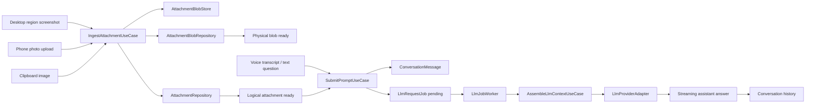
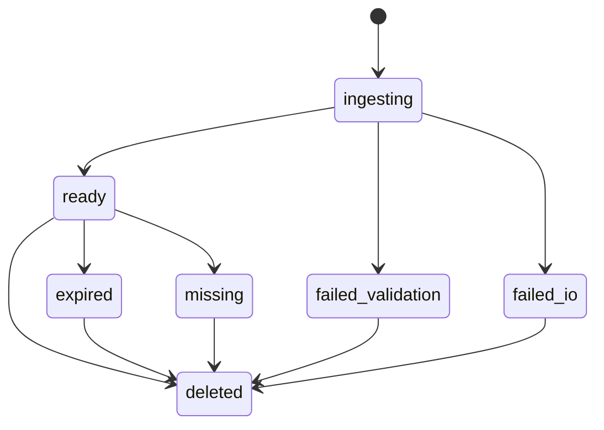
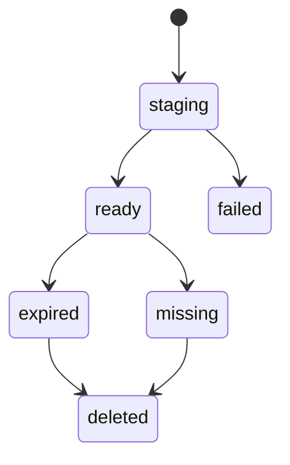
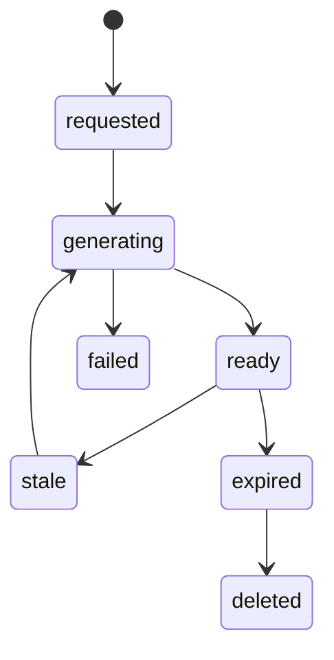
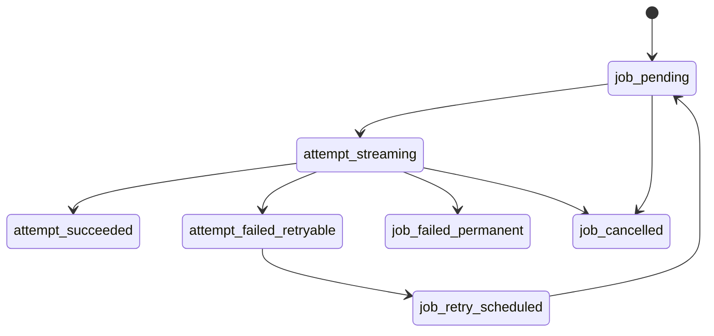
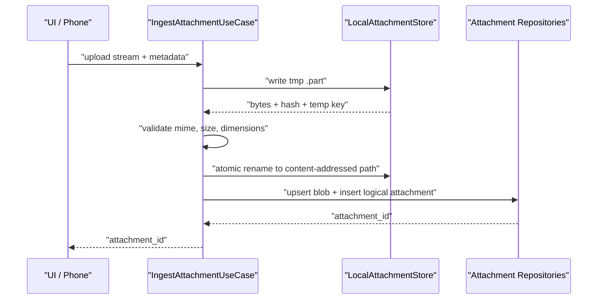
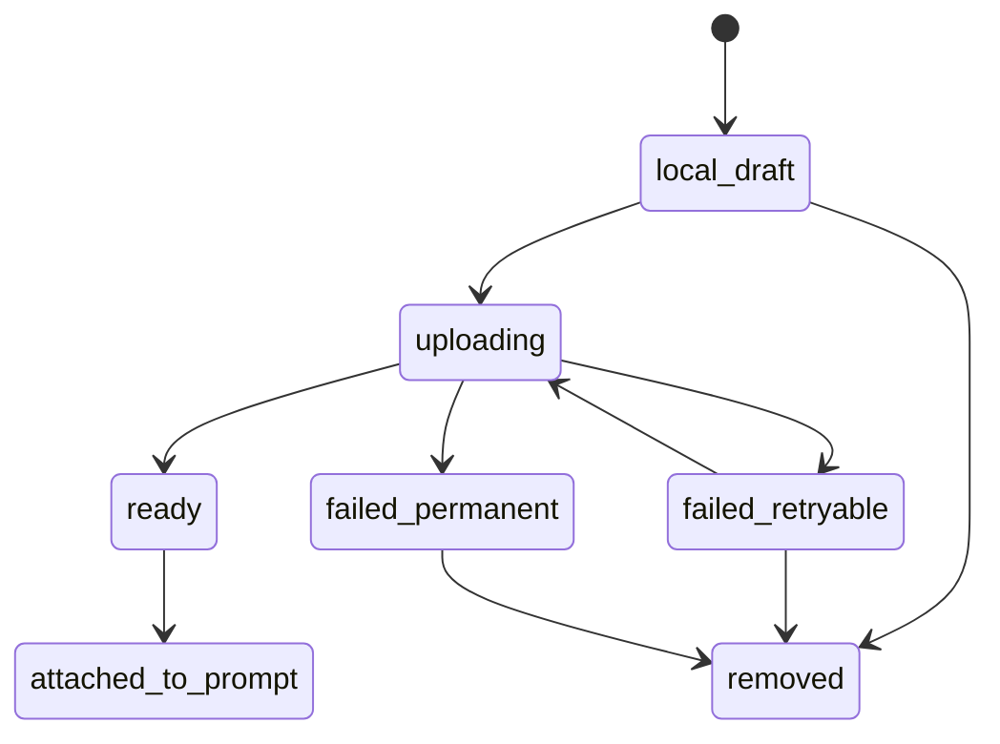
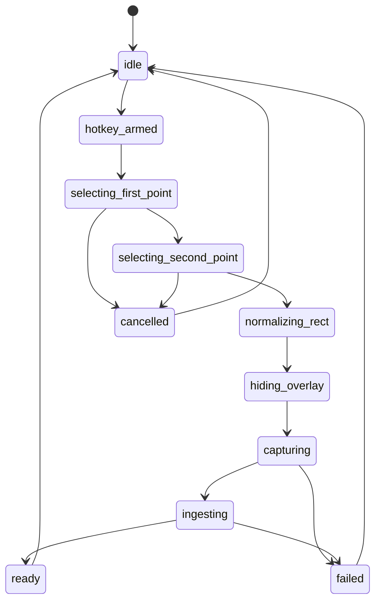
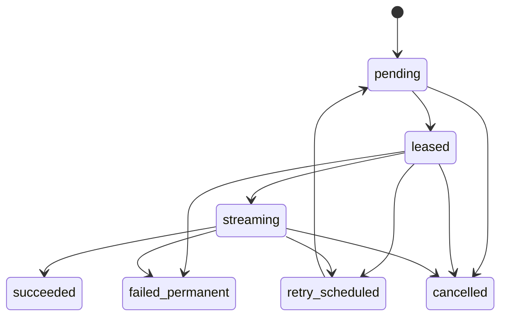

# Local-First Multimodal Attachment + Durable LLM Queue Plan

## Статус документа

Это целевой технический план для фичи:

- скриншоты выбранной области экрана
- фото с телефона пачкой
- вопросы голосом/текстом
- ответы LLM с учетом текущих изображений и истории
- надежная работа при плохом интернете
- независимость от конкретного LLM provider

Документ фиксирует решения, к которым мы пришли, и edge cases, которые нужно закрыть в реализации.
Эта версия плана уже учитывает текущий код проекта, а не только целевую архитектуру.

IOF-pass 2 усиливает документ в трех местах:

- превращает архитектуру в проверяемые контракты, а не список пожеланий
- фиксирует refactor map для текущих файлов, где уже есть base64/provider/UI ownership drift
- добавляет риск-регистр и implementation playbook с точками остановки, тестами и rollback gates

Главная идея: это не "чат с картинками", а **local-first multimodal pipeline**:

```text
capture/upload -> attachment store -> conversation history -> durable LLM queue -> provider adapter -> streamed answer
```

---

## Короткий итог

Делаем **Modular Monolith + Durable Queue + Ports/Adapters**.

Финальные решения:

- runtime: Rust поднимаем до свежего stable, целевой baseline - `1.95.0`
- ORM/DB: `SQLite + SeaORM 2.0.0-rc.38`, exact pin
- storage: `Custom LocalAttachmentStore` на файловой системе
- шифрование: не делаем
- raw audio: не сохраняем, только распознанный текст
- phone: сейчас LAN-only, но через ingress port, чтобы потом добавить relay
- raw image retention: 3 дня по умолчанию
- старые изображения: не отправляем в LLM автоматически
- контекст старых изображений: attachment markers + answer notes
- текущие изображения: отправляем в LLM raw, если пользователь прикрепил их к текущему вопросу
- текущий `LlmImageInput { media_type, data_base64 }` оставляем только как временный compatibility path
- новый основной contract: сначала upload/ingest attachment, потом prompt с `attachment_ids`
- retry: 3 попытки автоматически
- partial answer: показываем, retry пишет новый assistant message, старый partial не перетирается
- provider cache/file refs: используем как оптимизацию, но не как источник правды

Главное техническое исправление по сравнению с текущим кодом:

- provider payload assembly уезжает из `presentation/commands.rs` в application + provider adapters
- Anthropic/OpenAI/image support становится capability-driven, а не `if provider == Anthropic`
- companion timeline перестает быть единственным source of truth для AI истории
- phone photo batch перестает ехать огромным base64 JSON body

---

## Почему именно такой вариант

### Почему не просто хранить картинки в истории и отправлять все заново

Скриншоты будут часто содержать код. Для точного ответа текущий скрин нужно отправлять качественно. Но если в истории накопится 10 скриншотов, повторная отправка всех raw images на каждый вопрос будет:

- медленной
- дорогой
- нестабильной по provider limits
- склонной к путанице, когда модель смотрит не на тот старый скрин

Поэтому v1 политика такая:

- raw image отправляется только в turn, где он прикреплен
- дальше в истории остается marker, что image был и по нему уже был ответ
- если снова нужен актуальный код, пользователь прикрепляет новый скрин или явно reuses старый attachment

### Почему не делать VisualCodeMemory/OCR сразу

Это мощно, но для v1 необязательно. Пользователь готов в нужный момент прикрепить актуальный код. Значит нам важнее:

- не путать историю
- не повторять ответы на уже отвеченные вопросы
- не тормозить из-за старых картинок
- сохранить возможность позже добавить OCR/RAG без переписывания ядра

---

## Research facts, которые учитываем

### OpenAI

Источник: https://developers.openai.com/api/docs/guides/images-vision

- image inputs можно передавать как URL, base64 data URL или `file_id`
- multiple images поддерживаются, но images считаются input tokens и влияют на TPM
- поддержанные форматы: PNG, JPEG, WEBP, non-animated GIF
- общий payload limit для image input указан как 512 MB, но это не значит, что нам можно гонять такие payloads через companion JSON
- `detail` важен: `low`, `high`, `original`, `auto`
- для мелкого текста и code screenshots нельзя использовать `low`
- для GPT-5.5 `auto`/default эквивалентен `original`; для GPT-5.4 default ведет себя иначе, поэтому `detail` лучше задавать явно в provider adapter
- image metadata и filename модель не видит, поэтому важные сведения надо добавлять в textual attachment marker
- `previous_response_id` помогает state handling, но предыдущие input tokens в цепочке все равно billятся
- prompt caching автоматический и полезен для стабильного prefix, но это optimization, а не долговременная память
- OpenAI prompt caching требует exact prefix match; dynamic context и current attachments лучше держать ближе к концу
- images тоже могут попадать в cached prefix, но тогда image bytes/detail должны совпадать, что плохо подходит для частых новых скриншотов
- для code screenshots `detail` в adapter должен быть explicit: `original` если модель поддерживает, иначе `high`
- Responses API streaming приходит как typed SSE events, поэтому adapter должен мапить `response.output_text.delta`, completion и error events в provider-neutral stream events
- Files API дает `file_id` for vision use cases, но это provider-side ref, не наш attachment id и не долговременное local storage

### Anthropic

Источники:

- https://platform.claude.com/docs/en/build-with-claude/vision
- https://platform.claude.com/docs/en/build-with-claude/prompt-caching
- https://docs.anthropic.com/en/api/messages-streaming
- https://docs.anthropic.com/en/api/rate-limits

- multiple images поддерживаются, но API/request limits и request size limits приходят раньше, чем "теоретический максимум"
- Files API помогает не пересылать base64 каждый turn, но это provider-specific optimization
- Claude docs рекомендуют image-before-text структуру, это должен делать Anthropic adapter, а не use case
- images считаются tokens
- обычные Claude модели нативно ограничены примерно 1568 px по long edge, Opus 4.7 имеет более высокий vision ceiling
- lossy JPEG/WebP может ломать читаемость текста, особенно при повторной компрессии
- prompt caching есть, но это prefix cache с TTL; наличие/отсутствие images в prompt влияет на cache entries
- 5-minute cache подходит только для близких turn, 1-hour cache требует явного TTL и стоит дороже
- Anthropic automatic caching moves the cache point as conversation grows, but has edge cases: explicit breakpoint conflicts, maximum breakpoint slots and 20-block lookback behavior
- cache breakpoint на динамическом блоке вроде timestamp/current prompt может убить cache hit rate
- Anthropic rate limits возвращают `retry-after`; queue worker обязан уважать этот header, а не просто делать fixed backoff
- Anthropic оценивает ITPM/OTPM в начале request; `max_tokens` должен быть реалистичным, иначе можно словить rate limit раньше, чем кажется
- при большом числе images docs рекомендуют Files API, но для v1 это только provider adapter optimization поверх local store
- Messages streaming emits structured events like message/content block lifecycle and deltas, so adapter must not treat all SSE JSON as only text delta

### Rust, SeaORM, SQLite, файлы

Источники:

- https://blog.rust-lang.org/2026/04/16/Rust-1.95.0/
- https://www.sea-ql.org/SeaORM/docs/introduction/whats-new/
- https://www.sea-ql.org/SeaORM/docs/install-and-config/database-and-async-runtime/
- https://www.sea-ql.org/SeaORM/docs/basic-crud/raw-sql/
- https://www.sqlite.org/wal.html
- https://www.sqlite.org/c3ref/wal_checkpoint_v2.html
- https://docs.rs/http-body-util/latest/http_body_util/struct.Limited.html
- https://v2.tauri.app/security/csp/
- https://v2.tauri.app/reference/acl/capability/
- https://v2.tauri.app/security/capabilities/
- https://v2.tauri.app/reference/javascript/global-shortcut/
- https://v2.tauri.app/plugin/file-system/
- https://developer.apple.com/documentation/screencapturekit/scscreenshotmanager/captureimage(contentfilter:configuration:completionhandler:)
- https://cheatsheetseries.owasp.org/cheatsheets/File_Upload_Cheat_Sheet.html
- crates.io через `cargo search`/`cargo info`

Зафиксировано:

- текущий проект сейчас на `rust-version = "1.77.2"`, для фичи поднимаем baseline до `1.95.0`
- `sea-orm = 2.0.0-rc.38` актуален на момент проверки, но это RC, не stable
- `sea-orm` и `sea-orm-migration` 2.0.0-rc.38 требуют Rust `1.85.0`, поэтому bump до `1.95.0` закрывает minimum
- текущий `tauri = 2.8.5`, актуальный crates.io `tauri = 2.11.1`; не обновляем Tauri внутри этой фичи без отдельного risk pass
- текущий `screencapturekit = "1"`, актуальный crates.io `screencapturekit = 2.1.0`; нужен spike перед upgrade, потому что API capture может отличаться
- актуальный `image = 0.25.10`; его берем для decode/encode/thumbnail/variant, но не для security trust без magic-byte validation
- SeaORM 2.0 официально описан как большой релиз с breaking changes, значит pin обязателен
- SeaORM поддерживает raw SQL flow, поэтому точечный raw SQL для queue claim можно держать внутри repository adapter без отказа от ORM
- для SQLite с SeaORM используем `sqlx-sqlite` + `runtime-tokio`, не `sea-orm-sync`
- SQLite WAL дает лучшую concurrency для локального app DB, но все равно один writer и возможен `SQLITE_BUSY`
- WAL не должен лежать на network filesystem
- SQLite busy handling обязателен: `busy_timeout` plus repository-level retry для известных transient DB busy ошибок
- WAL checkpoint нельзя оставлять полностью случайным при долгих сессиях с большим числом queue writes; нужен lightweight maintenance path
- SQLite docs фиксируют default auto-checkpoint around 1000 WAL pages, но long readers can prevent checkpoint completion, поэтому projection reads должны быть короткими
- `wal_checkpoint_v2` can still return `SQLITE_BUSY`, so maintenance checkpoint must be best-effort and never block user-facing capture/upload path
- `http-body-util::Limited` уже подходит для hard limit на HTTP body: он возвращает error, если body превысил limit
- Tauri capabilities являются границей доступа IPC; remote origins с local access требуют отдельной осторожности
- Tauri CSP protection включается только если задана в config; текущий `csp = null` надо закрыть hardening task перед release
- Tauri capabilities могут merge permissions, если window/webview входит в несколько capability files, поэтому attachment feature не должна добавлять широкие permissions на main window
- Tauri global shortcut docs say a shortcut taken by another app may not trigger; capture hotkey registration must surface conflict/health status instead of silently doing nothing
- Tauri docs прямо говорят: если Rust side работает с файлами, лучше использовать `std::fs`/`tokio::fs`, а не выдавать frontend широкий FS plugin scope
- для attachment store в v1 frontend не получает прямой file-system access; все идет через application use cases и thumbnail endpoint
- Rust backend может писать файлы через `std::fs`/`tokio::fs`, frontend fs plugin нужен только если WebView сам читает local files
- Apple ScreenCaptureKit имеет `SCScreenshotManager` для single-frame screenshot capture; это лучше, чем stream-based audio capture API
- OWASP file upload guidance совпадает с нашим направлением: allowlist типов, не доверять `Content-Type`, проверять signature/magic bytes, генерировать filename приложением, задавать size limits, хранить вне webroot/direct public path
- актуальные маленькие crates для storage path:
  - `blake3 = 1.8.5`
  - `tempfile = 3.27.0`
  - `infer = 0.19.0`
  - `imagesize = 0.14.0`
  - `image = 0.25.10`, требует Rust 1.88, значит совместим с Rust 1.95
  - `multer = 3.1.0` для streaming `multipart/form-data`
  - `http-body-util = 0.1.3` уже есть в проекте
  - `tauri = 2.8.5` в проекте, latest crates.io на проверке - `2.11.1`
  - `tauri-plugin-fs = 2.5.1` latest, но v1 storage можно делать без frontend fs plugin
  - `screencapturekit = 1.0.0` resolved сейчас, latest crates.io - `2.1.0`

Вывод:

⚠️ Provider cache/file refs полезны, но не заменяют наш `ContextAssembler`, `AttachmentStore` и durable history.

⚠️ Не надо автоматически апгрейдить весь Tauri ради этой фичи. Апгрейд Tauri 2.8.5 -> 2.11.1 делаем отдельным техническим PR/commit, если screen capture/capabilities реально требуют новый API.

### Frontend/state-sync facts

Источники:

- https://developer.mozilla.org/en-US/docs/Web/API/XMLHttpRequest_API/Using_FormData_Objects
- локальный код `src/windowing/stateSync/*`
- локальный код `src/features/auth/*`

Из кода:

- `@statesync/core`, `@statesync/tauri`, `@statesync/pinia` уже используются как snapshot/invalidation инфраструктура
- `CompanionSnapshotData.timeline[].attachments[].dataUrl` сейчас хранит preview как data URL
- `ConversationFeedAttachment` тоже ожидает `dataUrl`
- `buildCompanionConversationFeedMessages` уже умеет строить UI projection из snapshot
- `ConversationFeed.vue` показывает attachments только у prompt messages и только как ``
- `src/companion/CompanionApp.vue` сейчас отправляет prompt images через JSON `dataBase64`
- `src/utils/promptImages.ts` делает client-side resize/base64 и должен остаться только preview/legacy helper
- `src/features/auth` уже показывает хороший frontend Clean Architecture pattern: domain/application/infrastructure/presentation plus DI container
- CSP в `tauri.conf.json` сейчас `null`
- MDN warns that when sending `FormData` files via fetch/XHR, client code must not manually set `Content-Type`; browser must add multipart boundary itself

Вывод:

⚠️ Durable attachment projection v2 не должен носить raw/base64 в snapshot. Snapshot должен носить attachment metadata + thumbnail URL/endpoint. Иначе мы просто перенесем проблему больших base64 из prompt request в state-sync.

### Current code friction discovered in IOF-pass 2

Ниже то, что особенно важно учесть в реализации, потому что это уже есть в коде и будет ломать Clean Architecture, если оставить как есть.

1. `start_haiku_chat_stream` сейчас делает слишком много.

   Сейчас в одном command path находятся:

   - env/config resolution
   - provider selection
   - system prompt fallback
   - prompt/context merge
   - base64 image conversion to provider JSON
   - companion prompt append
   - streaming task spawn
   - event emission
   - partial/final/error timeline mutation

   Это прямое нарушение SRP/DIP. В новой архитектуре command должен быть facade:

   ```text
   validate dto -> call SubmitPromptUseCase -> return job_group_id/message projection
   ```

2. `LlmProvider` port сейчас text-only.

   `LlmStreamRequest` содержит только `model/system_prompt/user_text/max_tokens/temperature`.
   Для мультимодальности нужен новый neutral request, иначе images опять окажутся provider-specific JSON рядом с command:

   ```text
   LlmRequest
     messages[]
     current_attachments[]
     historical_markers[]
     response_policy
     capability_requirements
     budget
   ```

3. OpenAI-compatible path сейчас может silently ignore images.

   В `commands.rs` при не-Anthropic provider есть warning, но request продолжается без изображений.
   Новый contract: если prompt требует current attachments, а selected provider/model не умеет images, job fails before provider call with `UnsupportedCapability`.

4. `read_json_body` сейчас collect-ит body целиком.

   Для phone photo batch это нельзя оставлять. Даже legacy JSON path должен быть wrapped in `Limited`; new path должен быть multipart/streaming.

5. `ConfigStore::write_file_atomic` уже есть, но config save paths не везде его используют.

   Attachment store должен иметь более строгий atomic protocol:

   ```text
   write temp -> fsync temp where practical -> rename final -> DB transaction commit
   ```

   Recovery обязан понимать оба полусостояния: файл есть без DB row, DB row есть без файла.

6. `companion_timeline` сейчас session-local in-memory.

   Для partial retry/restart этого недостаточно. Timeline v2 должен быть projection из DB plus live overlay, а не source of truth.

7. `chat.ts` содержит три почти одинаковых context builder.

   Это DRY-риск. После миграции final context assembly должен жить в Rust application layer, а frontend может только выбирать user intent/selection.

8. `cancelHaikuRequest` frontend-only.

   Durable queue требует backend cancellation:

   ```text
   cancel request -> mark job cancelled -> cancel active provider stream if possible -> projection update
   ```

### Current code friction discovered in IOF-pass 3

Дополнительные findings после более точечного просмотра кода:

1. Hotkey infrastructure exists only for recording.

   `src-tauri/src/infrastructure/hotkey.rs` нормализует recording hotkey. Capture hotkey must be separate and cannot reuse recording semantics blindly:

   ```text
   recording hotkey -> toggles recording/window
   capture hotkey -> starts/cancels capture region state machine
   ```

   Registration conflict must be visible in settings/debug because a global shortcut taken by another app may not trigger.

2. `AppState` is already a large mutable root.

   It stores transcription services, config, companion runtime, timeline, revisions, request generations, audio levels and auth state. New feature should add one `AppServices` root handle, not another dozen locks.

3. Companion phone client already has good network lifecycle handling.

   `CompanionApp.vue` handles offline, visibility, abort controllers, EventSource reconnect and `/api/state` resync. Upload queue should reuse that behavior and not build a second ad hoc network layer.

4. `promptImages.ts` currently couples preview, compression and transport.

   It creates `dataUrl` and `dataBase64`. For v2 split responsibilities:

   ```text
   preview: object URL / thumbnail
   upload: original File/Blob via FormData
   legacy compatibility: optional compressed base64 only while flag is on
   ```

5. Frontend already has a better feature architecture in `src/features/auth`.

   Auth has domain entities, application use cases, infrastructure repositories/adapters, presentation composables and DI container. Attachments/conversation frontend should copy that pattern instead of adding more state to `stores/chat.ts`.

6. Current SSE decoder is useful but too permissive for provider streams.

   It handles chunk splitting and multi-event chunks, but provider adapters currently ignore malformed JSON in some paths and may return success when stream closes without final event. Queue retry correctness needs typed stream termination.

---

## Текущее состояние кода, которое план обязан исправить

Это не greenfield. В проекте уже есть части Clean Architecture, но multimodal flow сейчас пробивает слои.

### Что уже есть полезного

- Tauri 2 backend на Rust
- папки `domain`, `application`, `infrastructure`, `presentation`
- `LlmProvider` port в `src-tauri/src/domain/ports/llm_provider.rs`
- `DefaultLlmProviderFactory` и adapters в `src-tauri/src/infrastructure/llm/`
- companion server с LAN token
- companion snapshot/SSE/invalidation механизм
- global shortcut plugin уже подключен
- `screencapturekit` уже есть в macOS dependencies, но сейчас используется для system audio, не для screenshot region
- frontend уже умеет выбирать несколько фото через `input type=file accept=image/* capture=environment multiple`

### Главные проблемы текущего flow

1. `LlmStreamRequest` text-only.

   Сейчас domain port умеет только:

   ```text
   model
   system_prompt
   user_text
   max_tokens
   temperature
   ```

   В нем нет attachments, image detail, provider file refs, capabilities, request budget, source links.

2. `start_haiku_chat_stream` в `presentation/commands.rs` делает слишком много.

   Сейчас там одновременно:

   - читаются env vars provider/model/tokens
   - выбирается provider
   - строится prompt
   - создается companion prompt message
   - создается haiku message
   - запускается async task
   - собирается Anthropic image JSON
   - dispatchятся stream events
   - меняется companion timeline

   Это нарушает SRP и DIP. Presentation должен быть facade, а не orchestrator.

3. Images поддержаны только Anthropic special-case path.

   В Anthropic path картинки вставляются как base64 content blocks прямо в command.  
   В OpenAI-compatible path при `images` просто логируется warning и attachments игнорируются.

4. Phone upload сейчас идет через JSON body с base64.

   `CompanionPromptSendBody` содержит:

   ```text
   text
   images: Vec<LlmImageInput>
   ```

   `read_json_body` собирает весь request body в память через `.collect().await`, без явного app-level лимита. Для пачки фото это тонкое место по memory, latency и ошибкам при плохом интернете.

5. `src/utils/promptImages.ts` заранее пережимает картинки на frontend.

   Это полезно как safety net, но для code screenshots рискованно:

   - default long edge сейчас 1568
   - возможен lossy WebP/JPEG
   - модель может хуже читать мелкий код

   Backend должен сам принять решение, какую variant отправить в LLM. Frontend preview не должен быть source of truth.

6. Companion timeline сейчас session-local.

   `AppState.companion_timeline` хранится в памяти, обрезается по `max_history_items` и не является durable storage. Для новой фичи он остается projection/cache для UI, но не primary history.

7. Нет durable queue.

   Стриминг запускается fire-and-forget task. Если app умер, network отвалился или provider частично ответил, у нас нет полноценного job/attempt state machine.

8. Контекст собирается в нескольких местах.

   Сейчас есть минимум два похожих контекстных сборщика:

   - `src-tauri/src/presentation/companion_timeline.rs::build_context_text`
   - `src/stores/chat.ts::buildHaikuContextText*`

   Оба форматируют `ОС`, `МИКРОФОН`, `ЗАПРОС`, `ПОМОЩНИК` и режут контекст строкой. Для новой мультимодальной истории это DRY-риск: разные окна начнут отправлять разные контексты.

9. Cancel сейчас frontend-only.

   `cancelHaikuRequest` в `src/stores/chat.ts` просто игнорирует будущие события и удаляет сообщение из массива UI. Backend job при этом не знает, что пользователь отменил запрос. Для durable queue это недопустимо.

10. Ошибка stream сейчас меняет одно сообщение.

    `fail_haiku_message` ставит status `error`, а partial text остается только если уже был. Retry как отдельная попытка не моделируется.

11. Companion server слушает LAN.

    `bind_listener` использует `0.0.0.0`, что правильно для телефона в одной сети, но повышает важность token, body limits, rate limits и CORS/Origin проверки.

12. `tauri.conf.json` сейчас имеет `security.csp = null`.

    Это уже существующее решение, но новая phone upload/thumbnail surface увеличивает blast radius frontend bugs. План должен явно требовать не расширять frontend capabilities без необходимости.

13. Screen capture UI/adapter отсутствуют.

    Есть Screen Recording permission helpers для system audio и зависимость `screencapturekit`, но нет команды region screenshot, overlay state machine, координатной модели и проверки black frame.

14. Backend provider placeholder не реализован.

    `BackendLlmProvider::stream_text` возвращает `Unsupported`. Новый provider contract должен считать backend adapter отдельным будущим adapter, а не "магическим fallback".

### Миграционный принцип

Не переписывать весь chat/companion за один раз.

Вводим новый backend pipeline за facade:

```text
existing Tauri command / companion HTTP
  -> PromptSubmissionFacade
  -> SubmitPromptUseCase
  -> durable DB state
  -> LlmJobWorker
  -> ProviderAdapter
```

Старые entrypoints временно остаются, но становятся thin wrappers:

- `start_haiku_chat_stream` вызывает новый `SubmitPromptUseCase`
- companion `/api/prompt/send` принимает legacy `images` только как compatibility path и сразу прогоняет их через `IngestAttachmentUseCase`
- новый production path для телефона: `/api/attachments` + `/api/prompt/send` с `attachmentIds`

## Самые тонкие места и как их закрываем

### 1. Provider independence при разном multimodal API

Риск:

- OpenAI Responses API, OpenAI-compatible Chat Completions, Anthropic Messages API и future backend имеют разные форматы image input, caching и stream events.

Решение:

- domain хранит provider-neutral `LlmRequest`
- `LlmProviderAdapter` имеет `capabilities()`
- `ContextAssembler` не знает JSON provider
- каждый adapter сам решает порядок content blocks, `detail`, file refs, cache hints

Acceptance:

- текущая картинка работает в Anthropic adapter
- текущая картинка работает в OpenAI adapter
- provider без image capability получает deterministic `UnsupportedCapability` до отправки запроса

### 2. Старые картинки в контексте без повторной отправки bytes

Риск:

- если отправлять все raw images заново, будет медленно и дорого
- если не отправлять ничего, модель забудет, что уже отвечала по картинке
- если marker слишком умный, он начнет выдумывать содержимое картинки

Решение:

- current attachments - raw image/file ref
- historical attachments - только factual markers + answer notes
- answer notes создаются из факта ответа: "assistant msg X answered using att Y, topic Z"
- marker не содержит распознанный код, если OCR/VisualCodeMemory не делали

Acceptance:

- follow-up без нового скрина видит, что ранее был attachment и по нему был ответ
- follow-up не получает raw bytes старого image
- explicit "используй тот прошлый скрин" требует либо еще живой raw attachment, либо понятную ошибку/просьбу переснять

### 3. Partial answer + retry без путаницы UI

Риск:

- пользователь видит partial, потом retry перезаписывает его, и история становится непонятной

Решение:

- `LlmAttempt` всегда отдельная сущность
- assistant message создается только когда есть first token или когда надо показать финальную ошибку
- retry после partial создает новый assistant message
- все attempts группируются одним `job_group_id`

Acceptance:

- attempt 1 partial остается видимым
- attempt 2 success виден ниже как новый assistant message
- UI может показать "попытка 1/3", "попытка 2/3"

### 4. Atomicity DB + filesystem

Риск:

- DB row есть, файла нет
- файл есть, DB row нет
- app умер между tmp write и commit

Решение:

- file write идет в `tmp` на том же filesystem
- hash считается во время streaming write
- final path content-addressed
- DB transaction создается после successful atomic rename
- startup recovery reconciliation обязателен

Acceptance:

- crash after tmp write leaves cleanup candidate
- crash after final rename before DB commit leaves quarantine/orphan cleanup candidate
- crash after DB commit with file present recovers as ready

### 5. SeaORM 2 RC

Риск:

- `2.0.0-rc.38` свежий, но RC. API может поменяться.

Решение:

- exact pin `=2.0.0-rc.38`
- SeaORM не попадает в domain/application types
- manual migrations
- no schema-sync as runtime path
- raw SQL allowed for queue claim
- update SeaORM only отдельным PR/commit с migration tests

Acceptance:

- upgrade ORM не требует менять domain/use cases

### 6. Screen region capture на macOS

Риск:

- Retina scaling, multiple displays, full-screen windows, permission prompt, black frames

Решение:

- `CaptureRegionService` получает logical points и возвращает image bytes + physical metadata
- overlay нормализует 2 точки в logical rect
- adapter переводит rect в display pixel coordinates
- при permission error не создается attachment/job

Acceptance:

- reverse-point selection работает
- multi-display не создает invalid crop
- black/empty screenshot detected as failed capture when possible

## Оценка ключевых развилок, которые уже закрыли

1. `SQLite + files + SeaORM` вместо embedded BLOBs - 🎯 9   🛡️ 9   🧠 6, примерно 900-1600 строк.

   Файлы лучше для raw images, SQLite лучше для metadata/jobs. BLOB в SQLite не берем как default, потому что картинки будут крупными, cleanup/preview/variants проще держать отдельными файлами.

2. `Attachment markers + answer notes` вместо resend all old images - 🎯 9   🛡️ 8   🧠 4, примерно 700-1300 строк.

   Это быстрее и меньше путает модель. Цена - если нужен старый код, пользователь должен явно прикрепить новый скрин или reuse живого attachment.

3. `Modular monolith + durable queue` вместо микросервисов/прямого stream call - 🎯 9   🛡️ 9   🧠 7, примерно 5000-9000 строк с тестами и UI reconciliation.

   Для local-first Mac app это правильная середина: надежность есть, распределенной сложности нет.

## Оставшиеся развилки с меньшей уверенностью

### Screen capture adapter

1. `Native ScreenCaptureKit SCScreenshotManager bridge` - 🎯 8   🛡️ 9   🧠 7, примерно 450-900 строк.

   Мой выбор для качества. Apple API напрямую умеет single-frame screenshots. Риск - придется писать/держать Swift/ObjC bridge и аккуратно переводить coordinates.

2. `Upgrade screencapturekit crate до 2.1.0 и использовать его API` - 🎯 6   🛡️ 7   🧠 6, примерно 300-700 строк.

   Может быть быстрее, но надо проверить, есть ли в crate удобный wrapper именно для `SCScreenshotManager`, а не только stream capture. Нужен spike.

3. `macOS screencapture CLI fallback` - 🎯 5   🛡️ 5   🧠 3, примерно 120-250 строк.

   Быстро, но хуже контроль privacy errors, координат, overlay exclusion, temp files и UX. Только fallback/dev diagnostic, не main path.

Spike:

```text
1. проверить capture одной rect через SCScreenshotManager
2. проверить Retina scaling на 1x/2x
3. проверить fullscreen app
4. проверить black/protected content
5. проверить permission prompt/error
```

### Multipart upload implementation

1. `Hyper Incoming + http_body_util::Limited + multer` - 🎯 8   🛡️ 8   🧠 6, примерно 350-700 строк.

   Мой выбор. Хорошо ложится на текущий Hyper companion server, дает hard body limit и streaming multipart parser.

2. `Custom chunked upload protocol` - 🎯 6   🛡️ 8   🧠 8, примерно 700-1200 строк.

   Надежно для плохого интернета и resume, но слишком много для v1. Можно добавить позже как transport adapter.

3. `Оставить JSON base64 + жесткий limit` - 🎯 4   🛡️ 4   🧠 2, примерно 80-180 строк.

   Дешево, но плохо для пачек фото и памяти. Только compatibility path на время миграции.

Spike:

```text
1. сделать test endpoint с Limited body
2. проверить Content-Length early reject
3. проверить chunked body без Content-Length
4. проверить 10 mixed files
5. проверить abort mid-upload
```

### Conversation projection ownership

1. `DB projection source of truth + SSE snapshots as live cache` - 🎯 9   🛡️ 9   🧠 6, примерно 600-1000 строк.

   Мой выбор. После restart UI восстанавливается из DB, stream events только ускоряют live UI.

2. `Оставить AppState timeline SoT и периодически snapshot в DB` - 🎯 5   🛡️ 5   🧠 4, примерно 250-500 строк.

   Быстрее внедрить, но сложнее гарантировать recovery, partial retry и context correctness.

3. `Full event sourcing` - 🎯 6   🛡️ 9   🧠 9, примерно 1500-2500 строк.

   Чисто, но для v1 слишком тяжело. Не нужно, пока нет multi-device sync и аудита каждого UI события.

Spike:

```text
1. build projection from DB only
2. restart during streaming
3. reconnect companion phone SSE
4. compare projection ids with optimistic UI ids
```

### New decisions after IOF-pass 2

Эти решения появились после повторной проверки текущего кода и свежих docs.

#### Provider state strategy

1. `Stateless provider calls + local conversation projection` - 🎯 9   🛡️ 9   🧠 6, примерно 700-1200 строк.

   Мой выбор. Мы каждый раз собираем provider-neutral request локально, отправляем только current attachments raw и historical markers text. OpenAI `previous_response_id`, Anthropic cache и Files API используются только как adapter-level optimization.

2. `Provider-native conversation state as primary memory` - 🎯 4   🛡️ 5   🧠 5, примерно 400-900 строк.

   Быстро для одного provider, но ломает независимость от OpenAI/Anthropic и делает recovery/provider switch сложными.

3. `Hybrid long-lived provider threads per conversation` - 🎯 5   🛡️ 6   🧠 8, примерно 1200-2200 строк.

   Может дать cache wins, но сильно усложняет invalidation, TTL, deletion и privacy semantics. Не брать в v1.

Decision:

```text
Local DB projection is source of truth.
Provider state is never source of truth.
Provider cache/file refs are disposable acceleration.
```

#### Attachment upload format

1. `multipart/form-data with per-file result objects` - 🎯 9   🛡️ 8   🧠 6, примерно 500-900 строк.

   Мой выбор для телефона. Удобно отправлять пачку фото, можно вернуть mixed success/failure, не нужно base64 JSON.

2. `one POST per photo, then prompt submit` - 🎯 8   🛡️ 8   🧠 4, примерно 350-650 строк.

   Проще и надежно, но хуже UX/latency для пачек и сложнее показать общий progress. Хороший fallback, если multipart parser окажется слишком рискованным.

3. `chunked resumable upload v1` - 🎯 5   🛡️ 9   🧠 9, примерно 1000-1800 строк.

   Сильно надежнее на плохой сети, но v1 слишком сложный. Архитектуру держим готовой через `PhoneIngressPort`, но не реализуем сразу.

Decision:

```text
V1 supports multipart batch and idempotent retry.
V2 can add resumable chunks without touching domain use cases.
```

#### Screenshot quality policy for code

1. `Keep original PNG for local blob, create provider-aware LLM variant lazily` - 🎯 9   🛡️ 9   🧠 6, примерно 450-850 строк.

   Мой выбор. Raw original не теряем, а provider adapter выбирает `original/high` and resize only when budget forces it.

2. `Always downsample to 1568px long edge before storage` - 🎯 4   🛡️ 5   🧠 3, примерно 150-300 строк.

   Быстро, но плохо для кода и irreversible. Нельзя как default.

3. `Store only provider-ready variant, no original` - 🎯 3   🛡️ 4   🧠 3, примерно 150-300 строк.

   Экономит диск, но ломает future provider switch and debug inspect. Не брать.

Decision:

```text
Original local blob is authoritative for 3 days.
LLM variant is derived and replaceable.
Thumbnail is UI-only and never used as LLM input.
```

---

## Architecture Overview



---

## DDD Bounded Contexts

Это modular monolith, но внутри него должны быть явные bounded contexts. Иначе `commands.rs` снова станет местом, где "временно" собирается весь flow.

### Attachment Context

Purpose:

- принять bytes/stream
- проверить безопасность и формат
- сохранить physical blob
- создать logical attachment
- создать variants
- управлять TTL/pin/delete

Owns:

```text
AttachmentBlob
Attachment
AttachmentVariant
ProviderFileRef
AttachmentRetentionPolicy
AttachmentIngestPolicy
```

Does not own:

- conversation order
- LLM prompt assembly
- provider request JSON
- screen overlay UI

Invariants:

- `Attachment` cannot be ready if its `AttachmentBlob` is not ready
- storage path is always generated by app
- user filename is metadata only
- physical blob can be shared by many logical attachments
- expired logical attachment does not automatically delete shared blob

### Conversation Context

Purpose:

- durable user/assistant/transcript/message history
- message ordering
- message-to-attachment links
- answer source links
- answer notes
- UI projection

Owns:

```text
Conversation
ConversationMessage
MessageAttachment
AssistantAnswerSource
AssistantAnswerAttachment
AttachmentAnswerNote
ConversationProjection
```

Does not own:

- file bytes
- provider file upload
- retry scheduling
- image validation

Invariants:

- assistant answer must link to the user message/job attempt that produced it
- historical image marker must not claim visual contents that were not explicitly summarized
- projection can be rebuilt from DB after restart
- frontend optimistic ids must reconcile to backend ids

### LLM Request Context

Purpose:

- durable job queue
- attempts
- retry/cancellation
- provider-neutral request assembly
- provider capability checks

Owns:

```text
LlmRequestJob
LlmAttempt
RetryPolicy
ContextBudget
ProviderCapabilities
ProviderErrorKind
```

Does not own:

- raw attachment storage
- UI message layout
- phone upload transport

Invariants:

- job cannot start unless current attachments are ready
- retry never overwrites previous partial answer
- provider without image capability fails before API call
- cancellation is persisted before late stream deltas are ignored

### Capture Context

Purpose:

- region selection
- OS permission handling
- coordinate conversion
- screenshot capture

Owns:

```text
CaptureRegion
DisplayDescriptor
CapturePermissionState
CapturedImage
```

Does not own:

- storage beyond passing bytes to `IngestAttachmentUseCase`
- provider calls
- conversation history

Invariants:

- invalid region cannot create attachment
- screen permission error cannot create dummy attachment
- logical and physical rect metadata are preserved

### Phone Ingress Context

Purpose:

- LAN token auth
- HTTP/multipart body handling
- per-file upload status
- future relay adapter

Owns:

```text
PhoneUploadSession
ClientRequestId
SourceDeviceId
UploadBatchResult
```

Does not own:

- image validation rules beyond invoking attachment ingest
- LLM provider requests
- conversation context assembly

Invariants:

- token is checked before reading large body
- one failed file does not fail the whole ready batch
- retry with same `source_device_id + client_request_id` is idempotent

### Cross-context dependency rule

Allowed direction:

```text
Presentation -> Application -> Domain ports/models
Infrastructure -> Domain ports/models
Application -> Domain ports/models
Domain -> no outer layers
```

Forbidden:

```text
Conversation directly reads filesystem
Attachment directly calls LLM provider
Provider adapter mutates conversation DB
Phone HTTP handler creates provider JSON
Frontend builds final LLM context
```

If a new use case needs multiple contexts, orchestration lives in application layer, not in domain entities and not in presentation.

---

## Layering

### Domain

Папка:

```text
src-tauri/src/domain/
  attachment/
  conversation/
  llm/
  job/
  capture/
```

Domain содержит только бизнес-сущности, value objects и инварианты.

Domain не знает про:

- SeaORM
- SQLite
- Tauri
- HTTP
- filesystem path
- OpenAI
- Anthropic
- конкретную модель

### Application

Папка:

```text
src-tauri/src/application/
  use_cases/
  services/
```

Application orchestrates:

- transactions
- state transitions
- retry decisions
- context assembly
- ingestion flow
- cleanup/recovery flow

### Infrastructure

Папка:

```text
src-tauri/src/infrastructure/
  db/
  storage/
  image/
  llm/
  capture/
  companion_http/
```

Infrastructure implements ports:

- SeaORM repositories
- SQLite connection/migrations
- local filesystem store
- image validation/probing
- macOS screen capture
- LAN companion HTTP upload
- OpenAI adapter
- Anthropic adapter

### Presentation

Папка:

```text
src-tauri/src/presentation/
  commands/
  events/
  companion/
```

Presentation только переводит UI/HTTP/Tauri events в use cases и обратно.

Presentation не должна:

- собирать provider payload
- решать retry semantics
- писать attachment files напрямую
- знать SeaORM entities
- держать source of truth для conversation

## Architecture Enforcement

Чтобы Clean Architecture не осталась только в документе, нужны проверяемые правила.

### Module dependency rules

Rust modules:

```text
domain/
  models/
  ports/

application/
  use_cases/
  services/

infrastructure/
  db/
  storage/
  image/
  llm/
  capture/
  companion_http/

presentation/
  commands/
  companion/
  events/
```

Rules:

- `domain` cannot import `tauri`, `sea_orm`, `sqlx`, `reqwest`, `tokio::fs`, `hyper`, `serde_json::Value` for provider payloads
- `application` can import domain and small infrastructure-independent crates, but not Tauri commands or SeaORM entities
- `infrastructure` implements ports and may import external crates
- `presentation` may call use cases and build DTOs, but must not import provider adapters directly
- `commands.rs` must shrink over time; new feature code goes into modules, not into the existing monolithic file

Suggested enforcement tests:

```text
rg "sea_orm|sqlx|tauri|hyper|reqwest" src-tauri/src/domain
rg "presentation::commands|tauri::command" src-tauri/src/application
rg "serde_json::json!" src-tauri/src/presentation/commands.rs
rg "data_base64" src-tauri/src/presentation/commands.rs
```

These can start as CI shell checks before adding heavier architecture tooling.

### DTO mapping rules

Every boundary maps explicitly:

```text
HTTP/Tauri DTO -> Application command DTO -> Domain value objects -> Repository entity -> DB row
Provider-neutral LlmRequest -> Provider-specific API JSON
DB projection row -> UI snapshot DTO -> Vue feed model
```

No layer should pass through a generic JSON blob unless the boundary is intentionally provider-specific.

### Naming rules

Use names that encode ownership:

- `AttachmentBlob` means physical stored bytes
- `Attachment` means logical user-visible attachment
- `AttachmentVariant` means generated representation
- `MessageAttachment` means message link
- `AssistantAnswerAttachment` means answer source link
- `ProviderFileRef` means provider-side upload/cache ref

Do not use a generic `Image` entity in domain. It will blur file storage, UI preview and LLM input.

---

## Current Code Refactor Map

Цель этой секции - не дать реализации снова размазаться по `commands.rs`, `chat.ts` и companion snapshot. Каждый текущий hotspot получает целевое место.

### Rust backend hotspots

| Current file | Current problem | Target owner | Migration rule |
| --- | --- | --- | --- |
| `src-tauri/src/presentation/commands.rs` | `start_haiku_chat_stream` orchestrates provider/config/payload/stream/timeline | `application/use_cases/submit_prompt.rs`, `application/services/llm_job_worker.rs` | Command becomes facade and later disappears |
| `src-tauri/src/presentation/companion.rs` | JSON body collection, legacy images, HTTP routing mixed with actions | `presentation/companion_http`, `application/use_cases/ingest_attachment.rs` | HTTP handler validates auth/limits then delegates |
| `src-tauri/src/presentation/companion_timeline.rs` | in-memory source of truth for AI conversation | `application/projections/conversation_projection.rs` | Keep as live overlay only until DB projection is stable |
| `src-tauri/src/domain/ports/llm_provider.rs` | text-only provider contract | `domain/ports/llm_provider.rs` v2 | Replace with multimodal neutral request/capabilities |
| `src-tauri/src/infrastructure/llm/*` | provider adapters cannot express image capability consistently | `infrastructure/llm/*_adapter.rs` | Add capability contract and mapping tests |
| `src-tauri/src/infrastructure/config_store.rs` | useful atomic helper exists but not universal | `infrastructure/storage/local_attachment_store.rs` | Implement stricter file protocol for blobs |

### Frontend hotspots

| Current file | Current problem | Target owner | Migration rule |
| --- | --- | --- | --- |
| `src/stores/chat.ts` | three context builders and base64 image submit | `application` backend context assembler, frontend only sends ids | Remove production LLM context assembly |
| `src/utils/promptImages.ts` | client compresses to data URL/base64 | new upload client plus preview-only local object URL | Keep preview, stop using base64 as backend API |
| `src/windowing/stateSync/contracts.ts` | `CompanionAttachment.dataUrl` in snapshot | `CompanionAttachmentV2` metadata + thumbnail URL | v1 dataUrl allowed only compatibility |
| `src/presentation/companionFeed.ts` | maps snapshot dataUrl into feed model | feed attachment metadata renderer | Use thumbnail endpoint and expired/missing states |
| `src/presentation/components/ConversationFeed.vue` | renders only prompt attachment images | attachment chips/previews/source links | Add status and answer source links |

### Migration dependency order

```text
1. Add new types alongside old types
2. Add new use cases behind legacy facade
3. Make old facade delegate to new use cases
4. Switch frontend to attachment ids and projection v2
5. Remove base64/dataUrl production path
6. Delete unused duplicate context builders
```

### Hard forbidden shortcuts

These shortcuts are explicitly not allowed:

- adding provider-specific JSON to `commands.rs`
- adding SeaORM entity structs to domain models
- adding direct file path reads to frontend for original blobs
- using thumbnail as LLM input
- retrying by mutating the same assistant message text
- treating provider file id as our attachment id
- reading multipart/JSON upload fully into memory before limit checks
- hiding image unsupported provider behavior behind warning logs

---

## Target Module Skeleton

Эта секция фиксирует не только слои, но и будущие файлы. Цель - чтобы реализация не ушла в "чуть-чуть допишем в commands.rs".

### Rust backend target tree

```text
src-tauri/src/
  domain/
    attachment/
      mod.rs
      attachment.rs
      attachment_blob.rs
      attachment_variant.rs
      content_hash.rs
      storage_key.rs
      validation.rs
    conversation/
      mod.rs
      conversation_message.rs
      message_attachment.rs
      answer_note.rs
      projection_cursor.rs
    llm/
      mod.rs
      provider_capabilities.rs
      llm_request.rs
      llm_response_event.rs
      llm_error.rs
      llm_job.rs
      llm_attempt.rs
      retry_policy.rs
    capture/
      mod.rs
      capture_region.rs
      capture_error.rs
    ports/
      attachment_repository.rs
      attachment_blob_store.rs
      attachment_variant_service.rs
      conversation_repository.rs
      llm_job_queue.rs
      llm_provider.rs
      clock.rs
      id_generator.rs

  application/
    use_cases/
      ingest_attachment.rs
      upload_attachment_batch.rs
      submit_prompt.rs
      assemble_llm_context.rs
      process_llm_job.rs
      retry_llm_job.rs
      cancel_llm_job.rs
      cleanup_expired_attachments.rs
      recover_storage.rs
      capture_region.rs
      build_conversation_projection.rs
    services/
      context_assembler.rs
      attachment_policy.rs
      image_quality_policy.rs
      provider_selection.rs
      partial_answer_policy.rs
      retention_policy.rs
    projections/
      conversation_projection.rs
      companion_snapshot.rs

  infrastructure/
    db/
      connection.rs
      migrations/
      entities/
        attachments.rs
        attachment_blobs.rs
        attachment_variants.rs
        conversations.rs
        conversation_messages.rs
        message_attachments.rs
        llm_jobs.rs
        llm_attempts.rs
        provider_file_refs.rs
      repositories/
        sea_orm_attachment_repository.rs
        sea_orm_conversation_repository.rs
        sea_orm_llm_job_queue.rs
    storage/
      local_attachment_store.rs
      attachment_path_layout.rs
      atomic_file_writer.rs
      startup_storage_scanner.rs
    image/
      image_probe.rs
      image_variant_service.rs
      exif_orientation.rs
    llm/
      openai_responses_adapter.rs
      openai_compatible_chat_adapter.rs
      anthropic_messages_adapter.rs
      provider_file_ref_cache.rs
      sse_stream_parser.rs
    capture/
      macos_screencapturekit_adapter.rs
      capture_permission_checker.rs
    http/
      companion_router.rs
      companion_auth.rs
      multipart_upload_reader.rs
      thumbnail_handler.rs

  presentation/
    commands/
      attachments.rs
      prompts.rs
      capture.rs
      companion.rs
    events/
      conversation_events.rs
      legacy_haiku_bridge.rs
    dto/
      attachment_dto.rs
      conversation_dto.rs
      companion_dto.rs
```

### Frontend target tree

```text
src/
  features/
    attachments/
      attachmentTypes.ts
      attachmentUploadClient.ts
      attachmentPreviewUrl.ts
      attachmentStatus.ts
    conversation/
      conversationTypes.ts
      conversationProjectionStore.ts
      messageReconciliation.ts
      partialAnswerGroups.ts
    capture/
      captureRegionHotkey.ts
      captureRegionOverlay.ts
    companion/
      companionApiClient.ts
      companionEventStream.ts
      companionUploadQueue.ts
      companionSnapshotMapper.ts

  presentation/
    components/
      AttachmentPreviewStrip.vue
      AttachmentStatusChip.vue
      AssistantAttemptGroup.vue
      ConversationFeed.vue
```

### Ownership rules

- `domain` owns invariants and state transitions.
- `application` owns orchestration and transaction boundaries.
- `infrastructure` owns SeaORM, files, HTTP provider payloads, image codecs and OS capture APIs.
- `presentation` owns Tauri commands, HTTP routing, DTO mapping and UI compatibility.
- frontend owns optimistic preview, local upload progress and rendering only.
- frontend must not decide LLM context, provider payload, retry policy or retention.

### Boundary checks to add in code review

- A domain type must not import `sea_orm`, `tauri`, `hyper`, `reqwest`, `serde_json::Value` for provider payloads, or provider SDK types.
- A use case must not construct OpenAI/Anthropic JSON.
- An adapter must not mutate conversation state.
- A projection mapper must not read original blob bytes.
- A Tauri command must be less than orchestration glue: validate DTO, call use case, map result.

### Legacy anti-corruption layer

Current code has four legacy centers that must be wrapped before replacement:

| Legacy center | Current coupling | Anti-corruption wrapper | Removal condition |
| --- | --- | --- | --- |
| `LlmProvider::stream_text` | text-only request and delta callback | `LegacyTextLlmProviderAdapter` maps old contract into new provider-neutral stream | all production jobs use `LlmProviderAdapterV2` |
| `companion_timeline.rs` | in-memory conversation source of truth | `LegacyTimelineProjectionAdapter` reads old timeline into projection v1/v2 compatibility | DB-backed projection passes parity tests |
| `AppState` | config, audio, companion timeline, revisions and active requests in one global object | `AppServices` container for new feature, stored inside `AppState` only as root handle | Tauri commands depend on `AppServices`, not individual locks |
| `chat.ts` | frontend context assembly and optimistic messages | `ConversationProjectionStore` consumes backend snapshot, old store only bridges events | no production LLM submit path uses `contextText` |

Wrapper rules:

- wrappers are allowed to import both legacy and new types
- new domain/application code cannot import legacy presentation structs
- every wrapper gets an explicit `TODO remove in Phase 10` with a tracking test
- wrapper tests compare legacy output and v2 projection for the same fixture

### AppState migration rule

Do not add many new locks directly to `AppState`. Add one root service handle:

```rust
pub struct AppServices {
    pub attachment_service: Arc<AttachmentApplicationService>,
    pub conversation_service: Arc<ConversationApplicationService>,
    pub llm_queue_worker: Arc<LlmQueueWorkerHandle>,
}

pub struct AppState {
    // existing fields
    pub multimodal: Arc<AppServices>,
}
```

Reason:

- `AppState` is already large and in-memory heavy
- adding per-entity locks there would hide persistence boundaries
- one root service handle keeps Tauri command wiring simple while domain/application stay testable

### Architecture fitness checks

Add CI/local scripts that fail on boundary drift:

```text
scripts/check-architecture.sh
  - domain must not import tauri/hyper/reqwest/sea_orm
  - application must not import tauri/hyper/provider JSON modules
  - infrastructure may import domain/application ports
  - presentation may import application DTOs, not SeaORM entities
  - frontend production code must not send dataBase64 after Phase 4
  - backend snapshot must not include dataUrl after Phase 4
```

Concrete `rg` checks:

```bash
rg "use (tauri|hyper|reqwest|sea_orm)" src-tauri/src/domain
rg "serde_json::json!|serde_json::Value" src-tauri/src/application
rg "entities::" src-tauri/src/domain src-tauri/src/application
rg "dataBase64|data_base64|dataUrl" src src-tauri/src
```

Allowed exceptions must live in a small allowlist with file paths and expiry phase. No silent exceptions.

---

## SOLID и DRY правила

### SRP

Каждый компонент имеет одну ответственность:

- `LocalAttachmentStore` пишет/читает blobs
- `AttachmentRepository` пишет/читает metadata
- `ContextAssembler` собирает provider-neutral context
- `LlmProviderAdapter` мапит neutral request в API provider
- `LlmJobQueue` claims/retries jobs
- `CaptureRegionService` делает screenshot

### OCP

Новый provider добавляется новым adapter:

```text
OpenAiProviderAdapter
AnthropicProviderAdapter
FutureProviderAdapter
```

Use cases не меняются.

### LSP

Любой provider adapter обязан честно соблюдать:

- `ProviderCapabilities`
- streaming contract
- error classification
- cancellation behavior, если поддерживается
- file refs behavior, если поддерживается

### ISP

Не делаем один огромный `AppService`.

Ports должны быть маленькими:

```rust
trait AttachmentBlobRepository;
trait AttachmentBlobStore;
trait AttachmentRepository;
trait ConversationRepository;
trait LlmJobQueue;
trait LlmProviderAdapter;
trait ContextAssembler;
```

### DIP

Application зависит от ports, а не от adapters.

SeaORM, SQLite, filesystem, OpenAI и Anthropic - детали infrastructure.

### DRY

Общие правила живут в одном месте:

- retry policy
- provider capability checks
- attachment validation
- context marker formatting
- error classification
- retention cleanup
- prompt/cache hints

Нельзя дублировать эти правила отдельно в OpenAI adapter, Anthropic adapter и companion action.

---

## State Machines And Invariants

Главный способ убрать баги - не хранить "примерно статус", а сделать явные transitions. Каждый переход проходит через application use case или queue worker. Прямой update статуса из UI/HTTP adapter запрещен.

### Attachment state machine



Allowed transitions:

| From | To | Owner | Notes |
| --- | --- | --- | --- |
| `ingesting` | `ready` | `IngestAttachmentUseCase` | DB metadata and final blob path confirmed |
| `ingesting` | `failed_validation` | `IngestAttachmentUseCase` | bad MIME, zero bytes, dimensions invalid |
| `ingesting` | `failed_io` | `LocalAttachmentStore` via use case | disk full, permission denied, interrupted stream |
| `ready` | `expired` | `CleanupExpiredAttachmentsUseCase` | raw/variant bytes deleted or scheduled for deletion, marker remains |
| `ready` | `missing` | `RecoverStorageUseCase` | DB says ready but file is gone |
| any terminal-ish | `deleted` | cleanup | only after no live message/job requires bytes |

Forbidden transitions:

- `expired -> ready` without reingesting bytes
- `missing -> ready` unless file is found and hash verified
- `failed_validation -> ready`
- `deleted -> any`

### Blob state machine



Blob invariants:

- `ready` means final path exists, hash equals DB hash, byte size equals DB byte size.
- `staging` may have temp file, but must not be visible to UI or provider adapter.
- `expired` means logical message marker can remain, but original bytes are not available for new LLM requests.
- `deleted` means DB row can remain only as audit/tombstone if needed.

### Variant state machine



Variant invariants:

- `thumbnail` is never valid LLM input.
- `llm_code` must preserve readability or fail explicitly.
- `llm_photo` can be lossy but must normalize orientation.
- variant hash is hash of variant bytes, not original bytes.
- variant generation must be idempotent by `(blob_id, variant_profile, policy_version)`.

### Job, attempt and message state relationship



Relationship rules:

- one user prompt creates one `job_group_id`
- each provider try creates one `LlmAttempt`
- each `LlmAttempt` has one assistant message
- retry never edits previous assistant message
- partial text belongs to the attempt that produced it
- final successful attempt marks the job group as succeeded, previous failed partials stay visible but grouped
- auto retry max is 3 attempts by default
- manual retry creates a new job group unless user explicitly chooses "retry same group"

### Attempt status mapping to UI

| Attempt state | UI status | Can show text | Can auto retry | User action |
| --- | --- | --- | --- | --- |
| `queued` | waiting | no | yes | cancel |
| `streaming` | streaming | yes | no | cancel |
| `failed_retryable` | partial_failed or failed | yes if any delta arrived | yes until max attempts | retry now |
| `failed_permanent` | failed | yes if any delta arrived | no | create new request |
| `succeeded` | final | yes | no | copy, cite sources |
| `cancelled` | cancelled | yes if any delta arrived | no | retry as new |

### Context marker invariants

- marker is text metadata, not a promise that old bytes were resent.
- marker must include attachment id, source, rough time, and whether answer already addressed it.
- marker must never claim OCR/code understanding unless OCR was actually performed.
- answer note links assistant response to the attachment ids used in that response.
- if old attachment bytes expired, marker can still say "previous screenshot existed, bytes expired".

### State transition enforcement

Implementation rule:

```rust
impl Attachment {
    pub fn mark_ready(self, verified: VerifiedBlob) -> Result<Self, DomainError>;
    pub fn expire(self, now: DateTimeUtc) -> Result<Self, DomainError>;
    pub fn mark_missing(self, reason: MissingReason) -> Result<Self, DomainError>;
}
```

Do not expose setters like `attachment.status = Ready` outside constructors/transition methods. SeaORM ActiveModel updates happen inside repositories after domain transition returns a valid new state.

---

## Domain Model

### Value Objects

```text
AttachmentId
AttachmentBlobId
AttachmentVariantId
ConversationId
MessageId
JobId
AttemptId
ContentHash
StorageKey
ProviderName
ModelName
ClientRequestId
LeaseToken
```

### AttachmentBlob

Physical stored binary object. Это важно отделить от logical attachment.

```text
AttachmentBlob
  id
  content_hash
  hash_algo
  mime
  byte_size
  width
  height
  storage_key
  state
  created_at
  verified_at
```

States:

```text
staging
ready
quarantined
missing
deleted
```

Почему нужен отдельный blob:

- один и тот же файл может быть прикреплен к разным messages
- dedup делается по content hash без потери logical history
- TTL/pin/usage относятся к logical attachment, а не только к physical file
- provider file refs могут ссылаться на blob/variant, но answer source должен ссылаться на attachment

### Attachment

```text
Attachment
  id
  blob_id
  conversation_id
  client_request_id
  source_device_id
  source
  state
  created_at
  expires_at
  pinned
  deleted_at
```

Sources:

```text
desktop_screenshot
phone_photo
clipboard_image
manual_file
```

States:

```text
ready
quarantined
missing
deleted
```

### AttachmentVariant

```text
AttachmentVariant
  id
  blob_id
  kind
  profile_hash
  storage_key
  mime
  byte_size
  width
  height
  content_hash
  created_at
```

Kinds:

```text
thumbnail
llm
normalized_original
```

Original source bytes живут в `AttachmentBlob`.  
`normalized_original` нужен только если мы сохранили исправленную ориентацию/формат отдельно от source bytes.

### ConversationMessage

```text
ConversationMessage
  id
  conversation_id
  role
  text
  state
  created_at
  completed_at
```

Roles:

```text
system
user
assistant
transcript
attachment_marker
```

States:

```text
draft
submitted
streaming
partial_failed
done
failed
deleted
```

### AssistantAnswerSource

Links assistant answer to the user message. Attachments are linked separately so DB can query by attachment.

```text
AssistantAnswerSource
  assistant_message_id
  source_user_message_id
  source_attempt_id
```

```text
AssistantAnswerAttachment
  assistant_message_id
  attachment_id
  order_index
  usage
```

### LlmRequestJob

```text
LlmRequestJob
  id
  job_group_id
  conversation_id
  user_message_id
  status
  attempts
  max_attempts
  next_retry_at
  lease_token
  lease_expires_at
  provider_hint
  model_hint
  created_at
  updated_at
```

Statuses:

```text
pending
leased
streaming
retry_scheduled
succeeded
failed_permanent
cancelled
```

### LlmAttempt

```text
LlmAttempt
  id
  job_id
  attempt_no
  assistant_message_id
  status
  started_at
  finished_at
  provider
  model
  error_kind
  error_message
```

Statuses:

```text
started
streaming
partial_failed
succeeded
failed_before_output
failed_permanent
```

---

## Ports

```rust
trait AttachmentBlobRepository {
    async fn create_staging(...);
    async fn mark_ready(...);
    async fn mark_missing(...);
    async fn find_by_hash(...);
    async fn find_by_id(...);
}

trait AttachmentRepository {
    async fn create_ready(...);
    async fn mark_missing(...);
    async fn find_by_id(...);
    async fn find_by_client_request(...);
    async fn list_expired(...);
    async fn pin(...);
}

trait AttachmentBlobStore {
    async fn put_original(...);
    async fn put_variant(...);
    async fn open(...);
    async fn exists(...);
    async fn delete(...);
}

trait ConversationRepository {
    async fn append_user_message(...);
    async fn append_assistant_message(...);
    async fn append_attachment_marker(...);
    async fn link_message_attachment(...);
    async fn link_answer_sources(...);
    async fn load_recent_context(...);
}

trait LlmJobQueue {
    async fn enqueue(...);
    async fn claim_next(...);
    async fn mark_streaming(...);
    async fn schedule_retry(...);
    async fn mark_succeeded(...);
    async fn mark_failed_permanent(...);
    async fn recover_expired_leases(...);
}

trait LlmProviderAdapter {
    async fn stream(...);
    fn capabilities(&self) -> ProviderCapabilities;
    fn classify_error(&self, error: &ProviderError) -> RetryDecision;
    async fn ensure_file_ref(...);
}

trait ContextAssembler {
    async fn assemble(...);
}

trait LlmRuntimeConfigProvider {
    async fn resolve(...);
}

trait AttachmentVariantService {
    async fn ensure_variant(...);
}

trait ConversationProjectionRepository {
    async fn load_projection(...);
}

trait IdGenerator {
    fn new_message_id(...);
    fn new_job_id(...);
    fn new_attempt_id(...);
}

trait Clock {
    fn now(...);
}

trait CaptureRegionService {
    async fn capture_region(...);
}

trait PhoneIngressService {
    async fn accept_upload(...);
}
```

Port boundary rules:

- `LlmRuntimeConfigProvider` is application/infrastructure boundary for env/auth/model config. Use cases do not read env vars.
- `AttachmentVariantService` may depend on image crates and storage, but returns domain-level variant metadata.
- `ConversationProjectionRepository` builds UI-readable projection from DB. UI should not rebuild LLM context itself.
- `IdGenerator` and `Clock` make retry, TTL and crash tests deterministic.
- `PhoneIngressService` handles transport details only; it does not call providers.

---

## Infrastructure Adapters

### DB

```text
SeaOrmAttachmentBlobRepository
SeaOrmAttachmentRepository
SeaOrmConversationRepository
SeaOrmLlmJobQueue
SeaOrmUnitOfWork
SqliteMigrator
```

SeaORM правила:

- exact pin `=2.0.0-rc.38`
- explicit migrations only
- no runtime schema-sync as core path
- raw SQL allowed for atomic queue claim
- entities do not leak into domain/application

### Storage

```text
LocalAttachmentStore
```

Directory layout:

```text
AppData/HackInterview/
  data/
    app.sqlite
  attachments/
    tmp/
    original/blake3/ab/cd/<hash>.<ext>
    variant/llm/blake3/ab/cd/<hash>.<ext>
    variant/thumb/blake3/ab/cd/<hash>.webp
```

Storage rules:

- storage key generated only by app
- no user filename as path
- no path traversal possible
- originals for screenshots should prefer PNG/lossless
- thumbnails can be WebP
- llm variants should preserve code readability

### LLM

```text
OpenAiProviderAdapter
AnthropicProviderAdapter
ProviderFileRefStore
ProviderCapabilityRegistry
```

Provider-specific features are optional:

- file refs
- prompt cache key
- cache control
- image detail
- previous response id

Use cases must work even if provider has none of these.

### Dependency plan

Backend dependencies to add when implementing:

```toml
sea-orm = { version = "=2.0.0-rc.38", features = ["sqlx-sqlite", "runtime-tokio", "macros", "with-chrono", "with-json", "with-uuid"], default-features = false }
sea-orm-migration = { version = "=2.0.0-rc.38", features = ["sqlx-sqlite", "runtime-tokio"], default-features = false }
blake3 = "1.8.5"
tempfile = "3.27.0"
infer = "0.19.0"
imagesize = "0.14.0"
image = { version = "0.25.10", default-features = false, features = ["png", "jpeg", "webp"] }
```

Dependency rules:

- keep `image` features narrow, no default-formats unless needed
- do not add `object_store`/`opendal` in v1 unless local filesystem abstraction becomes insufficient
- do not add SQLCipher/encryption
- if SeaORM stable 2.0 releases before implementation, re-check and update plan before coding
- add `multer` only in backend companion HTTP module, not domain/application
- do not add frontend `tauri-plugin-fs` permissions unless WebView must read files directly
- if `screencapturekit` crate 1.x cannot expose screenshot manager cleanly, either upgrade to 2.1.0 in isolated commit or use native bridge

Dependency upgrade governance:

```text
Allowed inside feature PR:
  - Rust baseline bump to 1.95.0
  - SeaORM/sea-orm-migration exact pin
  - small storage/image crates listed above

Separate technical PR required:
  - Tauri 2.8.5 -> 2.11.1
  - screencapturekit 1.x -> 2.1.0
  - changing tauri-nspanel git dependency
  - adding tauri-plugin-fs
  - adding object storage abstraction crate
```

Why:

- Tauri/capture upgrades can affect windowing, capabilities, NSPanel and hotkeys.
- Attachment store and queue can be built without broad framework upgrade.
- Exact SeaORM pin keeps RC behavior reproducible.

Dependency review checklist:

- run `cargo tree -i <crate>` before adding
- check minimum Rust version
- check default features and disable broad image formats/codecs unless needed
- check license compatibility
- add one compile-only test for feature-gated macOS capture adapter where practical
- update this plan if latest stable/RC changed before implementation starts

---

## SQLite Schema Draft

Схема ниже специально разделяет physical blob и logical attachment.
Это уменьшает путаницу с dedup, TTL и source links.

Schema rules:

- DB constraints must enforce the most important domain invariants.
- Repositories still validate domain transitions, but DB must protect against accidental bad writes.
- All ids are text ULID/UUID-like values unless a table needs local autoincrement only for event sequence.
- Timestamps are UTC in one format across the feature, preferably integer milliseconds for ordering-sensitive rows.
- Foreign keys are enabled and migrations set `PRAGMA foreign_keys = ON`.
- Additive migrations only until Phase 10.

```text
attachment_blobs
  id TEXT PRIMARY KEY
  content_hash TEXT NOT NULL
  hash_algo TEXT NOT NULL DEFAULT 'blake3'
  mime TEXT NOT NULL
  byte_size INTEGER NOT NULL
  width INTEGER
  height INTEGER
  storage_key TEXT
  state TEXT NOT NULL
  created_at TEXT NOT NULL
  verified_at TEXT
  deleted_at TEXT
  UNIQUE(hash_algo, content_hash)

attachments
  id TEXT PRIMARY KEY
  blob_id TEXT NOT NULL REFERENCES attachment_blobs(id)
  conversation_id TEXT REFERENCES conversations(id)
  source TEXT NOT NULL
  source_device_id TEXT
  client_request_id TEXT
  display_name TEXT
  state TEXT NOT NULL
  created_at TEXT NOT NULL
  expires_at TEXT
  pinned INTEGER NOT NULL DEFAULT 0
  deleted_at TEXT
  UNIQUE(source_device_id, client_request_id)

attachment_variants
  id TEXT PRIMARY KEY
  blob_id TEXT NOT NULL REFERENCES attachment_blobs(id)
  kind TEXT NOT NULL
  profile_hash TEXT NOT NULL
  content_hash TEXT NOT NULL
  hash_algo TEXT NOT NULL DEFAULT 'blake3'
  mime TEXT NOT NULL
  byte_size INTEGER NOT NULL
  width INTEGER
  height INTEGER
  storage_key TEXT NOT NULL
  state TEXT NOT NULL
  created_at TEXT NOT NULL
  deleted_at TEXT
  UNIQUE(blob_id, kind, profile_hash)

conversations
  id TEXT PRIMARY KEY
  title TEXT
  state TEXT NOT NULL
  created_at TEXT NOT NULL
  updated_at TEXT NOT NULL

conversation_messages
  id TEXT PRIMARY KEY
  conversation_id TEXT NOT NULL REFERENCES conversations(id)
  role TEXT NOT NULL
  state TEXT NOT NULL
  text TEXT NOT NULL
  created_at TEXT NOT NULL
  completed_at TEXT
  parent_message_id TEXT
  job_group_id TEXT
  attempt_id TEXT

message_attachments
  message_id TEXT NOT NULL REFERENCES conversation_messages(id)
  attachment_id TEXT NOT NULL REFERENCES attachments(id)
  order_index INTEGER NOT NULL
  usage TEXT NOT NULL
  created_at TEXT NOT NULL
  PRIMARY KEY (message_id, attachment_id)

assistant_answer_sources
  assistant_message_id TEXT NOT NULL REFERENCES conversation_messages(id)
  source_user_message_id TEXT NOT NULL REFERENCES conversation_messages(id)
  source_attempt_id TEXT
  created_at TEXT NOT NULL
  PRIMARY KEY (assistant_message_id, source_user_message_id)

assistant_answer_attachments
  assistant_message_id TEXT NOT NULL REFERENCES conversation_messages(id)
  attachment_id TEXT NOT NULL REFERENCES attachments(id)
  order_index INTEGER NOT NULL
  usage TEXT NOT NULL
  PRIMARY KEY (assistant_message_id, attachment_id)

attachment_answer_notes
  id TEXT PRIMARY KEY
  conversation_id TEXT NOT NULL REFERENCES conversations(id)
  attachment_id TEXT NOT NULL REFERENCES attachments(id)
  assistant_message_id TEXT NOT NULL REFERENCES conversation_messages(id)
  topic TEXT NOT NULL
  note TEXT NOT NULL
  created_at TEXT NOT NULL

llm_request_jobs
  id TEXT PRIMARY KEY
  job_group_id TEXT NOT NULL
  conversation_id TEXT NOT NULL REFERENCES conversations(id)
  user_message_id TEXT NOT NULL REFERENCES conversation_messages(id)
  status TEXT NOT NULL
  attempts INTEGER NOT NULL DEFAULT 0
  max_attempts INTEGER NOT NULL DEFAULT 3
  next_retry_at TEXT
  lease_token TEXT
  lease_expires_at TEXT
  provider_hint TEXT
  model_hint TEXT
  request_fingerprint TEXT NOT NULL
  created_at TEXT NOT NULL
  updated_at TEXT NOT NULL

llm_attempts
  id TEXT PRIMARY KEY
  job_id TEXT NOT NULL REFERENCES llm_request_jobs(id)
  attempt_no INTEGER NOT NULL
  assistant_message_id TEXT REFERENCES conversation_messages(id)
  status TEXT NOT NULL
  provider TEXT
  model TEXT
  started_at TEXT NOT NULL
  first_token_at TEXT
  finished_at TEXT
  error_kind TEXT
  error_message TEXT
  retry_after_ms INTEGER
  UNIQUE(job_id, attempt_no)

provider_file_refs
  id TEXT PRIMARY KEY
  provider TEXT NOT NULL
  blob_id TEXT NOT NULL REFERENCES attachment_blobs(id)
  variant_id TEXT REFERENCES attachment_variants(id)
  remote_file_id TEXT NOT NULL
  detail_profile TEXT
  created_at TEXT NOT NULL
  expires_at TEXT
  last_verified_at TEXT
  UNIQUE(provider, blob_id, variant_id, detail_profile)
```

Indexes:

```text
attachment_blobs(hash_algo, content_hash)
attachment_blobs(state, deleted_at)
attachments(blob_id)
attachments(conversation_id, created_at)
attachments(expires_at, pinned, deleted_at)
attachments(source_device_id, client_request_id)
attachment_variants(blob_id, kind, profile_hash)
conversation_messages(conversation_id, created_at)
conversation_messages(job_group_id)
message_attachments(attachment_id)
assistant_answer_attachments(attachment_id)
attachment_answer_notes(conversation_id, created_at)
llm_request_jobs(status, next_retry_at)
llm_request_jobs(lease_expires_at)
llm_request_jobs(conversation_id, created_at)
llm_attempts(job_id, attempt_no)
provider_file_refs(provider, blob_id, variant_id, detail_profile)
```

Minimum constraints:

```text
attachment_blobs
  CHECK byte_size > 0
  CHECK state in staging/ready/expired/missing/deleted/failed
  UNIQUE(hash_algo, content_hash)

attachments
  CHECK state in ingesting/ready/expired/missing/deleted/failed_validation/failed_io
  UNIQUE(source_device_id, client_request_id)

attachment_variants
  CHECK byte_size > 0
  CHECK kind in thumbnail/llm_code/llm_photo/original
  CHECK state in requested/generating/ready/stale/expired/deleted/failed
  UNIQUE(blob_id, kind, profile_hash)

conversation_messages
  CHECK role in user/assistant/system/tool
  CHECK state in final/streaming/error/cancelled/partial_failed/waiting

llm_request_jobs
  CHECK attempts >= 0
  CHECK max_attempts >= 1
  CHECK status in pending/leased/streaming/retry_scheduled/succeeded/failed_permanent/cancelled

llm_attempts
  CHECK attempt_no >= 1
  CHECK status in queued/streaming/failed_retryable/failed_permanent/succeeded/cancelled
  UNIQUE(job_id, attempt_no)

provider_file_refs
  UNIQUE(provider, blob_id, variant_id, detail_profile)
```

SeaORM migration notes:

- use SeaORM entities for normal CRUD and relations
- use raw SQL migration fragments for partial indexes or exact SQLite expressions if SeaORM migration DSL is awkward
- keep raw SQL strings in migration/repository modules only
- every raw SQL query gets a test that proves placeholders are bound, not interpolated
- queue claim SQL is allowed to be raw and hidden behind `LlmJobQueue`

Queue claim может потребовать raw SQL, потому что нам нужен atomic update с lease:

```sql
UPDATE llm_request_jobs
SET status = 'leased',
    lease_token = ?,
    lease_expires_at = ?,
    updated_at = ?
WHERE id = (
  SELECT id
  FROM llm_request_jobs
  WHERE status IN ('pending', 'retry_scheduled')
    AND (next_retry_at IS NULL OR next_retry_at <= ?)
  ORDER BY created_at ASC
  LIMIT 1
)
RETURNING *;
```

Если SQLite/SQLx/SeaORM combo не поддержит `RETURNING` в нашем target, fallback:

```text
BEGIN IMMEDIATE
SELECT next candidate
UPDATE by id where status still claimable
COMMIT
```

SQLite pragmas:

```text
PRAGMA foreign_keys = ON;
PRAGMA journal_mode = WAL;
PRAGMA busy_timeout = 5000;
PRAGMA synchronous = NORMAL;
```

For critical metadata writes, transactions must be explicit.

DB connection rules:

- use one shared `DatabaseConnection` pool configured during app startup
- never open ad-hoc SQLite connections in presentation code
- set pragmas immediately after connect
- migrations run before companion server starts accepting uploads
- UI read paths must avoid long read transactions, otherwise WAL checkpoint can starve
- every repository method that changes multiple rows accepts a transaction handle

Migration rules:

- migrations are forward-only
- migration test covers empty DB and DB with old companion-only history
- before destructive schema migration, create app-local backup copy of `.sqlite`, `.sqlite-wal`, `.sqlite-shm` when present
- failed migration blocks new attachment upload and shows explicit startup error
- before Phase 10, rollback means feature flag off plus additive schema remains
- migration runner must not delete attachment files
- cleanup after failed migration is handled by `RecoverStorageUseCase`, not migration itself
- migration logs must not include raw prompt text, base64, provider payloads or companion token

Migration/rollback acceptance:

```text
empty DB -> all tables created
old config/no DB -> app starts and companion server can still be disabled/enabled
failed migration -> multimodal disabled, existing STT/chat still usable where possible
rollback build after additive migration -> old app ignores new tables or fails gracefully
crash during migration backup -> no attachment file deletion
```

---

## Public Contracts

### Tauri desktop commands

```text
capture_region_start()
capture_region_cancel()
ingest_clipboard_image()
submit_prompt(conversation_id, text, attachment_ids)
retry_llm_job(job_group_id)
pin_attachment(attachment_id)
delete_attachment(attachment_id)
```

`start_haiku_chat_stream` becomes legacy facade:

- accepts old `images` for compatibility
- ingests them as attachments immediately
- calls `submit_prompt`
- returns `job_group_id` or first `request_id` depending frontend migration phase

### Companion HTTP v2

```text
POST /api/attachments
  auth: companion token
  content-type: multipart/form-data
  body:
    files[]
    clientRequestId
    sourceDeviceId
  response:
    attachments: [{ attachmentId, state, mime, byteSize, width, height }]

POST /api/prompt/send
  auth: companion token
  content-type: application/json
  body:
    conversationId?
    text
    attachmentIds[]
  response:
    userMessageId
    jobGroupId
    acceptedAttachmentIds[]

GET /api/attachments/{id}/thumbnail
  auth: companion token
  response:
    image bytes

GET /api/attachments/{id}/metadata
  auth: companion token
```

### Companion snapshot v2

Current snapshot contract has:

```text
attachments: [{ id, kind, mime, dataUrl }]
```

This must become:

```text
attachments: [{
  id,
  kind,
  mime,
  byteSize,
  width,
  height,
  state,
  source,
  thumbnailUrl,
  expiresAt,
  pinned
}]
```

Rules:

- snapshot never includes raw/base64 image bytes
- `thumbnailUrl` points to token-protected companion endpoint
- if thumbnail expired/missing, UI shows placeholder and metadata
- prompt message can show attachment before thumbnail generation finishes
- assistant answer can show source attachment chips without image preview

State-sync migration:

```text
CompanionAttachmentV1 { dataUrl }
CompanionAttachmentV2 { thumbnailUrl, metadata }
```

During migration:

- TS type supports both shapes
- renderer prefers `thumbnailUrl`
- legacy `dataUrl` path is allowed only for optimistic local preview
- backend projection emits v2 only after attachment endpoint exists

### Conversation feed v2

Current `ConversationFeedMessage.status` only supports:

```text
final
streaming
error
```

Need expand to:

```text
submitted
streaming
partial_failed
done
failed
cancelled
expired
```

UI mapping can still render these as a smaller visual set, but data model must not collapse them too early.

Attempt grouping in projection:

```text
message:
  id
  kind
  role
  status
  attemptNo?
  jobGroupId?
  sourceUserMessageId?
  sourceAttachmentIds[]
```

This prevents retry attempts from looking like unrelated assistant messages.

Legacy:

```text
POST /api/prompt/send { text, images: [{ mediaType, dataBase64 }] }
```

Legacy rules:

- keep only during migration
- strict body size limit
- converts each image through `IngestAttachmentUseCase`
- returns same result as v2 prompt send
- logs deprecation warning in debug/dev logs

### Companion HTTP implementation details

Current code uses Hyper `Incoming` and `http_body_util`.

Current code gaps found:

- `read_json_body` currently calls `.collect().await` directly on `Incoming`.
- legacy prompt send accepts `images: Vec<LlmImageInput>` in JSON.
- `/api/state` and `/events` use query token.
- `/c/{token}` redirects to `/companion.html?token=...`.
- dev asset proxy allows Vite paths under debug, including `/@fs/`, so release gating must stay tested.

Target correction:

- JSON compatibility endpoint gets a small hard limit and deprecation path.
- new attachment upload endpoint streams multipart and never buffers full batch in memory.
- token validation happens before body polling where route design allows it.
- all request logs use redacted URI without query string.
- response errors are typed JSON for API routes, not plain text after v2.

For JSON endpoints:

```text
1. validate token
2. validate Content-Type
3. check Content-Length if present
4. wrap body with http_body_util::Limited
5. collect only after limit wrapper
6. map LengthLimitError to 413 Payload Too Large
```

For multipart upload:

```text
1. validate token before body polling
2. require multipart/form-data boundary
3. check aggregate Content-Length if present
4. wrap Incoming with Limited(batch_limit)
5. pass stream to multer
6. for each file field:
   - enforce per-file limit while streaming
   - write to tmp
   - compute hash
   - ingest independently
7. return per-file results
```

Do not call `.collect().await` on raw `Incoming` for uploads.  
Do not parse image base64 in `presentation/companion.rs` except legacy path.

### Body limits

Default app-level limits:

```text
single phone photo upload: 20 MB hard limit
single desktop screenshot upload: 30 MB hard limit
batch upload: 80 MB hard limit
legacy JSON prompt body: 8 MB hard limit, lower to 2 MB after frontend switches
prompt text: 64 KB
attachments per prompt: 10 default limit
thumbnail response: 1 MB target, 2 MB hard limit
metadata JSON response: 256 KB
```

These are product defaults, not provider limits. Provider adapter can reduce further based on model capability.

Why these limits:

- phone photos can be large but should fit comfortably under 20 MB after camera compression
- desktop code screenshots should remain lossless more often, so 30 MB is safer
- 80 MB batch allows several photos but prevents LAN upload abuse
- legacy JSON base64 has 33 percent overhead and must be temporary

Over-limit behavior:

- if `Content-Length` exceeds limit, return 413 before reading body
- if chunked/unknown length crosses limit while streaming, abort stream and return 413
- if one file in batch exceeds per-file limit, continue or stop based on parser feasibility, but response must mark that file failed
- if batch has partial success, accepted attachments remain valid and failed items can be retried by client ids

### Idempotency

Phone upload and desktop capture must accept a `client_request_id`.

Rules:

- same `source_device_id + client_request_id` returns the previous logical attachment
- same content hash can reuse physical blob but still create a new logical attachment if client request differs
- prompt submit can include an idempotency key later, but v1 can rely on user message id/job group generated after submit

---

## Attachment Ingest Flow



Rules:

- accept stream, not huge base64 JSON for phone uploads
- hard byte limit
- MIME by magic bytes, not by `Content-Type`
- dimensions probing before model use
- hash while streaming
- final path by hash
- DB insert after file commit
- if blob hash already exists, do not rewrite final file
- logical attachment is still created per upload/client request
- cleanup handles DB/FS mismatch

Recommended ingestion algorithm:

```text
1. Validate auth/token before reading body.
2. Reserve client_request_id if provided.
3. Stream body to tmp file and compute BLAKE3 hash.
4. Probe MIME from magic bytes.
5. Probe dimensions without decoding full image when possible.
6. Reject unsupported or oversized input.
7. Move tmp file to final content-addressed path, or discard tmp if final already exists.
8. In DB transaction:
   - upsert attachment_blob by hash
   - create logical attachment
   - create thumbnail/variant rows only if already generated
9. Emit snapshot/update event after commit.
```

Do not emit UI "ready" before commit.  
Do not enqueue LLM job before attachments are `ready`.

---

## Phone Upload Policy

Current v1:

- LAN-only companion server
- QR/token auth
- multipart or streamed upload endpoint, not base64 JSON
- each uploaded file returns `attachment_id`
- prompt submit references attachment ids
- batch upload returns per-file status, not all-or-nothing

Future:

- `PhoneIngressService` gets a relay adapter
- domain/use cases unchanged
- relay only changes transport

Do not design phone upload as direct LLM send.

Correct flow:

```text
phone uploads photo -> Mac returns attachment_id -> phone submits prompt with attachment_ids -> Mac enqueues LLM job
```

Important LAN constraints:

- token must be checked before body collection
- CORS should be narrow, ideally only companion page origin
- upload endpoint must not expose arbitrary local files
- companion server should not serve raw originals without token
- if token rotates, in-flight upload can finish only if token was valid at request start

Batch semantics:

```text
photo 1 ready
photo 2 ready
photo 3 failed_too_large
photo 4 upload_interrupted
```

The UI can submit prompt only with ready attachment ids.  
Failed uploads stay visible as per-file errors and do not block ready photos.

Future relay semantics:

```text
phone -> relay -> Mac ingress adapter -> same IngestAttachmentUseCase
```

Relay must not change domain model. It only changes `PhoneIngressService` implementation.

---

## Phone Upload Client Deep Dive

Current phone UI must be migrated away from `dataBase64` request bodies. The preview behavior can stay, but upload source of truth must be `File`/`Blob` streamed as multipart.

### Target phone client flow

```text
1. User selects/takes one or more photos
2. UI creates local draft ids and object URLs for preview
3. UI builds FormData:
   - files[] as File/Blob
   - clientRequestId per file
   - batchId
   - sourceDeviceId
4. fetch('/api/attachments', { method: 'POST', headers: { X-Companion-Token }, body: formData })
5. Do not set Content-Type manually
6. Backend returns per-file results
7. UI maps draft ids to attachment ids
8. Prompt submit sends text + ready attachment ids only
```

Reason for no manual `Content-Type`: browser must add multipart boundary. If we set `multipart/form-data` manually, backend may fail to parse boundaries.

### Upload queue states



State rules:

- `local_draft` can use object URL preview.
- `uploading` can show progress only if browser APIs expose it; otherwise show indeterminate.
- `ready` must have backend `attachment_id`.
- `failed_retryable` keeps original `File` object only while page session is alive.
- after page reload, failed drafts are gone unless backend already accepted them.
- `failed_permanent` includes reason: too large, unsupported type, unreadable image, auth expired.

### Retry policy for phone uploads

```text
network/offline/timeout: retry with exponential backoff while page visible
413 too large: no auto retry, ask user to crop/take smaller photo
415 unsupported media: no auto retry
401/403 token expired: stop, ask user to reopen QR
5xx from Mac: retry up to 3 times
tab hidden: abort in-flight upload and retry/resync when visible
```

Do not auto retry a file if backend already returned `attachment_id`. Use idempotency key to recover result.

### Frontend module shape

Mirror existing `src/features/auth` Clean Architecture style:

```text
src/features/attachments/
  domain/
    types.ts
    errors.ts
  application/
    ports/IAttachmentUploadClient.ts
    usecases/CreateAttachmentDraftUseCase.ts
    usecases/UploadAttachmentBatchUseCase.ts
    usecases/RetryAttachmentUploadUseCase.ts
  infrastructure/
    companion/CompanionAttachmentUploadClient.ts
  presentation/
    composables/useAttachmentUploadQueue.ts
    components/AttachmentPreviewStrip.vue
```

Rules:

- `CompanionApp.vue` should call composable/use case, not construct upload payloads itself.
- `promptImages.ts` becomes legacy/preview helper or is split into preview and compression policies.
- domain/application frontend code must not import Vue.
- infrastructure client is the only module that knows endpoint URLs and companion token header.

### Batch edge cases

- user selects 20 files, limit is 10
- one file is huge but others are valid
- two files have same content but different local draft ids
- user removes draft while upload is in flight
- user submits prompt while upload still pending
- phone goes offline after backend accepted first file
- phone reloads after upload success before prompt submit
- token rotates during upload
- server returns duplicate idempotency result

Required behavior:

- enforce max file count before upload
- upload ready items can be submitted even if some siblings failed
- removed in-flight item should send best-effort abort, but backend accepted result may still appear in snapshot
- after reload, resync by snapshot; local-only drafts are not durable
- prompt submit rejects pending draft ids and shows which files are still uploading

---

## Desktop Region Capture Deep Dive

The user-visible capture flow is "hotkey -> first click -> second click -> rectangle -> attachment". The implementation must treat capture as a state machine, not as ad hoc mouse handlers.

### Capture state machine



### Capture command split

```text
register_capture_hotkey(hotkey)
start_capture_region()
capture_region_point(point)
cancel_capture_region()
finish_capture_region()
```

`start_capture_region` opens overlay and creates capture session id. `capture_region_point` records first/second point. `finish_capture_region` calls `CaptureRegionUseCase`.

### Coordinate model

Store these separately:

```text
display_id
display_logical_bounds
display_physical_bounds
scale_factor
point_a_logical
point_b_logical
rect_logical
rect_physical
captured_image_width
captured_image_height
```

Rules:

- UI overlay works in logical pixels.
- macOS capture adapter receives physical pixels or native rect depending API.
- normalize reverse points.
- reject rect smaller than minimum readable size.
- if points are on different displays, either split by display or reject with clear message for v1.
- store coordinate metadata in attachment metadata for debugging wrong crops.

### Overlay strategy options

1. One transparent overlay window per display - 🎯 8 🛡️ 8 🧠 6, примерно 350-700 строк.
2. One giant virtual-desktop overlay window - 🎯 6 🛡️ 6 🧠 5, примерно 250-500 строк.
3. Native macOS capture picker/CLI fallback - 🎯 5 🛡️ 7 🧠 4, примерно 150-350 строк.

Decision for v1: option 1 if Tauri multi-window coordinates behave reliably. If not, keep option 3 as fallback adapter.

### Overlay must not appear in screenshot

Capture sequence:

```text
1. user selects second point
2. freeze normalized rect
3. hide overlay windows
4. wait one animation frame or small platform-specific delay
5. capture pixels
6. restore UI only if capture failed or user setting asks for preview
7. ingest captured bytes
```

Risk: always-on-top overlay can be captured if hidden too late. Test with pixel fixture/manual QA.

### Hotkey edge cases

- shortcut already taken by another app
- shortcut parser accepts old config string but plugin does not trigger
- user presses hotkey twice during selection
- user starts capture while recording hotkey action is running
- app not authenticated
- app is in background or fullscreen app is active
- escape cancels selection
- display configuration changes during selection

Required behavior:

- capture hotkey has separate config key from recording hotkey
- registration status visible in settings/debug
- one active capture session at a time
- second hotkey press cancels or restarts deterministically
- unregister on app shutdown and hotkey change

### Capture quality checks

- reject black/transparent all-zero image as likely permission/adapter failure
- compare captured dimensions to requested physical rect
- if captured image is larger/smaller because of scale mismatch, mark adapter bug and do not send to LLM
- store original as PNG/lossless
- generate thumbnail after ingest, not before canonical blob write

---

## Context Policy

### Final v1 rule

Raw images are sent to LLM only when attached to the current user message.

Historical images are represented as markers.

"Current attachments" значит:

- attachments selected/captured/uploaded for this exact user prompt
- attachments explicitly reused by user for this exact prompt while raw file is still available
- attachments created by legacy `images` compatibility path during this prompt

It does not mean:

- all attachments visible in the UI
- all attachments in the conversation
- all attachments from previous prompts

Example LLM context:

```text
User: Что не так в этом коде?
[Attachment att_123: image/screenshot, 1920x1080, source=desktop_screenshot, sent with this user message]
Assistant: Проблема в том, что ...
[Answer note: assistant msg_11 answered using att_123. Topic: upload flow bug.]

User: А что дальше лучше сделать?
```

The model sees:

- there was an image
- it was used in prior answer
- what topic the answer covered
- current question likely continues the same topic

The model does not see old raw image bytes again.

### Current attachments

If a user attaches a screenshot/photo to the current prompt:

- include raw image or provider file ref
- use high-quality profile for code screenshots
- include attachment metadata
- create source link from assistant answer to this attachment

### Historical attachments

For old attachments:

- include marker
- include answer note
- do not include raw bytes
- if user explicitly reuses old attachment and raw file is alive, it becomes current for that turn
- if raw file expired, show "attachment expired" and ask for a fresh screenshot/photo

### Marker format

```text
[Attachment att_123 attached to user msg_10: screenshot/code, 1920x1080, created 2026-05-12T12:41:00Z.]
[Assistant msg_11 answered using att_123. Topic: TypeScript upload flow and durable attachment ids.]
```

Marker must be concise. It should not pretend to know image contents unless that was explicitly produced during the answer.

Answer note creation:

- create automatically after successful/partial assistant answer
- topic is derived from the user question + first assistant summary, not from OCR
- if assistant produced only partial, mark note as `partial`
- note should be short enough to fit history cheaply

Example:

```text
[Answer note: msg_a2 partially answered msg_u1 using att_9. Topic: SeaORM migration and attachment queue architecture.]
```

Context budget:

```text
1. Always include system/developer prompt.
2. Include current user prompt.
3. Include current raw attachments.
4. Include recent text turns up to budget.
5. Include historical attachment markers only for relevant recent turns.
6. Include answer notes linked to current thread/job group.
7. Drop oldest markers before dropping current user prompt.
8. Never silently include old raw image bytes to "help context".
```

---

## LLM Request Assembly

Provider-neutral request:

```text
LlmRequest
  system_instructions
  conversation_context
  current_user_text
  current_attachments
  historical_attachment_markers
  answer_notes
  response_preferences
  cache_hints
```

Provider-neutral attachment item:

```text
LlmAttachmentInput
  attachment_id
  blob_id
  variant_id
  mime
  byte_size
  width
  height
  local_storage_key
  preferred_detail
  semantic_kind
```

`semantic_kind` examples:

```text
code_screenshot
phone_photo
generic_image
diagram
unknown
```

Ordering:

```text
1. stable system instructions
2. stable conversation policy
3. recent text conversation
4. historical attachment markers and answer notes
5. current user message
6. current raw image attachments
```

Provider adapters may reorder content if provider docs recommend it. For example, Anthropic often benefits from image before the text asking about it. That should happen only inside adapter mapping.

Capability gate before provider call:

```text
if current_attachments not empty and !provider.supports_images:
  permanent failure: UnsupportedCapability(images)

if attachment_count > provider.max_images:
  budget reducer tries:
    - drop non-current attachments
    - reject oversized batch with clear UI error

if provider supports file refs:
  adapter may call ensure_file_ref
else:
  adapter reads local bytes and sends request-local image
```

Provider adapter output events:

```text
StreamStarted
Delta(text)
ProviderUsage(input_tokens, output_tokens, cached_tokens?)
Completed
Failed(error_kind, retry_after?)
```

Application owns interpretation of these events. Adapter must not mutate conversation state directly.

### Provider adapter mapping examples

These examples are intentionally pseudo-shapes. The domain/application layer must never construct these JSON payloads directly.

OpenAI Responses-style mapping:

```text
Provider-neutral:
  current_user_text: "Что не так в этом Rust коде?"
  current_attachments:
    - att_123, mime image/png, preferred_detail original, semantic_kind code_screenshot

Adapter output:
  input:
    - role: user
      content:
        - type: input_text
          text: "...context markers...\n\nЧто не так в этом Rust коде?"
        - type: input_image
          image_url or file_id
          detail: original
```

Anthropic Messages-style mapping:

```text
Provider-neutral:
  current_user_text: "Что не так в этом Rust коде?"
  current_attachments:
    - att_123, mime image/png, semantic_kind code_screenshot

Adapter output:
  messages:
    - role: user
      content:
        - type: image
          source: base64/file/url
        - type: text
          text: "...context markers...\n\nЧто не так в этом Rust коде?"
```

Adapter rules:

- if provider supports file ids and local ref is absent/expired, upload from local blob inside adapter
- if provider file upload fails with retryable error, attempt fails retryably before message request
- if file upload succeeds but message request fails, store ref with expiry and reuse on retry
- if provider rejects image dimensions, adapter can ask `AttachmentVariantService` for smaller variant once
- if smaller variant would break code readability policy, fail with `ProviderPayloadTooLarge` instead of silently degrading
- adapter must emit redacted diagnostics: provider, model, image count, byte sizes, detail, not base64

### Context assembly ownership

Only backend `AssembleLlmContextUseCase` is allowed to decide what goes into LLM context.

Current duplicate builders to retire:

```text
src-tauri/src/presentation/companion_timeline.rs::build_context_text
src/stores/chat.ts::buildHaikuContextText
src/stores/chat.ts::buildHaikuContextTextIgnoringSelection
src/stores/chat.ts::buildHaikuContextTextFullHistory
```

Migration rule:

- frontend can pass `selected_message_ids` or `conversation_scope`
- frontend cannot pass already flattened `contextText` as source of truth
- backend may keep accepting `contextText` only as legacy field during migration
- context budget, marker policy and answer notes live in one backend service

Provider-neutral request must be inspectable in tests before provider mapping:

```text
assembled_request.debug_view:
  system_prefix_hash
  text_message_count
  current_attachment_ids
  historical_marker_count
  dropped_items
  estimated_input_tokens_or_bytes
```

---

## Image Quality Policy For Code

Screenshots likely contain code, so default image policy must optimize readability.

Rules:

- desktop screenshot original stored as PNG/lossless when possible
- do not JPEG-compress code screenshots by default
- avoid downscaling below readable text size
- preserve original dimensions in metadata
- use `detail=high` or `detail=original` for current code screenshots on OpenAI when supported
- for Claude, resize only when needed, and inspect quality assumptions
- if screenshot is full monitor and code text is small, prefer user-selected region

Variant profiles:

```text
thumbnail
  purpose: UI preview
  format: WebP or JPEG
  long_edge: 320-512
  quality: small, not for LLM

llm_code
  purpose: code screenshots
  format: PNG preferred, high-quality JPEG only if provider/request size requires
  long_edge: keep original until provider budget forces resize
  OpenAI detail: original if supported, otherwise high
  Claude: crop/resize consciously around code, avoid lossy artifacts

llm_photo
  purpose: phone camera photo
  format: JPEG high quality after orientation normalization
  long_edge: provider-aware, default around 1568-2048 unless model supports more

original
  purpose: source of truth for 3-day retention
  format: source bytes or lossless screenshot bytes
```

Frontend compression policy:

- `src/utils/promptImages.ts` can still create preview/legacy compatibility data
- it must not be the long-term storage source of truth
- for new upload path, prefer uploading `File`/Blob to backend
- for code screenshot path, avoid the current "always squeeze to 1568 and maybe lossy" default

Quality guardrails:

- store dimensions of original and LLM variant
- expose debug/dev ability to inspect actual bytes sent to provider
- if image is too large, prefer crop/tile strategy over blind downscale
- if text would become unreadable after resize, fail with "capture smaller region" instead of sending bad input
- if image has EXIF orientation, normalize variant and record original orientation metadata when possible

Future improvement:

- optional local crop/tile pipeline for huge screenshots
- optional OCR/VisualCodeMemory later

---

## Provider Cache Policy

Provider caches are optimizations only.

### OpenAI

Use when available:

- `file_id` for repeated image references
- `prompt_cache_key`
- `prompt_cache_retention`
- explicit image `detail`
- `previous_response_id` only if it fits provider-specific flow

Do not assume:

- old images are free
- previous response state means no token cost
- cache always hits
- cache avoids rate limits
- cache can be manually cleared

OpenAI-specific plan:

- use Responses API for native OpenAI adapter when possible
- keep OpenAI-compatible adapter separate because many proxies only implement Chat Completions
- put static system/context policy first for better prefix cache
- dynamic current prompt and current images go last
- set image `detail` explicitly per model capability
- log usage/cache metrics when provider returns them

### Anthropic

Use when available:

- Files API for repeated image references
- `cache_control`
- automatic caching if useful

Do not assume:

- cache TTL is enough for history
- cache replaces our conversation storage
- base64 images are acceptable for repeated turns
- image presence can vary without cache impact

Anthropic-specific plan:

- map current images before text in message content when possible
- use Files API only as optimization for live current/reused attachments
- do not rely on Files API for old image context beyond our TTL policy
- if prompt caching is used, keep cache breakpoints stable and avoid per-request timestamps before them
- `cache_control` must remain an adapter concern

### ProviderFileRefs

Provider file refs are stored in DB:

```text
provider_file_refs(provider, blob_id, variant_id, remote_file_id, detail_profile, expires_at)
```

If ref expired or missing:

- reupload variant
- store new ref
- continue job

If provider has no files API:

- send bytes/base64 for current attachments only

---

## Provider Capability Registry

Provider independence будет работать только если capabilities не спрятаны в if-ах внутри adapter. Нужен registry, который описывает provider/model как данные и тестируется отдельно.

### Current provider code gaps

Найдено в коде:

- `domain/ports/llm_provider.rs` имеет только `stream_text(&LlmStreamRequest, on_delta)`.
- `domain/models/llm.rs::LlmStreamRequest` содержит только `system_prompt`, `user_text`, `max_tokens`, `temperature`.
- `infrastructure/llm/openai_compatible_provider.rs` строит Chat Completions JSON напрямую и не знает image capability.
- `infrastructure/ai/anthropic.rs` уже имеет `stream_user_content_deltas`, но возвращает только text deltas and generic errors.
- текущий SSE parser может вернуть `Ok(())`, если stream закрылся без final event.

Target correction:

```rust
#[async_trait]
pub trait LlmProviderAdapter: Send + Sync {
    fn provider_id(&self) -> ProviderId;
    fn capabilities(&self, model: &ModelName) -> ProviderCapabilities;

    async fn stream(
        &self,
        request: ProviderNeutralLlmRequest,
        sink: Box<dyn LlmStreamSink>,
        cancellation: CancellationToken,
    ) -> Result<ProviderResponseMetadata, ProviderError>;
}
```

Migration:

- keep old `LlmProvider` until legacy command path is removed
- implement `LegacyTextLlmProviderAdapter` for old providers if needed
- implement new OpenAI Responses adapter separately from OpenAI-compatible Chat adapter
- do not mutate old `LlmStreamRequest` into a huge multimodal struct; create v2 types instead

### Capability record

```text
ProviderCapabilityRecord
  provider_id
  wire_api
  model_pattern
  supports_streaming
  supports_images
  image_input_kinds
  supported_mime_types
  max_images_per_request
  max_total_image_bytes
  max_single_image_bytes
  supported_detail_levels
  default_detail_for_code
  supports_provider_file_refs
  provider_file_ref_purpose
  provider_file_ref_ttl
  supports_prompt_cache
  prompt_cache_strategy
  retry_after_header_names
  stream_event_parser
  known_limit_notes
```

Example shape:

```toml
[[providers]]
provider_id = "openai"
wire_api = "responses"
model_pattern = "gpt-5.5*"
supports_streaming = true
supports_images = true
image_input_kinds = ["data_url", "file_id", "url"]
supported_mime_types = ["image/png", "image/jpeg", "image/webp", "image/gif"]
supported_detail_levels = ["low", "high", "original", "auto"]
default_detail_for_code = "original"
supports_provider_file_refs = true
provider_file_ref_purpose = "vision"
supports_prompt_cache = true
prompt_cache_strategy = "stable_prefix"
stream_event_parser = "openai_responses_sse"

[[providers]]
provider_id = "anthropic"
wire_api = "messages"
model_pattern = "claude-*"
supports_streaming = true
supports_images = true
image_input_kinds = ["base64", "file_ref_when_available"]
supported_mime_types = ["image/png", "image/jpeg", "image/webp", "image/gif"]
default_detail_for_code = "provider_default"
supports_provider_file_refs = true
supports_prompt_cache = true
prompt_cache_strategy = "cache_control_breakpoints"
retry_after_header_names = ["retry-after"]
stream_event_parser = "anthropic_messages_sse"
```

### Registry rules

- Unknown provider/model must fail closed for images unless capability is explicitly configured.
- OpenAI native Responses and OpenAI-compatible Chat Completions are separate wire APIs.
- "OpenAI-compatible" must not inherit OpenAI image/file/cache capabilities automatically.
- Provider adapters can be selected by `(provider_id, wire_api)`, not by model name string parsing in use cases.
- Capability registry is loaded at startup and exposed to diagnostics, but API keys are never included.
- Runtime provider error can downgrade a capability only through a recorded compatibility override.

### Model detail policy

For code screenshots:

- use `original` when provider/model supports it and latency/cost budget allows it
- otherwise use `high`
- never use `low` for code unless user explicitly asks for fast/cheap mode
- if provider ignores detail, record this in debug info

For phone photos:

- prefer high-quality JPEG variant after orientation normalization
- if text is small, keep higher long edge or ask user for closer photo
- if photo is blurry, do not retry provider three times with same bytes; surface capture-quality error after first provider-readable failure

### Provider file refs as optimization

Provider file refs help avoid re-uploading current bytes during retries, but they are not our source of truth.

Rules:

- our `AttachmentBlob` remains canonical
- provider file ref is scoped by provider, model family when needed, variant id, detail profile and remote expiry
- provider file ref can be reused inside the 3-day local TTL only if remote expiry is still valid
- provider file ref must be invalidated if variant policy version changes
- provider file ref failure must not corrupt local attachment state

### Streaming parser contract

Every adapter maps provider-specific stream events to:

```text
ProviderStreamEvent
  Started
  TextDelta(text)
  UsageSnapshot(input_tokens, output_tokens, cached_tokens?)
  Completed(provider_response_id?)
  RetryableFailure(kind, retry_after?)
  PermanentFailure(kind)
```

Adapter must handle:

- delta split across chunks
- duplicated final event after reconnect
- provider connection closed after partial text
- provider sends error event after deltas
- usage arrives only at final event
- cancellation while stream parser is waiting on network

Current parser fixes required:

- invalid JSON after non-empty data must become `MalformedStreamEvent` after threshold, not silently ignored forever
- stream end before provider final event must be `StreamEndedWithoutCompletion`
- provider error event after text delta must preserve partial and classify attempt as retryable/permanent
- Anthropic `message_start`, `content_block_start`, `message_delta`, `message_stop` must be recognized even if only deltas affect text
- OpenAI Responses `response.output_text.delta`, `response.completed`, `response.failed`, `response.incomplete` must map explicitly
- Chat Completions `[DONE]` is final only for that wire API, not generic SSE final

Parser tests:

```text
split UTF-8 codepoint across chunks
multi-line data fields joined correctly
keepalive comments ignored
invalid JSON event classified
partial text then network close classified retryable with partial preserved
final event without usage accepted
usage-only event updates metrics without text
provider refusal maps to assistant content when provider marks it as normal response
```

### Capability tests

Add table tests:

- OpenAI native supports current images and `original` detail for configured model.
- OpenAI-compatible provider with missing image capability rejects images before HTTP call.
- Anthropic adapter maps images before text and cache hints only inside adapter.
- Unknown model with images fails with `UnsupportedCapability`.
- Provider file ref expiry triggers reupload, not stale remote id reuse.

---

## Durable Queue

### State machine



### Lease

Every claimed job gets:

```text
lease_token
lease_expires_at
```

If app crashes:

- expired leased jobs are recovered
- if output already started, attempt may be `partial_failed`
- next retry creates a new assistant message

### Retry policy

Max attempts:

```text
3
```

Retryable:

- network error
- timeout
- 429
- 5xx
- provider temporary overload
- provider file upload temporary failure

Permanent:

- auth/config error
- invalid request
- unsupported MIME
- attachment missing
- request too large after budget reduction
- provider rejects content permanently

Respect provider `Retry-After` when present.

Backoff:

```text
attempt 1 retry after 2s-5s
attempt 2 retry after 10s-20s
attempt 3 final or longer retry only if user requests
```

Add jitter.

### Error taxonomy

Provider and infrastructure errors must map into stable app error kinds.

```text
AppErrorKind
  Validation
  Unauthorized
  Forbidden
  UnsupportedCapability
  AttachmentMissing
  AttachmentExpired
  PayloadTooLarge
  ProviderAuth
  ProviderRateLimited
  ProviderTemporary
  ProviderInvalidRequest
  ProviderRefused
  NetworkTimeout
  NetworkOffline
  StorageFull
  StoragePermissionDenied
  DbBusy
  DbMigrationFailed
  CapturePermissionDenied
  CaptureEmptyOrBlack
  CancelledByUser
  InternalBug
```

Retry mapping:

```text
ProviderRateLimited -> retry with Retry-After
ProviderTemporary -> retry
NetworkTimeout -> retry
NetworkOffline -> retry later or wait for online signal
DbBusy -> short retry inside repository, not LLM attempt retry
StorageFull -> permanent until user frees space
ProviderAuth -> permanent until config changes
UnsupportedCapability -> permanent for selected provider/model
AttachmentExpired -> permanent for that job, user must reattach
CancelledByUser -> no retry
```

UI copy mapping:

```text
PayloadTooLarge -> "Файл слишком большой"
CapturePermissionDenied -> "Нужно разрешение на запись экрана"
UnsupportedCapability -> "Выбранная модель не поддерживает изображения"
AttachmentExpired -> "Изображение уже удалено по TTL, приложи его снова"
ProviderRateLimited -> "Провайдер ограничил запросы, повторю автоматически"
```

Do not expose raw provider body to user by default. Store raw-ish diagnostic detail only in debug logs with redaction.

### Transaction boundaries

Submit prompt transaction:

```text
BEGIN
  validate attachments ready
  insert user message
  insert message_attachments
  insert factual attachment markers if needed
  insert llm_request_job pending
COMMIT
publish snapshot/invalidation
```

Start attempt transaction:

```text
BEGIN
  claim job with lease
  insert llm_attempt started
COMMIT
```

First token transaction:

```text
BEGIN
  insert assistant message streaming
  attach attempt_id
  mark attempt streaming
  mark job streaming
COMMIT
publish snapshot/invalidation
```

Delta persistence:

- buffer small deltas in memory for UI responsiveness
- flush to DB by interval or chunk size
- always flush on completion/error
- if app crashes between flushes, DB may miss last few streamed characters, but visible UI also reconnects to DB snapshot after restart

Completion transaction:

```text
BEGIN
  flush final text
  mark assistant message done
  mark attempt succeeded
  mark job succeeded
  insert answer sources
  insert answer notes
COMMIT
publish snapshot/invalidation
```

Failed attempt transaction:

```text
BEGIN
  flush partial text if any
  if partial exists: assistant message partial_failed
  mark attempt failed/partial_failed
  schedule retry or mark job failed_permanent
COMMIT
publish snapshot/invalidation
```

### Worker model

v1 can use one local worker loop:

```text
LlmJobWorker
  recover expired leases on startup
  claim one job
  process stream
  sleep until next pending/retry job
```

Do not start multiple worker loops until queue claim concurrency tests exist.

### Cancellation

User cancellation rules:

- cancelling pending job marks job `cancelled`
- cancelling streaming job asks adapter to stop if supported
- if adapter cannot stop, ignore later deltas after cancellation marker
- partial text produced before cancellation remains visible as cancelled/partial
- retry is not scheduled after user cancellation

Migration note:

- current `cancelHaikuRequest` is frontend-only and deletes UI message
- new `cancel_llm_job(job_group_id)` command must write cancellation to DB
- frontend may optimistically mark cancelled, but must reconcile from projection
- late deltas after cancellation are ignored by attempt state, not by local JS map only

---

## Partial Answer Policy

Requirement:

- show partial answer if provider streamed anything
- auto retry up to 3 attempts
- retry must not overwrite partial
- retry appears as next assistant message

Flow:

```text
attempt 1 -> assistant msg A: partial_failed, visible
attempt 2 -> assistant msg B: partial_failed or succeeded, visible
attempt 3 -> assistant msg C: succeeded or failed, visible if any output
```

If attempt failed before first token:

- do not create visible assistant message
- record attempt error
- retry silently

If all attempts fail before output:

- show one final failed assistant message with retry button

If all attempts produce partials and fail:

- show all partials
- final job status failed
- UI offers manual retry

Manual retry:

- creates new job group or continues existing group depending UX
- should keep source links to original user message and attachments

UI grouping:

```text
User msg U
  Assistant attempt 1: partial_failed
  Assistant attempt 2: succeeded
```

The UI should show attempts as related, but not collapse/hide partials by default.  
The user needs to see exactly what model already said before retry.

Snapshot recovery:

- frontend events are not source of truth
- after reconnect/restart UI loads conversation projection from DB
- streaming events are only a live optimization

---

## Retention Policy

Default:

```text
raw files and variants expire after 3 days
```

Retention rules:

- pinned attachments do not expire
- conversation messages do not expire by default
- attachment markers remain after raw file expiry
- answer source links remain
- if raw file expired, UI shows attachment as expired/missing
- if user deletes conversation, related unpinned attachments become cleanup candidates
- deleting logical attachment does not necessarily delete blob if another attachment uses it
- physical blob can be deleted only when no live logical attachments or variants require it
- provider file refs expire independently from local raw files

Cleanup job:

```text
CleanupExpiredAttachmentsUseCase
```

Must:

- avoid deleting files still referenced by pinned attachments
- avoid deleting currently used attachments
- handle missing files idempotently
- mark deleted_at in DB
- remove variants before originals when appropriate

Cleanup order:

```text
1. expire logical attachments
2. delete provider file refs that are expired/useless locally
3. delete variants for blobs with no live attachment need
4. delete original blobs when no live attachment references them
5. mark rows deleted
6. compact/checkpoint opportunistically, not on hot path
```

---

## Recovery Policy

### Startup recovery

Run on app start:

```text
RecoverStorageUseCase
RecoverExpiredLeasesUseCase
CleanupStaleTmpFilesUseCase
```

### DB/FS mismatch cases

File exists, DB row missing:

- if in tmp and old - delete
- if in final and path is content-addressed - quarantine first, delete only after grace period

Blob row ready, file missing:

- mark blob `missing`
- mark logical attachments backed by blob as `missing`
- jobs requiring current raw attachment become permanent fail unless user retries with new upload

Blob row staging, tmp file missing:

- mark failed/quarantined

Blob row staging, tmp file exists and old:

- delete tmp
- mark failed/quarantined

Variant missing:

- regenerate lazily if original exists
- otherwise mark variant missing

Provider file ref expired:

- reupload if raw/variant exists
- otherwise fall back to marker only or fail current raw requirement

---

## Security and Privacy

Decisions:

- app-level encryption is out of scope for v1
- raw audio is not persisted
- transcripts are persisted as text messages/history where needed
- raw images/variants expire after 3 days by default

Still required even without encryption:

- store files only under app data dir
- never use user filename in storage path
- reject path separators and weird filenames for display metadata
- validate MIME by magic bytes
- reject unsupported formats before provider call
- apply hard byte limits before buffering full request
- require companion token for upload, metadata and thumbnail endpoints
- do not log base64 image data or raw provider payloads
- redact API keys and provider file ids in logs unless debug mode explicitly needs ids
- old raw image bytes are not sent to provider unless current prompt references them

Prompt injection through images:

- image contents are user-provided context, not system instructions
- system prompt should explicitly say that screenshots/photos may contain untrusted text
- provider adapters must not place image-extracted text into system role

LAN companion threat model:

- local network clients can discover the companion URL if QR/token leaks
- token rotation should invalidate future requests
- requests without valid token should be rejected before body read where possible
- CORS should not allow arbitrary websites to post images to the Mac
- rate limit upload attempts per token/IP to protect memory and disk

Concrete companion hardening:

- add `Origin`/`Referer` handling for browser requests where available
- do not add permissive `Access-Control-Allow-Origin: *`
- keep token in header for API calls; query token stays only for initial page/SSE compatibility
- for `GET /api/attachments/{id}/thumbnail`, validate token and attachment visibility
- response headers should keep `Cache-Control: no-store`, `Referrer-Policy: no-referrer`, `X-Content-Type-Options: nosniff`
- consider restoring non-null CSP for packaged companion page before release
- block dev-only asset paths like `/@fs/` in release, already cfg-gated but keep test coverage
- rate limit failed token attempts and over-limit uploads

### Local network threat model

Assets:

- screenshots/photos may contain private code, API keys, terminals and personal data
- companion token grants ability to upload images and submit prompts
- provider API keys live on the Mac side
- SQLite DB stores conversation text and attachment metadata
- attachment files store raw image bytes for 3 days by default

Attack surfaces:

- QR URL/token shown on screen or copied into logs
- `GET /events?token=...` token in URL because browser `EventSource` cannot set custom headers
- rogue device on same LAN sending large upload bodies
- malicious website trying to POST to local companion server from user's browser
- attachment thumbnail endpoint leaking image previews without token
- dev server or release bundle accidentally exposing `/@fs/` or internal file paths
- provider debug logs capturing base64 or full request payloads
- stale phone tab continuing to send requests after token rotation

Mitigations for v1:

- reject mutating API calls unless `X-Companion-Token` is valid
- for routes where header auth is possible, validate token before reading full body
- body reader must stop at configured byte limit while streaming
- query token is allowed only for page bootstrap/SSE, must be redacted from logs
- use `Cache-Control: no-store`, `Referrer-Policy: no-referrer`, `X-Content-Type-Options: nosniff`
- do not enable wildcard CORS
- require `Origin`/`Host` checks for browser-originated companion calls
- rotate companion token on user action and invalidate existing upload sessions
- rate-limit invalid token attempts and oversized uploads by source IP/token
- release build must have CSP and must not load remote scripts

SSE auth options, ranked:

1. Keep EventSource query token for read-only stream, redact logs, short TTL - 🎯 8 🛡️ 7 🧠 4, примерно 100-250 строк.
2. Replace SSE with `fetch` streaming so token can stay in header - 🎯 7 🛡️ 8 🧠 6, примерно 300-600 строк.
3. Move to WebSocket with token in protocol/init message - 🎯 6 🛡️ 8 🧠 7, примерно 600-1000 строк.

Decision for v1: option 1. It matches current companion implementation and keeps scope controlled. Add option 2 later if token-in-query becomes unacceptable.

### Tauri security hardening

Current code has `app.security.csp = null`, so the plan must include a hardening phase before release.

Required checks:

- define restrictive CSP for packaged app instead of null
- keep image sources limited to app/local thumbnail endpoints, `blob:` and controlled `data:` only where needed
- keep `connect-src` limited to Tauri IPC, local companion endpoint and configured provider endpoints if frontend ever calls them directly
- avoid remote scripts/CDNs in release
- review all `src-tauri/capabilities/*.json` because Tauri capabilities merge when a window is in multiple capability files
- keep attachment file access out of Tauri FS plugin scope
- do not expose original blob paths to webview

Concrete repo notes:

- current capabilities are already split per window, keep that shape
- main window has global shortcut and clipboard permissions, so do not add attachment filesystem permissions there
- companion upload should remain Rust HTTP ingestion, not webview filesystem reads
- if a future companion window/webview is added, give it a narrow capability file and no privileged commands

File upload hardening based on OWASP:

- allowlist image MIME/kinds
- validate magic bytes, not only extension or `Content-Type`
- generated storage names only
- size limits before and during processing
- do not serve uploaded originals as static files
- thumbnail endpoint maps `attachment_id` to internal storage key
- no execution permissions in attachment directory where platform supports it
- never unzip/extract uploaded files in v1

---

## Edge Cases

### Screen Capture

- user selects 0x0 rectangle
- user clicks points in reverse order
- selection crosses monitors
- selection begins on one display and ends on another with different scale factor
- Retina scaling mismatch
- selected area outside display bounds
- display removed during capture
- OS permission missing for screen recording
- screenshot black due to privacy permissions
- full-screen app blocks capture
- capture returns huge image
- capture returns unsupported format
- overlay captures itself
- selected region includes protected/video content and returns blank area
- hotkey is already registered by another app

Required behavior:

- normalize rectangle
- validate min size
- clamp to display bounds
- return clear error for permission issues
- exclude app overlay/window from capture where platform allows
- save physical pixel dimensions and logical rect metadata
- never enqueue LLM job with invalid attachment

Implementation details:

- region selector UI produces logical points only
- native adapter owns display lookup and conversion to physical pixels
- store capture metadata:
  - display id/name when available
  - logical rect
  - physical rect
  - scale factor
  - capture API used
- first implementation must be macOS-only if cross-platform behavior is uncertain
- if screen permission is missing, request permission and stop, do not create a dummy attachment
- if overlay cannot be excluded, hide overlay before capture and delay capture one frame/tick

### Phone Upload

- phone sends 10 photos, network dies after 6
- duplicate retry after timeout
- same phone double taps send and submits duplicate prompt
- huge photo
- wrong MIME
- HEIC or unsupported image
- EXIF orientation
- animated GIF
- invalid multipart boundary
- malicious filename/path
- expired token
- token rotates during upload
- phone and Mac clocks differ
- concurrent uploads from same phone
- user submits prompt before all uploads finish
- upload succeeds but prompt submit loses network

Required behavior:

- upload returns per-file `attachment_id`
- prompt only accepts ready attachments
- filenames ignored for storage path
- idempotency by `client_request_id` and content hash
- upload hard limits
- token validation before body processing when possible
- client can list recently uploaded attachments to recover after submit failure

### Filesystem

- disk full
- permission denied
- temp file remains after crash
- final file already exists due to duplicate hash
- fsync fails
- rename fails across devices
- user manually deletes files
- antivirus/cloud sync locks file
- path too long
- app data dir moved or unavailable
- same content hash final file exists but is corrupted/truncated

Required behavior:

- use app data dir only
- write temp in same filesystem as final
- atomic rename
- idempotent duplicate handling
- recovery on startup
- clear user-facing error when disk full
- verify existing final file size/hash before reusing it if mismatch suspected

### SQLite

- DB locked
- migration fails midway
- WAL checkpoint issues
- corrupted DB
- app killed during transaction
- concurrent queue worker claim
- slow query in UI path
- WAL grows due to long read transaction
- DB file copied without wal/shm during backup
- app version downgrades after schema migration

Required behavior:

- WAL
- busy timeout
- explicit transactions
- single writer assumptions respected
- queue claim atomic
- DB access isolated behind repositories
- migration tested on empty and existing DB
- no long-lived read transactions in snapshot streaming
- downgrade is unsupported unless migration plan explicitly adds it

### LLM Provider

- no API key
- auth expired
- rate limit
- timeout
- streamed invalid JSON/SSE
- provider sends refusal
- provider supports text but not image
- provider max images exceeded
- provider payload too large
- file upload succeeds but response fails
- provider file ref expires
- provider changes model capabilities
- provider streams partial JSON chunk split across packets
- provider returns usage only after stream completion
- provider sends content filter/refusal after partial output
- provider accepts request but closes stream without final event

Required behavior:

- classify errors
- retry only retryable
- capability check before request
- provider-neutral failure categories
- source links remain even if provider fails
- SSE/stream parser must tolerate chunk boundaries
- refusal is a valid assistant answer unless API error says otherwise

### Context

- old image exists in history but should not be resent
- user says "как раньше" and no current image attached
- user asks follow-up after image answer
- many partial retry messages
- history too long
- context includes contradictory old answer
- attachment marker accidentally overclaims image content
- answer note from partial attempt contradicts later successful retry
- user attaches new screenshot of same code after old answer

Required behavior:

- use markers and answer notes
- include recent messages
- include enough source links to avoid confusion
- keep markers factual
- do not hallucinate image content in marker
- if image needed again, ask user to attach or use explicit reuse
- prefer latest successful answer note over earlier partial note when budget is tight

### UI

- retry creates multiple assistant messages
- partial and success both visible
- user edits/deletes message linked to job
- raw image expired but message still visible
- upload in progress and user submits
- app restarts during streaming
- SSE disconnects
- frontend receives delta after backend already marked attempt failed
- snapshot and local optimistic message conflict
- attachment thumbnail expired but message marker remains

Required behavior:

- UI groups attempts visually
- partial status visible
- expired attachment state visible
- retry button manual fallback
- stream recovery via backend snapshot
- no frontend-only source of truth
- optimistic UI reconciles by backend ids, not array position

---

## Use Cases

### IngestAttachmentUseCase

Input:

- stream or bytes
- source
- client_request_id
- optional display metadata

Output:

- attachment_id
- metadata

Responsibilities:

- validate input
- write blob
- create DB metadata
- dedup by hash
- assign TTL
- return logical attachment id
- generate thumbnail asynchronously or immediately based on latency budget

### SubmitPromptUseCase

Input:

- conversation_id
- user text
- attachment_ids

Responsibilities:

- validate attachments ready
- create user message
- link attachments
- create attachment markers
- enqueue LLM job
- run all metadata writes in one transaction
- publish UI update only after commit

### ProcessLlmJobUseCase

Responsibilities:

- claim job
- create attempt
- assemble context
- create assistant message when streaming starts
- call provider adapter
- persist deltas
- update attempt/job status
- schedule retry if needed
- create answer sources and notes on completion/partial

### AssembleLlmContextUseCase

Responsibilities:

- load recent messages
- include current attachments
- include historical attachment markers
- include answer notes
- enforce context budget
- create provider-neutral request
- classify current attachment semantic kind where possible
- choose LLM variant profile without mutating provider-specific payload

### CleanupExpiredAttachmentsUseCase

Responsibilities:

- delete unpinned expired raw files/variants
- mark DB deleted
- preserve history markers and answer links
- respect blob vs attachment references

### RecoverStorageUseCase

Responsibilities:

- clean tmp files
- reconcile DB/FS mismatches
- mark missing attachments
- regenerate variants lazily when needed

### CaptureRegionUseCase

Input:

- two logical points
- active display/window metadata when available
- source context

Responsibilities:

- normalize rectangle
- call `CaptureRegionService`
- detect invalid/blank capture where possible
- ingest resulting image through `IngestAttachmentUseCase`
- return attachment id

### UploadAttachmentBatchUseCase

Input:

- stream of files
- source device id
- per-file client request id

Responsibilities:

- process files independently
- return per-file success/failure
- never make whole batch fail because one photo is bad
- apply aggregate batch limits

### RetryLlmJobUseCase

Input:

- job group id or user message id

Responsibilities:

- validate original user message still exists
- validate current required attachments are still available
- create new job group or new job depending UX rule
- preserve source links
- do not delete/overwrite old attempts

### BuildConversationProjectionUseCase

Responsibilities:

- build durable conversation snapshot for UI
- include message state, attempts, attachments and expiry/missing state
- merge live in-memory stream buffer only as optional overlay
- be callable after app restart
- output snapshot v2 without base64 image bytes
- preserve `insertAfterId` semantics for existing feed ordering
- include attempt grouping metadata

Output:

```text
ConversationProjection
  revision
  conversation_id
  messages[]
  live{}
  controls{}

ProjectedMessage
  id
  seq
  kind
  role
  status
  text
  created_at_ms
  insert_after_id
  job_group_id
  attempt_no
  source_user_message_id
  attachments[]
```

The projection is the only data source the companion feed should render after migration.

### MigrateLegacyHaikuStreamUseCase

Temporary anti-corruption use case for current UI.

Input:

- legacy `contextText`
- legacy `questionText`
- legacy `images`
- legacy companion metadata

Responsibilities:

- ingest legacy images into attachments
- preserve current prompt/assistant placement semantics
- create durable user message and job
- return legacy-compatible request id while internally mapping to job/attempt ids
- emit current `haiku:*` events until frontend switches to projection events

Exit criteria:

- no production caller passes `contextText`
- no production caller passes base64 images
- frontend uses projection snapshot for messages
- then delete this use case and simplify command facade

---

## Event And UI Reconciliation Contracts

Сейчас UI живет на in-memory timeline and optimistic local state. После durable queue нельзя полагаться на "последний пришедший event победил". Нужен явный reconciliation contract.

### Domain/application events

Persisted or replayable events:

```text
AttachmentIngestStarted
AttachmentIngested
AttachmentIngestFailed
AttachmentVariantReady
AttachmentExpired
UserMessageCreated
MessageAttachmentLinked
LlmJobEnqueued
LlmAttemptStarted
LlmAttemptDeltaAppended
LlmAttemptFailed
LlmAttemptSucceeded
LlmJobRetryScheduled
LlmJobCancelled
ConversationProjectionChanged
```

Event rules:

- every event has monotonically increasing `event_seq` inside one conversation
- every event has stable ids, never only array indexes
- events are idempotent by `(event_id)` and can be replayed from snapshot cursor
- event payloads contain metadata, not raw image bytes
- text deltas can be stored as chunks or appended to attempt text, but projection must be deterministic
- provider request/response raw payloads are not events

### Projection snapshot v2

```text
ConversationSnapshotV2
  schema_version
  conversation_id
  cursor
  messages[]
  attachments_by_id{}
  attempt_groups_by_job_group_id{}
  pending_uploads[]
  connection_state
```

Message DTO:

```text
ConversationMessageDto
  id
  kind
  role
  created_at
  text
  status
  job_group_id?
  attempt_id?
  attachment_ids[]
  answer_source_attachment_ids[]
```

Attachment DTO:

```text
AttachmentDto
  id
  source
  mime
  width
  height
  byte_size?
  state
  thumbnail_url?
  expires_at?
  marker_text
  upload_progress?
  error?
```

### Optimistic upload reconciliation

Phone/Desktop UI flow:

```text
1. UI creates local draft attachment id: draft_x
2. UI shows object URL preview immediately
3. Upload request includes idempotency key and batch id
4. Backend returns attachment_id for each accepted file
5. UI maps draft_x -> attachment_id
6. Snapshot v2 becomes source of truth
7. If upload failed, draft remains local failed item with retry/remove actions
```

Rules:

- object URL preview is UI-only and must be revoked
- server thumbnail URL replaces object URL when available
- batch order is preserved in UI, but backend can ingest files independently
- partial batch success is allowed
- duplicate upload idempotency returns existing attachment metadata
- failed upload must not create a fake message attachment

### Assistant attempt grouping

UI must represent retry attempts without overwriting partial answers:

```text
Job group
  User prompt
  Attempt 1 assistant message: partial_failed, text preserved
  Attempt 2 assistant message: failed_retryable, text maybe empty
  Attempt 3 assistant message: final, text complete
```

Display rules:

- show latest attempt expanded by default
- keep previous partials visible but visually grouped under same prompt
- do not mix deltas from different attempts
- retry button attaches to job group, not to individual text node
- "auto retry scheduled" indicator must not hide partial text
- if all attempts fail, show last error and preserved partials

### Frontend StateSync rules

- StateSync snapshot is read model, not domain state.
- frontend may keep ephemeral upload/capture drafts outside snapshot.
- reconciliation maps drafts to persisted ids when snapshot arrives.
- if snapshot is older than local cursor, ignore it or request resync.
- if event stream disconnects, use `/api/state` to resync by cursor.
- message ordering must use server timestamp plus event sequence, not client array append order.

### Tests to add

- optimistic draft is replaced by persisted attachment id.
- partial failed attempt remains visible after auto retry starts.
- retry creates separate assistant message.
- expired attachment marker renders without image preview.
- missing thumbnail does not break conversation rendering.
- stale snapshot does not remove newer local upload progress.
- `companionFeed` mapper handles `schema_version = 2` and rejects unknown breaking version.

---

## Implementation Playbook

Эта секция описывает, как именно писать фичу, чтобы не получить "план хороший, код опять монолит".

### Golden path sequence

```text
1. User captures region or phone uploads photo batch
2. Presentation validates auth and body size
3. IngestAttachmentUseCase validates MIME/signature/dimensions
4. LocalAttachmentStore writes physical blob atomically
5. AttachmentRepository creates logical attachment and variants metadata
6. UI gets attachment_id plus preview metadata
7. User submits prompt with attachment_ids
8. SubmitPromptUseCase creates user message, message_attachments and LlmRequestJob
9. Worker claims job lease
10. ContextAssembler builds provider-neutral request
11. Provider adapter checks capabilities and maps to API payload
12. Stream deltas append to attempt assistant message
13. On failure, partial stays visible and retry schedules next attempt as separate assistant message
14. Projection builder emits conversation snapshot v2
```

### Application command DTOs

Use command DTOs that are independent of Tauri, Hyper, SeaORM and provider JSON.

```rust
pub struct IngestAttachmentCommand {
    pub conversation_id: ConversationId,
    pub source: AttachmentSource,
    pub source_device_id: DeviceId,
    pub client_request_id: ClientRequestId,
    pub original_filename: Option<String>,
    pub declared_mime: Option<String>,
    pub byte_stream: AttachmentByteStream,
    pub created_at: DateTimeUtc,
}

pub struct SubmitPromptCommand {
    pub conversation_id: ConversationId,
    pub text: String,
    pub attachment_ids: Vec<AttachmentId>,
    pub selection: ContextSelection,
    pub idempotency_key: ClientRequestId,
    pub created_at: DateTimeUtc,
}

pub struct CancelLlmJobCommand {
    pub job_group_id: JobGroupId,
    pub reason: CancellationReason,
}
```

Rules:

- commands accept ids and value objects, not SeaORM models
- commands return application result DTOs, not UI snapshot structs
- provider-specific fields are not accepted at use-case boundaries

### Domain invariants

The domain should reject invalid states before infrastructure sees them.

```text
Attachment:
  - mime is allowlisted
  - byte_size > 0
  - source_device_id is present
  - logical attachment belongs to one conversation
  - raw file can expire while marker remains

Message:
  - assistant attempt message links to exactly one job attempt
  - user prompt can have zero or more current attachments
  - historical marker never implies raw image was resent

Job:
  - job cannot start without ready current attachments
  - job attempt is append-only
  - retry creates a new assistant message
  - cancellation is terminal unless user creates a new job

Provider:
  - adapter cannot mutate conversation state
  - adapter must expose capabilities before first request
  - unsupported image input fails before HTTP provider call
```

### Repository transaction boundaries

Use short DB transactions and keep external I/O outside DB locks where possible.

Attachment ingest:

```text
1. stream bytes into temp file while hashing
2. validate magic bytes/dimensions after enough bytes are available
3. finalize file path
4. DB transaction:
   - upsert attachment_blob by hash
   - insert logical attachment
   - insert initial variant rows if generated
5. emit projection invalidation
```

DB/FS atomicity protocol:

```text
storage_root/
  blobs/
    sha256-or-blake3-prefix/
      hash.original
  variants/
    variant-profile/
      hash.policy-version.ext
  tmp/
    ingest-{uuid}.part
    variant-{uuid}.part
  quarantine/
    {timestamp}-{reason}-{hash-or-random}
```

Write protocol:

```text
1. create tmp file with exclusive create
2. stream with byte limit, hash, MIME sniff and dimensions probe
3. fsync tmp file when platform support is practical
4. compute final content-addressed path
5. rename tmp to final path
6. insert/update DB rows
7. if DB insert fails after rename, leave final content-addressed blob for startup scanner
8. startup scanner either links orphan by hash or quarantines it
```

Why final path before DB insert is acceptable:

- final path is content-addressed and deterministic
- duplicate uploads can reuse the same blob
- DB transaction is short and does not wait on file streaming
- orphan final files can be safely recovered by hash scanner

Failure matrix:

| Failure point | Expected recovery |
| --- | --- |
| crash while streaming tmp | delete old `tmp/*.part` on startup |
| validation fails after tmp write | delete tmp and return validation error |
| rename fails | mark ingest failed, keep/delete tmp depending on error |
| crash after rename before DB row | scanner hashes final file and links/quarantines |
| DB insert fails due duplicate hash | reuse existing blob row and delete/ignore duplicate final path |
| DB insert fails due corruption/logic bug | quarantine final file after grace period |
| startup sees DB ready but file missing | mark blob and attachments `missing` |
| startup sees variant missing but original exists | regenerate lazily |

SQLite settings for this workload:

```sql
PRAGMA journal_mode = WAL;
PRAGMA busy_timeout = 5000;
PRAGMA foreign_keys = ON;
PRAGMA synchronous = NORMAL;
```

Notes:

- WAL improves read/write concurrency, but SQLite can still return `SQLITE_BUSY`.
- Long read transactions can block checkpoints and make WAL grow.
- Keep projection reads short and avoid holding transactions across streaming.
- Add lightweight periodic checkpoint/size monitoring only after measuring real WAL growth.

Prompt submit:

```text
DB transaction:
  - validate attachments belong to conversation and are ready
  - insert user message
  - insert message_attachments
  - insert attachment markers if needed
  - insert llm_request_job
  - insert first job event/audit row if we keep events
```

Worker claim:

```text
DB transaction:
  - atomically claim pending/retryable job whose lease expired or is null
  - set lease_owner and lease_expires_at
  - insert attempt row
  - insert assistant message for this attempt
```

Stream append:

```text
small batched updates:
  - append delta to assistant attempt text buffer
  - update attempt first_token_at on first delta
  - publish snapshot at throttled cadence
```

### HTTP ingestion details

Every request path must have explicit limits:

```text
JSON legacy prompt:
  max body: small compatibility limit
  image count: low temporary limit
  returns: 413 before deserializing huge payload

Multipart attachments:
  max total body: product limit
  max files: product limit
  max bytes per file: product limit
  max filename length: bounded
  unknown Content-Length: still protected by Limited stream
```

Response for batch upload should support mixed results:

```json
{
  "batchId": "upload_batch_123",
  "results": [
    {
      "clientRequestId": "phone-1",
      "ok": true,
      "attachmentId": "att_1",
      "mime": "image/png",
      "width": 1920,
      "height": 1080,
      "thumbnailUrl": "/api/attachments/att_1/thumbnail"
    },
    {
      "clientRequestId": "phone-2",
      "ok": false,
      "errorKind": "UnsupportedMediaType",
      "message": "Unsupported image type"
    }
  ]
}
```

### Worker retry schedule

Default retry policy:

```text
attempt 1: immediate
attempt 2: 1.5s + jitter, unless Retry-After is larger
attempt 3: 5s + jitter, unless Retry-After is larger
then terminal failed
```

Use provider headers:

- `Retry-After` from OpenAI/Anthropic rate-limit responses wins over local backoff
- provider timeout with partial output is retryable, but retry starts new assistant message
- `UnsupportedCapability`, invalid attachment, missing API key and malformed request are permanent

### Projection throttling

Streaming deltas can be frequent. Do not publish snapshot per byte/chunk.

Rules:

- append deltas to DB/memory buffer quickly
- publish UI projection at throttled interval, for example 50-100 ms
- always publish immediately on first token, error, done, retry scheduled, cancelled
- on restart, projection reads durable text already flushed

### Cleanup order

Cleanup must be reference-aware:

```text
1. mark logical attachments expired
2. delete expired provider file refs
3. delete variants not needed by live logical attachments
4. delete original blobs only when no live logical attachment references them
5. delete orphan temp files older than startup safety window
```

Never delete:

- pinned attachments
- blobs referenced by a non-expired logical attachment
- files currently used by a running job attempt

---

## Feature Flags And Compatibility Plan

Новая фича должна включаться по частям. Иначе любой баг в DB/queue/upload может сломать текущий voice assistant.

Feature flags:

```text
multimodal.db_enabled
multimodal.attachment_upload_enabled
multimodal.desktop_capture_enabled
multimodal.queue_enabled
multimodal.provider_v2_enabled
multimodal.projection_v2_enabled
multimodal.legacy_json_images_enabled
```

Default rollout:

```text
Phase 1: db_enabled on, no user-facing upload
Phase 2: attachment_upload_enabled on in debug/dev only
Phase 3: projection_v2_enabled on with legacy projection parity tests
Phase 4: phone upload v2 on, legacy_json_images_enabled still on
Phase 5: desktop capture on
Phase 6: queue/provider_v2 on with mock provider first, real provider second
Phase 10: legacy_json_images_enabled off
```

Compatibility rules:

- old companion UI must still render old snapshots during migration
- new companion UI must accept v1 and v2 envelopes until Phase 10
- backend can emit only one canonical snapshot version per endpoint after Phase 4
- Tauri events `haiku:*` stay as bridge until frontend consumes projection events
- no DB migration should require immediate frontend upgrade

Kill switch behavior:

- if DB init fails, disable multimodal and keep old transcription features running when possible
- if attachment store path is unavailable, hide upload/capture controls
- if provider v2 fails capability registry load, fall back to text-only provider path
- if queue worker crashes, keep jobs persisted and show "retry pending" rather than deleting messages

Telemetry/debug without privacy leak:

- log feature flag states at startup
- log counts, sizes and ids, not raw image bytes/text
- expose dev diagnostics panel for attachment state, job state and provider capability
- diagnostics must support copy as redacted JSON

---

## Implementation Phases

### Phase 0 - Contract Freeze and Compatibility Map

Scope:

- document current `start_haiku_chat_stream` inputs/events
- document companion `/api/prompt/send` legacy contract
- add feature flag/config guard for new pipeline if needed
- define ID mapping between old `request_id` and new `job_group_id/attempt_id/message_id`

Acceptance:

- existing UI flow keeps working before storage/queue migration
- tests can assert old facade delegates to new use case once implemented
- no provider payload assembly is added to presentation after this phase

Extra required tests:

- legacy `images` with OpenAI-compatible provider must fail capability check, not silently ignore
- legacy cancellation must call backend cancellation once command exists
- legacy `contextText` is marked deprecated in code comments and tests

### Phase 1 - Foundation

Scope:

- raise Rust version
- add SeaORM 2 exact pin
- SQLite connection setup
- migrations module
- DB pragmas
- test DB harness
- app startup initializes database before companion server

Acceptance:

- app starts with SQLite DB
- migrations run
- foreign keys enabled
- WAL enabled
- integration test creates empty DB and migrates
- failed migration blocks attachment feature with clear error

### Phase 2 - Attachment Store

Scope:

- `AttachmentBlobStore` port
- `LocalAttachmentStore`
- `attachment_blobs`, `attachments`, `attachment_variants` schema
- attachment repository
- blob repository
- MIME/dimensions validation
- hash-based storage
- startup cleanup for tmp files
- thumbnail/llm variant policy skeleton

Acceptance:

- screenshot/photo bytes become attachment row + file
- duplicate upload returns deterministic behavior
- invalid MIME rejected
- crash-like orphan files cleaned in test
- same physical blob can back two logical attachments

### Phase 3 - Conversation Persistence

Scope:

- conversation/messages schema
- message attachments
- answer source links
- attachment markers
- repository implementation
- projection builder for companion/chat UI

Acceptance:

- user message with attachment persists
- assistant answer links to source attachment
- LLM context includes marker but not old raw image
- restart rebuilds conversation projection from DB
- projection snapshot v2 does not include base64/dataUrl from backend

### Phase 4 - Phone Upload Refactor

Scope:

- replace base64 JSON images with upload endpoint
- return attachment ids
- prompt submit uses attachment ids
- keep LAN token auth
- add request body limits
- add per-file batch result
- add `http_body_util::Limited` to all JSON/multipart body reads
- add `multer` multipart parser behind companion HTTP adapter

Acceptance:

- phone can upload multiple photos
- prompt can reference uploaded photos
- network retry does not duplicate ready attachments
- legacy JSON path remains temporarily but is size-limited
- over-limit JSON/multipart returns 413 without OOM risk
- snapshot thumbnail uses endpoint, not embedded data URL

### Phase 5 - Desktop Capture Integration

Scope:

- region selection flow
- capture adapter
- screenshot as attachment
- current prompt attachment linking
- permission/black-frame errors
- Retina/multi-display metadata
- spike `SCScreenshotManager` direct bridge vs `screencapturekit` crate upgrade

Acceptance:

- user selects two points
- screenshot stored as attachment
- prompt sends current raw image to LLM
- reverse point order and tiny rect are handled correctly
- test fixture or manual QA verifies 2x Retina crop accuracy

### Phase 6 - Durable LLM Queue

Scope:

- jobs/attempts schema
- queue claim with lease
- retry policy
- worker
- expired lease recovery
- cancellation path
- DB-backed projection of attempts

Acceptance:

- job survives restart
- network failure retries
- partial output creates visible partial
- retry creates separate assistant message
- all attempts remain linked to original user message

### Phase 7 - Provider Adapters

Scope:

- provider-neutral `LlmRequest`
- OpenAI adapter
- Anthropic adapter
- capabilities
- provider file refs
- image detail policy
- provider usage/error classification
- remove image JSON assembly from `presentation/commands.rs`
- move env/model/provider selection out of presentation into config provider

Acceptance:

- current image prompt works for OpenAI-compatible path
- current image prompt works for Anthropic path
- old image markers do not attach raw images
- provider errors classified
- provider without image capability fails before API request
- no provider adapter writes conversation state directly

### Phase 8 - Retention and Cleanup

Scope:

- TTL 3 days
- cleanup job
- expired attachment UI state
- blob/reference-aware deletion
- provider file ref expiry cleanup

Acceptance:

- expired raw files deleted
- markers remain
- pinned attachments not deleted
- missing files handled gracefully
- logical attachment deletion does not delete shared blob prematurely

### Phase 9 - Hardening

Scope:

- integration tests
- crash recovery tests
- bad network tests
- large upload tests
- UI snapshot/reconcile behavior
- provider mock streams for partial/failure cases
- rate/body limit tests

Acceptance:

- no frontend-only source of truth for conversation state
- app recovers after simulated crash during upload and stream
- queue does not lose jobs
- code screenshot quality path can be inspected in dev/debug

### Phase 10 - Legacy Removal

Scope:

- remove production use of legacy `contextText`
- remove production use of legacy base64 `images`
- delete or shrink `MigrateLegacyHaikuStreamUseCase`
- remove old provider image JSON assembly from `commands.rs`
- update TS contracts to require attachment metadata/thumbnail URL

Acceptance:

- no production caller passes raw `dataBase64` to `start_haiku_chat_stream`
- no backend snapshot includes image `dataUrl`
- `rg "buildHaikuContextText" src` shows no production LLM request path usage
- `rg "data_base64|dataBase64" src src-tauri/src` finds only legacy tests or deleted compatibility code

### Recommended implementation order

Do not start with UI capture. Start with durable backend primitives.

```text
0. Contract freeze
1. DB + storage
2. attachment ingest tests
3. conversation persistence
4. queue/attempts with mock provider
5. provider adapters
6. phone upload v2
7. desktop region capture
8. UI polish/reconcile
9. legacy removal
```

Reason:

- capture UI is easy to demo but hard to make reliable without attachment store
- provider adapters are hard to test without durable job/attempt model
- phone upload must be built on the same ingest use case as desktop capture

### Rollback strategy

Each phase should be revertable without corrupting existing app state.

Rules:

- schema migrations are additive until Phase 10
- old in-memory companion timeline remains available until projection v2 is stable
- legacy command facade remains until frontend no longer needs it
- attachment files use new directory under app data, separate from existing config/auth files
- if DB init fails, app can still run old transcription features with attachment feature disabled
- if queue worker fails, queued jobs remain pending/retryable
- if provider adapter fails capability check incorrectly, user can switch provider/model without losing attachments

### Estimated change size

Rough implementation size:

```text
backend domain/application: 900-1400 lines
db entities/migrations/repositories: 900-1600 lines
local storage/image validation: 500-900 lines
queue/worker/retry: 500-900 lines
provider adapters refactor: 500-900 lines
companion upload API: 300-600 lines
desktop capture UI/adapter: 500-900 lines
frontend reconciliation: 400-800 lines
tests: 900-1600 lines
```

Total realistic range: 5000-9000 changed lines including tests.

---

## PR Slicing And Review Gates

Do not implement this as one giant PR. Split by durable boundary and keep each PR shippable behind feature flags.

Recommended PRs:

```text
PR 1: Rust baseline + dependency pins + architecture check script
PR 2: SQLite connection/migrations/entities, no UI
PR 3: LocalAttachmentStore + validation + recovery scanner
PR 4: Conversation persistence + projection v2 read model
PR 5: LlmJobQueue + mock provider worker
PR 6: Companion multipart upload v2 + frontend upload queue
PR 7: Provider adapter v2 for Anthropic/OpenAI with capability registry
PR 8: Desktop capture overlay + capture adapter
PR 9: Retention/cleanup/diagnostics
PR 10: Legacy base64/context removal
```

Each PR must include:

- feature flag state
- rollback behavior
- migration impact
- tests for its own boundary
- `rg` architecture check output or CI job
- one manual QA note if UI/capture/network behavior changed

Review blockers:

- domain imports infrastructure/presentation
- base64/dataUrl appears in production snapshot v2
- provider-specific JSON appears in use case
- raw original path reaches frontend
- upload endpoint buffers raw `Incoming` without `Limited`
- retry mutates previous assistant message
- old image bytes are included in context without explicit current attachment/reuse

Branching strategy:

- keep additive DB migrations until legacy removal
- keep compatibility paths until new path has parity tests
- when removing legacy, first add `rg` checks that fail if new code reintroduces it

---

## Lowest-Confidence Spikes Before Coding

Эти места стоит проверить маленькими spike-задачами до большого рефакторинга. Цена ошибки там высокая, поэтому по ним нужны отдельные proof checks.

### SQLite queue claiming with SeaORM

Problem: нужна атомарная lease-операция для pending/retry jobs. SeaORM удобен для entities, но durable queue часто требует точного SQL.

Options:

1. SeaORM repository + raw SQL only for `claim_next_job` - 🎯 8 🛡️ 8 🧠 5, примерно 120-250 строк.
2. Add SQLx only for queue repository, SeaORM for остальную DB - 🎯 7 🛡️ 9 🧠 6, примерно 250-450 строк.
3. Bring a dedicated job queue crate - 🎯 4 🛡️ 6 🧠 7, примерно 400-900 строк.

Decision for v1: option 1. Keep one ORM stack, isolate raw SQL behind `LlmJobQueue` port, add concurrency tests.

Spike acceptance:

- two workers cannot claim same job
- expired lease can be reclaimed
- retry schedule respects `run_after`
- `busy_timeout` behavior is tested under parallel claims

### Screen capture implementation

Problem: current project already uses macOS/Tauri and `screencapturekit = "1"`, while latest crate versions and OS permissions can change behavior.

Options:

1. Keep existing capture path and wrap it in `CaptureRegionPort` - 🎯 8 🛡️ 7 🧠 4, примерно 150-300 строк.
2. Upgrade `screencapturekit` and Rust first, then implement region capture - 🎯 7 🛡️ 8 🧠 6, примерно 300-700 строк.
3. Use OS `screencapture` CLI fallback for v1 - 🎯 6 🛡️ 6 🧠 3, примерно 80-180 строк.

Decision for v1: option 1 unless current crate cannot capture selected regions reliably. Keep option 3 as emergency fallback behind adapter.

Spike acceptance:

- captures Retina region with correct pixels
- reverse-point selection normalizes rectangle
- multi-monitor scale factor works or fails with clear message
- missing permission returns typed error, not black image silently

### Companion streaming auth

Problem: mutating API can use token header, but current SSE uses query token because browser `EventSource` cannot set custom headers.

Options:

1. Keep SSE query token but redact logs, no-store, no-referrer, token rotation - 🎯 8 🛡️ 7 🧠 4, примерно 100-250 строк.
2. Replace SSE with `fetch` streaming plus header token - 🎯 7 🛡️ 8 🧠 6, примерно 300-600 строк.
3. Replace with WebSocket - 🎯 6 🛡️ 8 🧠 7, примерно 600-1000 строк.

Decision for v1: option 1. It is acceptable for local-first LAN if logs are redacted and token TTL/rotation exist.

Spike acceptance:

- token never appears in app logs
- invalid token gets 401 without reading large body where route allows it
- browser refresh reconnects cleanly
- stale token after rotation stops receiving updates

### Provider file refs now or later

Problem: provider file refs reduce retry upload cost, but each provider behaves differently.

Options:

1. Build local attachment store first, send current bytes in provider request, add file refs as adapter optimization later - 🎯 9 🛡️ 8 🧠 4, примерно 0-80 строк initially.
2. Implement OpenAI file refs in v1 only - 🎯 7 🛡️ 7 🧠 6, примерно 250-500 строк.
3. Implement OpenAI + Anthropic file refs immediately - 🎯 5 🛡️ 7 🧠 8, примерно 600-1200 строк.

Decision for v1: option 1 for correctness. Add DB table now if cheap, but code path can remain disabled behind capability flag.

Spike acceptance:

- provider adapter works without file refs
- retry can reuse local bytes
- capability registry can enable file refs later without domain changes

### Context policy for old images

Problem: user wants history to understand that photos/screenshots existed, but does not want slow requests or repeated old raw bytes.

Options:

1. Attachment markers + answer notes, no old raw bytes - 🎯 9 🛡️ 9 🧠 4, примерно 700-1300 строк.
2. Keep last N old raw images when token/byte budget allows - 🎯 5 🛡️ 5 🧠 6, примерно 300-700 строк.
3. OCR/VisualCodeMemory immediately - 🎯 4 🛡️ 6 🧠 8, примерно 1200-2500 строк.

Decision for v1: option 1. If user asks follow-up that truly needs old visual detail, assistant should ask for current screenshot/photo again.

Spike acceptance:

- markers are factual and do not hallucinate code content
- answer notes prevent repeated same answer
- old expired attachment still renders as marker/source chip
- current prompt images are always passed when ready

---

## Risk Register

Риски ниже нужно отслеживать в implementation PRs. Это не "потом подумаем", а конкретные failure modes с mitigation.

### 🔴 Highest risk

| Risk | Why it matters | Mitigation | Verification |
| --- | --- | --- | --- |
| Wrong Retina/multi-display crop | User sends wrong code area, model answers wrong thing | Store display id, scale factor, logical rect and physical pixel rect | fixture/manual QA on 1x/2x and mixed displays |
| Base64 still leaks into state-sync | Large snapshots freeze phone/desktop UI | Snapshot v2 forbids `dataUrl`; thumbnail endpoint only | `rg "dataUrl" stateSync` plus snapshot size tests |
| Provider silently drops images | User asks about screenshot, model answers from text only | capability gate before API call | OpenAI-compatible image test must fail/pass explicitly |
| Partial retry overwrites old answer | UI loses evidence of provider failure and confuses user | attempt message append-only | provider mock partial-failure test |
| DB/FS mismatch corrupts attachments | Upload reports success but file missing after crash | recovery scanner and state `missing` | crash point tests |
| Companion phone upload OOM | Bad/large upload kills local app | `Limited` stream and multipart file limits | chunked over-limit test returns 413 |

### Medium risk

| Risk | Why it matters | Mitigation | Verification |
| --- | --- | --- | --- |
| SQLite writer contention | Queue, stream updates and uploads can hit `SQLITE_BUSY` | WAL, busy timeout, short transactions, batching | concurrent claim/upload tests |
| SeaORM 2 RC behavior changes | RC can change APIs before stable | exact pin, migration module isolated | lockfile review, compile tests |
| Tauri CSP stays null | Larger attack surface for companion/assets | separate CSP hardening task | manual app smoke and asset loading tests |
| Phone token in URL leaks via logs/referrers | LAN URL contains credential | prefer header token for API, no-referrer, rotate token | request log redaction tests |
| `max_tokens` too high hits OTPM | Provider rate limits before useful output | provider config budget policy | provider 429 fixture with Retry-After |
| Thumbnail endpoint becomes public file server | Attachment exfiltration risk | token/visibility checks, no original endpoint by default | unauthorized thumbnail tests |

### Lower risk, still track

| Risk | Why it matters | Mitigation | Verification |
| --- | --- | --- | --- |
| Duplicate phone retries create duplicate attachments | UI/history clutter | `source_device_id + client_request_id` idempotency | retry same request test |
| EXIF orientation mismatch | Photo appears rotated or OCR worse | normalize dimensions and orientation during variant generation | rotated JPEG fixture |
| Animated GIF first-frame surprises | Providers use first frame or unsupported behavior | reject animated GIF or store first-frame policy explicitly | animated fixture |
| Very tiny crop accepted | Model gets unreadable image | min dimensions and user-visible error | tiny rect test |
| Disk full during write | DB row without file or temp leftovers | temp write before DB insert and cleanup | simulated storage error where practical |
| User reuses expired attachment | Confusing "why cannot answer old code" | explicit expired state and "capture again" UI | expired reuse test |

### Risk gates before coding big chunks

Do these spikes before Phase 5/7 can be considered done:

1. Screen capture spike - 🎯 8   🛡️ 9   🧠 7, примерно 300-600 строк throwaway/prototype.

   Must prove selected rect -> actual pixel crop on Retina and fullscreen.

2. Multipart + `Limited` spike - 🎯 9   🛡️ 8   🧠 5, примерно 180-350 строк.

   Must prove oversized unknown-length body stops without collecting all bytes.

3. Provider adapter fixture spike - 🎯 8   🛡️ 9   🧠 6, примерно 250-500 строк.

   Must prove Anthropic image-before-text and OpenAI `input_image` mapping are tested from neutral request.

4. SQLite queue claim spike - 🎯 8   🛡️ 9   🧠 6, примерно 250-500 строк.

   Must prove two workers cannot claim the same job and expired lease is recovered.

---

## Edge Case Matrix

This matrix should become the checklist for implementation review.

### Capture edge cases

| Case | Expected behavior |
| --- | --- |
| User clicks second point above/left of first | Normalize rect and capture |
| Rect below minimum size | Reject with clear UI error |
| Rect spans displays with different scale | Either split/capture correctly or reject with explicit reason |
| Screen recording permission missing | Request permission and do not create attachment |
| Protected/black content | Mark capture failed or low-confidence, do not enqueue job silently |
| App overlay appears in screenshot | Capture adapter should exclude overlay where possible or delay/hide overlay |
| User cancels selection | No attachment row and no job |

### Upload edge cases

| Case | Expected behavior |
| --- | --- |
| Phone uploads 5 photos, one invalid | Return mixed results, valid attachments stay usable |
| Phone retries same upload after timeout | Same `client_request_id` returns same logical attachment |
| Upload aborts mid-stream | Temp file cleaned later, no ready attachment |
| Content-Type says PNG but bytes are text | Reject by magic bytes |
| Valid image but unsupported by provider | Attachment accepted, LLM job fails capability check only when used |
| Huge body without Content-Length | `Limited` stops read and returns 413 |
| Filename has path traversal | Ignore filename for storage path |

### Conversation/context edge cases

| Case | Expected behavior |
| --- | --- |
| Follow-up without new screenshot | Model sees marker/note, not old raw image |
| User explicitly reuses non-expired old attachment | Attachment becomes current for that turn |
| User explicitly reuses expired attachment | Clear error, prompt to recapture |
| User asks same question twice | Previous assistant answer marker stays in context to reduce repetition |
| User clears context | Old messages remain in history but excluded from LLM context floor |
| User deletes message with attachments | Source links become deleted/hidden according to projection policy, blobs ref-counted |

### Queue/stream edge cases

| Case | Expected behavior |
| --- | --- |
| Provider sends 100 chars then network dies | Partial assistant message stays, retry creates new message |
| Provider sends refusal after partial | Attempt classified, partial/refusal visible, retry policy depends on error kind |
| App quits while job leased | Lease expires, job retried/recovered |
| App quits after first token | Flushed partial restored from DB |
| User cancels active stream | Job terminal cancelled, active request aborted best-effort |
| Retry succeeds after partial failure | UI shows both partial failed attempt and final successful attempt |

### Provider edge cases

| Case | Expected behavior |
| --- | --- |
| OpenAI image model supports `original` | Adapter sends explicit `detail: original` for code screenshots |
| OpenAI model lacks `original` | Adapter uses `high` or fails if quality policy requires original |
| Anthropic adapter receives images | Adapter orders image blocks before text |
| Provider returns 429 with `Retry-After` | Queue uses provider wait time |
| Provider file ref expired | Adapter reuploads current local blob if still available |
| Provider file upload succeeds, message request fails | Provider ref kept with expiry and reused on retry if valid |

---

## Testing Plan

### Unit tests

- value objects validation
- retry policy
- provider error classification
- context marker formatting
- context assembler budget behavior
- attachment semantic kind detection
- provider capability gating
- image variant profile selection
- idempotency decision logic

### Integration tests

- SQLite migrations
- repository CRUD
- queue claim concurrency
- expired lease recovery
- attachment ingest
- duplicate upload
- TTL cleanup
- missing file recovery
- DB/FS mismatch recovery
- WAL/busy retry behavior where practical
- legacy JSON body limit
- multipart upload partial failure
- provider file ref expiry

### End-to-end tests

- desktop screenshot -> prompt -> streamed answer
- phone photo batch -> prompt -> streamed answer
- provider network failure -> partial -> auto retry
- app restart during streaming -> recovery
- old attachment marker appears in follow-up context
- OpenAI-compatible image path no longer ignores attachments
- Anthropic image path goes through adapter, not presentation special case
- provider without image support returns clear UI error
- frontend context builders no longer decide LLM context
- cancel during stream persists cancellation in DB

### Manual QA

- no screen capture permission
- large Retina screenshot with code
- phone disconnect mid-upload
- provider key missing
- disk full simulation if practical
- token expired/rotated during phone upload
- full-screen app screenshot
- multi-monitor different scale factors
- 10-photo batch with mixed valid/invalid files
- companion opened on phone while Mac app restarts
- LAN request with stale token
- upload from browser without Content-Length

### Test fixtures

Create deterministic fixtures:

```text
fixtures/images/code-small-text.png
fixtures/images/code-retina-large.png
fixtures/images/photo-orientation-rotated.jpg
fixtures/images/not-image.txt
fixtures/images/truncated.png
fixtures/provider/anthropic-stream-partial.sse
fixtures/provider/openai-stream-partial.sse
fixtures/provider/rate-limit-429.json
fixtures/http/multipart-two-valid-one-too-large.bin
fixtures/http/chunked-over-limit.bin
```

Provider tests should not require real API keys by default.

### Mock provider contract

Add an in-process mock provider adapter and, for HTTP-level tests, a `wiremock` server.

Mock scenarios:

```text
success_text_only
success_with_images
unsupported_images
partial_then_network_close
partial_then_retryable_429
partial_then_permanent_400
slow_first_token
stall_mid_stream
malformed_sse_event
usage_only_final
refusal_as_normal_answer
provider_file_upload_success_then_message_failure
```

Mock provider assertions:

- receives provider-neutral request, not OpenAI/Anthropic JSON
- current attachment ids are present when prompt has images
- old attachment markers are text only
- no expired raw attachment bytes are opened
- retry attempt gets new attempt id and assistant message id
- cancellation token stops stream parser and marks attempt cancelled

### Architecture tests

Add a small test/script suite:

```text
architecture_no_domain_infrastructure_imports
architecture_no_application_provider_json
architecture_no_snapshot_data_url_v2
architecture_no_frontend_context_submit_after_phase_4
architecture_no_raw_file_path_to_webview
```

These tests are intentionally "boring". They stop regressions before code review.

### Crash simulation tests

Simulate these points:

```text
after tmp write
after final rename before DB commit
after DB commit before UI event
after job lease before first token
after first token before assistant message flush
after partial failure before retry schedule
```

Each crash point must have expected recovery behavior documented in the test name.

---

## Observability and Debuggability

This feature needs enough diagnostics to debug bad network and provider behavior without logging private image bytes.

Structured logs:

```text
attachment.ingest.started
attachment.ingest.completed
attachment.ingest.failed
llm.job.enqueued
llm.job.claimed
llm.attempt.started
llm.attempt.first_token
llm.attempt.failed
llm.attempt.succeeded
llm.job.retry_scheduled
llm.job.cancelled
provider.request.started
provider.request.failed
provider.file_ref.created
cleanup.expired_attachment_deleted
recovery.db_fs_mismatch
```

Required log fields:

```text
conversation_id
message_id
attachment_id
blob_id
job_id
job_group_id
attempt_id
provider
model
error_kind
retry_after_ms
byte_size
width
height
duration_ms
```

Never log:

- base64 image data
- raw screenshot bytes
- API keys
- auth tokens
- full provider payload by default

Debug-only inspection commands:

```text
debug_list_recent_jobs()
debug_get_job(job_id)
debug_get_attachment_metadata(attachment_id)
debug_export_llm_variant(attachment_id)
debug_run_storage_recovery_dry_run()
```

Debug commands should be compiled or gated for dev builds only.

Metrics to track in logs/tests:

- upload bytes accepted/rejected
- attachment ingest latency
- thumbnail generation latency
- queue time before claim
- time to first token
- total stream duration
- retry count by error kind
- provider cached tokens when available
- DB busy retries

---

## Non-goals For v1

Not doing now:

- app-level encryption
- raw audio persistence
- OCR/VisualCodeMemory/RAG
- automatic resend of historical raw images
- cloud relay for phone
- multi-device sync
- full event sourcing
- SQLCipher
- vector DB
- automatic OCR/code memory
- keeping raw images forever
- using provider cache as primary memory
- direct phone-to-provider upload

Keep architecture open for:

- phone relay adapter
- local OCR
- embeddings
- visual code extraction
- remote backend sync
- provider-specific file cache improvements

---

## Critical Acceptance Criteria

The feature is not done unless:

- a screenshot/photo cannot be lost silently after upload success
- a queued LLM request survives app restart
- partial answer is visible and not overwritten by retry
- old images are not resent automatically
- the model sees enough markers to know an image was used before
- retry attempts are source-linked to the same user message
- provider adapter can be replaced without touching domain/application
- DB/FS mismatch recovery exists
- raw files are cleaned after 3 days unless pinned
- UI reflects expired/missing attachment state
- OpenAI-compatible path does not silently ignore images
- Anthropic image handling is not embedded in presentation layer
- phone batch upload cannot OOM the app with base64 JSON
- companion server validates token before reading large bodies where possible
- code screenshot LLM variant can preserve readable text
- SeaORM entities do not leak into domain model
- queue claim is atomic and tested
- `start_haiku_chat_stream` is a facade or deleted, not the orchestrator
- frontend does not assemble final LLM context
- HTTP body limits are enforced before collecting body bytes
- stream cancellation is persisted, not JS-only
- screen capture coordinate conversion is tested on Retina
- backend snapshot does not embed base64/dataUrl attachments
- DDD bounded contexts do not call across forbidden ownership boundaries
- errors map to stable `AppErrorKind`
- debug logs are useful without leaking image bytes or tokens

---

## Final Design Summary

We build a **local-first multimodal assistant pipeline**.

SeaORM/SQLite stores metadata, history, jobs, attempts and source links.  
LocalAttachmentStore stores physical blobs and variants.  
The LLM queue is durable and retryable.  
Provider adapters hide OpenAI/Anthropic differences.  
Old images remain in history as markers, not as repeated raw model input.  
Current images are sent in high quality when attached to the current question.  
Partial answers are preserved, retries appear as separate assistant messages.

This gives the right balance for v1:

- reliable
- fast enough
- not over-engineered
- provider-independent
- compatible with future relay/OCR/RAG

📌 Summary:

- Current raw images are sent only for the current prompt.
- Old images stay as factual markers + answer notes.
- Phone and desktop both feed the same `IngestAttachmentUseCase`.
- Provider differences stay inside adapters.
- SQLite/SeaORM is metadata and queue state; files hold image bytes.
- Retry/partial behavior is durable and explainable in UI.
